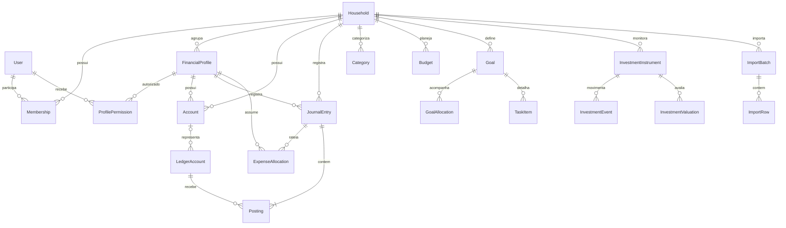
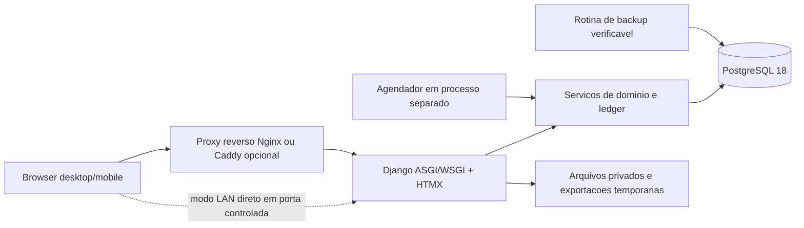

# ALECE — Especificação vigente v1.29 (15/10/2026)

> **Prioridade documental:** esta revisão substitui as regras de interação e importação contraditórias registradas em versões anteriores. O material histórico permanece abaixo apenas para preservar o contexto de evolução do projeto. O arquivo `ALECE_Prototipo_Visual_v1.29.html` demonstra o fluxo em memória, sem backend, transações reais ou persistência financeira.

## 1. Visão do produto

Aplicação GPL gratuita e self-host, projetada para Python/Django + PostgreSQL + Docker em ZimaOS e outras instalações compatíveis. Desktop, tablet e celular, temas claro e escuro, permissões por perfil financeiro. A finalidade do ALECE é operar com **entrada mínima**, processamento automático conservador e **revisão humana de inferências bancárias**.

### Estado de implementação demonstrativa

| Fluxo | Situação na v1.29 HTML | Futuro backend |
|---|---|---|
| Renda | Informar, editar, aceitar **R$ 0,00** e excluir o cadastro | Armazenar versão e autoria em PostgreSQL |
| Saldo | Criar, editar, excluir conta sem histórico, informar valor ou deixar desconhecido | Conta identificada por UUID, posição, reconciliação e arquivamento |
| Conta sem saldo | **Ocultada automaticamente** se saldo igual a zero **ou não informado**, com botão para mostrar e editar | Arquivamento/ocultação por preferência; preservar histórico |
| Despesa previsível | Cadastro, edição, exclusão condicionada ao histórico, pagamento e **dia do mês obrigatório (1–31)** | Recorrência mensal gerada por competência; histórico de parcelas imutável |
| Despesa imprevisível | Nome e valor; data atual e confirmação automáticas na sessão | Data explícita ou data do extrato; competência e categorias opcionais |
| Investimentos | Nome, instituição, categoria fixa, valor aplicado e valor líquido, edição, meta opcional, aplicação e resgate | Posições e eventos separados; custo, saldo, rentabilidade, conciliação |
| Reserva | Base de despesas essenciais × **9 meses por padrão**, ajustável de 6 a 12 por Administrador | Parâmetro auditável por perfil; sugestão nunca executa aplicação |
| CSV de extrato | Leitura local, classificação heurística, edição e confirmação linha a linha | Adaptadores por banco, idempotência e auditoria transacional |
| Fatura PDF | **Somente simulação explícita**. Nenhum PDF real é extraído pelo HTML | Extração de texto/tabelas + conferência, OCR somente se indispensável |
| Movimentações | Histórico na sessão, baixa vinculada, estorno demonstrativo | Livro-razão imutável, estorno por evento reverso |

## 2. Campos que a pessoa informa

**Renda:** valor mensal por perfil financeiro. Permitir zero, inclusive em períodos sem trabalho/renda; diferenciar `0` de `NULL` (não cadastrado). Excluir o cadastro somente após confirmação, sem excluir o restante dos dados. Alterar renda orçamentária não cria lançamento bancário fictício.

**Saldo:** nome do local/banco, tipo (conta ou dinheiro físico), perfil financeiro e saldo em reais. `NULL` é desconhecido, `0,00` é saldo conhecido zerado. Ambos podem ser omitidos da visão principal, porém permanecem recuperáveis em **Mostrar contas sem saldo**. Contas com transações vinculadas não podem ser destruídas fisicamente; arquivar/ocultar. Evitar nomes duplicados no mesmo perfil financeiro.

**Despesa previsível:** nome, categoria fixa (Essenciais, Estratégicas, Discricionárias), valor e **dia do vencimento mensal de 1 a 31**, obrigatórios. Não cadastrar frequência semanal/anual. A competência é `AAAA-MM`, distinta da data de pagamento. Para meses sem dia 29/30/31, **regra proposta para Django:** adotar último dia válido do mês, mantendo o dia original do contrato. Não inventar vencimentos para registros históricos sem data: exigir atualização quando editados.

**Despesa imprevisível:** somente nome e valor no formulário simplificado. Data e perfil vêm automaticamente do contexto; quando o extrato importado fornece data, preservar a data real. A despesa aparece no mês correspondente e integra os cálculos apenas após confirmação.

**Investimento:** nome, instituição, tipo fixo (Desenvolvimento pessoal e profissional, Aquisição patrimonial, Consumo planejado e Reserva), valores de posição, data e meta opcional. O usuário pode criar, alterar, excluir posições sem histórico e registrar aplicações e resgates. A meta automática da Reserva não é um campo editável como os demais objetivos.

## 3. Fonte de verdade e pagamentos automáticos

A despesa previsível é uma **obrigação recorrente**, não um pagamento já realizado. Ao criar, aparece `Pendente / pagamento não informado` para cada competência; pagamentos confirmados vinculados atualizam `Pago` ou `Parcial`. A situação não pode mudar somente por similaridade textual não revisada.

Um extrato confirmado gera evento financeiro vinculado ao `expense_id` e à competência `YYYY-MM`. A soma de pagamentos confirmados determina a situação. Transferências entre contas próprias não são despesa, aplicação não é consumo, resgate não é renda habitual e saldo acumulado não é renda do mês. Nunca conciliar movimentação dupla do mesmo evento automaticamente.

### Política de conciliação e revisões

1. Ler arquivo e detectar formato/banco, sem gravar lançamentos no banco de dados.
2. Normalizar data, valor sinalizado, descrição, referência original e conta/perfil.
3. Sugerir tipo e vínculo, calcular confiança e detectar eventuais duplicatas.
4. **Mostrar prévia editável** para incluir/excluir cada linha, corrigir data, descrição, valor, categoria e vínculo; rejeitar ambiguidades.
5. Somente após confirmação e autorização: gravar lote e eventos em uma transação atômica, aplicar baixa ou atualizar posição e registrar trilha de auditoria.
6. Produzir resumo de importação (inseridos, ignorados, duplicados, divergentes, erros) e disponibilizar estorno por lançamento reverso.

**Deduplicação:** usar preferencialmente ID único da transação fornecido pelo banco, identificador da conta, competência, quantidade de centavos, data, descrição normalizada, hash SHA-256 do arquivo e identificação do lote. A chave de impressão digital `perfil+data+valor+descrição` do protótipo é insuficiente para distinguir duas compras iguais no mesmo dia: sinalizar revisão e jamais apagar dados existentes.

**Regras conservadoras da classificação automática:** correspondência de despesa precisa de associação nominal e preferencialmente de valor; divergências, ambiguidades ou pagamento acima do limite devem bloquear o lote até correção. A pessoa pode marcar a transação como gasto imprevisível, recebimento, aplicação, resgate, transferência ou ignorar. Ajustes aprovados podem se transformar em regras pessoais explícitas, revogáveis e versionadas para o futuro.

## 4. CSV e PDF

### CSV já demonstrado

O protótipo lê arquivos **CSV UTF-8**, incluindo delimitadores `;`, `,` e tabulação com campos entre aspas, e cabeçalhos equivalentes a Data, Descrição/Histórico e Valor. A análise é heurística. Há tamanho máximo de 2 MiB e 500 linhas de dados na demonstração. Permite prévia editável e não salva nada antes de confirmar. Um botão gera CSV fictício, sem vínculo com bancos reais. Valores em centavos são a representação ideal na camada de demonstração; no backend usar `Decimal` e campo `NUMERIC`, nunca `float` para valores financeiros.

Os CSVs bancários variam de formato. Implementar adaptadores versionados para bancos, validação de codificação (UTF-8/Windows-1252), cabeçalhos, colunas de crédito/débito separadas, regras de sinais, valores negativos, data do lançamento vs compensação, e parcelas de fatura. Nas importações, os campos de texto devem ser exibidos como **texto, não HTML**. Ao oferecer exportação CSV, proteger contra **formula injection**.

### PDF — não implementado no HTML autônomo

O botão **Simular fatura PDF** gera lançamentos claramente rotulados como fictícios para testar o fluxo; carregar um PDF real exibe aviso de que não foi analisado. A implementação definitiva deve rodar no **backend** self-host usando extratores por tipo de documento (texto e tabelas); PDFs digitalizados podem exigir OCR isolado e revisão reforçada. Recusar PDF criptografado sem senha válida, truncado, inválido ou fora dos limites. Não afirmar que o extrator leu o documento se apenas foram reconhecidos metadados. PDFs são fonte **não confiável**.

### Controles de segurança

Seguir limites de tamanho **no proxy reverso e no Django**, validação de extensão e assinatura, MIME não confiável, nomes gerados e diretório temporário protegido, limites de páginas e tempo de processamento, execução sem privilégios, quarentena/descarte controlado de arquivos por política de retenção, acesso RBAC por perfil e registro de erros sem expor dados bancários. Não encaminhar PDFs/extratos para terceiros sem decisão explícita do administrador. Preferir extração local.

Fontes técnicas consultadas em 2026-10-15:
- Django 6.0 — File uploads: https://docs.djangoproject.com/en/6.0/topics/http/file-uploads/
- Django — Security: https://docs.djangoproject.com/en/6.0/topics/security/
- OWASP — File Upload Cheat Sheet: https://cheatsheetseries.owasp.org/cheatsheets/File_Upload_Cheat_Sheet.html
- OWASP — CSV Injection: https://owasp.org/www-community/attacks/CSV_Injection

## 5. Modelo de dados proposto

- `FinancialProfile`: UUID, núcleo, nome/emoji, estado, permissões por usuário.
- `IncomePlan`: UUID, perfil, valor mensal `NUMERIC(18,2) NULL`, vigência, revisão, autor.
- `Account`: UUID, perfil, nome, instituição opcional, tipo, estado ativo/arquivado, `balance_snapshot`, `balance_as_of`, proveniência.
- `RecurringExpense`: UUID, perfil, nome, categoria, valor, `due_day` 1–31, início/fim opcional, estado ativo/arquivado.
- `ExpenseOccurrence`: UUID, recorrência FK, competência, vencimento resolvido, valor previsto, valor pago, situação derivada.
- `InvestmentPosition`: UUID, perfil, nome, instituição, categoria fixa, valor aplicado, valor líquido, meta nullable e histórico de saldos.
- `ReservePolicy`: perfil, `coverage_months` (6–12, padrão **9**), base `essential_monthly`, revision timestamp/autor.
- `ImportBatch`: UUID, perfil, conta, SHA-256 do original, nome interno, formato, parser/versão, status (staged/reviewed/committed/failed), autoria.
- `ImportCandidate`: UUID, lote FK, valores normalizados, posição da linha/página, classe sugerida, confiança, justificativa, status e decisão humana.
- `FinancialTransaction`: UUID, perfil, conta origem/destino FK, tipo, data, centavos, referência à obrigação ou posição, chave de importação e vínculo a reversão; **imutável após confirmação**.
- `AuditEvent`: quem fez, quando, antes/depois estruturado com dados mínimos, motivo, lote/operação, idempotency key. Segredos não são logados.

Constraints: `CHECK (coverage_months BETWEEN 6 AND 12)`, `CHECK (due_day BETWEEN 1 AND 31)`, valores financeiros com precisão decimal, índices por perfil/data/competência, `UNIQUE` para transação bancária identificável, transações atômicas Django `transaction.atomic()` em confirmação e idempotência de lote.

## 6. Regras de cálculo atuais

Para perfis diferentes de Caio, o protótipo só estima aplicação mensal depois de cadastrar uma renda (inclusive zero) **e pelo menos uma despesa previsível**, evitando tratar a ausência de gastos informados como renda integralmente disponível. O backend definitivo deverá solicitar confirmação explícita do orçamento completo.

**Meta da Reserva = Despesas Essenciais Mensais × Meses de Proteção**

**Padrão novo:** 9 meses; administrador pode escolher 6–12. A Reserva da demonstração anterior tinha sido alcançada com 7 meses. Ao alterar para 9 meses, **pode voltar a aparecer como incompleta**: isso é comportamento correto, e não uma duplicação de reserva.

Na base ilustrativa herdada: Essenciais R$ 536,39 → meta com 9 meses **R$ 4.827,51**; saldo da Reserva R$ 3.754,73 → faltam **R$ 1.072,78**. A aplicação mensal sugerida é limitada à renda livre após despesas e ao restante da meta, sem aplicação bancária automática. Quando a Reserva alcançar a meta, sua aplicação sugerida vai a zero e a Visão geral oculta essa parcela; o restante pode ser distribuído entre as três outras categorias por peso.

Regra de não duplicação: o orçamento discricionário de R$ 500,00 engloba despesas previsíveis já classificadas como Discricionárias; imprevisíveis confirmadas entram separadamente; saldos acumulados nunca entram como fatias da renda mensal. Valores planejados e recebimentos reais permanecem separados.

## 7. Testes e limitações da demonstração

Executados no Chromium com largura de **320, 390, 768 e 1440 px**: inicialização sem erros JavaScript; padrão de 9 meses; ocultação/recuperação de contas sem saldo; classificação e confirmação de CSV fictício; prevenção de reimportação idêntica; painel de PDF sem alegar extração; criação de visualização PDF simulada; validação de vencimento mensal; baixa automática da despesa ChatGPT após confirmação de extrato; renda zero e exclusão de renda; CSV real de exemplo carregado. Testes não equivalem a auditoria de produção ou teste de segurança.

O HTML **não fornece** login real, servidor Django, PostgreSQL, processamento de PDFs reais, saldo conciliado, OCR, importação permanente, autorização real nem automação bancária. Todos os eventos da demonstração financeira ficam em memória da aba; atualizações são perdidas ao recarregar. O produto final deve persistir e auditar no banco; o botão de logout ainda é ilustrativo.

---

## Histórico e documentação anterior (preservados integralmente)

> **DECISÃO VIGENTE — ALECE v1.21 (15/10/2026).** As regras e os nomes desta seção prevalecem sobre descrições de versões históricas mais abaixo. Os nomes antigos da planilha permanecem no histórico apenas como origem dos valores, não como opções atuais da interface.

## Regras vigentes v1.21 — Planejamento por divisão financeira e nomenclatura de aplicações

### Nome e operação de investimentos

- Na interface, **aporte** passa a ser chamado de **aplicação**; o botão **Aportar** passa a **Aplicar**. `Registrar aplicação`, `Aplicação mensal` e `Aplicação na Reserva` substituem os rótulos anteriores. **Resgate** permanece como a operação inversa.
- Aplicar dinheiro em investimentos desloca recursos para uma posição financeira e **não é automaticamente uma despesa de consumo**. O código interno pode preservar os identificadores técnicos `deposit` e `investment` para compatibilidade, mas as labels exibidas usam Aplicação.

### Tabela Planejamento — cinco divisões vigentes

| Nome mostrado no sistema | Valor de exemplo | Origem na planilha |
|---|---:|---|
| Despesas - Essenciais | R$ 536,39 | Essenciais |
| Despesas - Discricionárias | R$ 500,00 | Lazer (R$ 500,00) + Discricionárias (R$ 0,00) |
| Despesas - Estratégicas | R$ 444,28 | Estratégicas |
| Investimentos - Desenvolvimento pessoal e profissional | R$ 409,67 | Investimento Profissional |
| Investimentos - Aquisição patrimonial | R$ 409,67 | Investimento para Metas |
| **Total alocado** | **R$ 2.300,01** | Soma preservada |

A tabela tem **cinco linhas**, não seis. Não manter uma linha separada chamada Lazer e não duplicar a verba de R$ 500,00. **Investimentos - Consumo planejado** existe como categoria fixa no módulo de Investimentos, mas não recebe dotação fictícia no planejamento de exemplo.

A Renda original é **R$ 2.300,00**, mantendo **R$ 0,01** de excesso de arredondamento. Não fazer correção automática sem consentimento.

### Distinção entre orçamento e gastos efetivamente registrados

- Os R$ 500,00 de **Despesas - Discricionárias** representam **alocação mensal**, não pagamento ou despesa realizada.
- A tabela de despesas continua mostrando somente registros cadastrados, sem inventar transações.
- Nos cálculos das metas de investimento, utilizar `despesas_previsiveis + max(0, orçamento_discricionarias - despesas_previsiveis_discricionarias) + imprevisiveis_confirmadas + aplicacao_mensal_reserva`. Assim, caso uma despesa previsível de categoria Discricionárias seja registrada, ela consome parte da mesma verba e não é somada novamente sobre o orçamento de R$ 500,00.
- Os R$ 409,67 de cada divisão de investimento **já pertencem** à parte mensal destinada às aplicações. Não deduzir mais uma vez na apuração da capacidade de aplicação.
- O resumo da Visão geral que exibe gastos registrados é distinto do Planejamento. Ele não deve apresentar os R$ 500,00 como se fossem despesas pagas.

### Compatibilidade de dados

- Na migração real Django/PostgreSQL, as categorias **antigas** (especialmente `Lazer` e `Discricionárias`) precisam ser consolidadas de modo **idempotente e auditável**, preservando histórico e mantendo cópia original; a migração não deve executar débito, pagamento ou aplicação financeira.
- **Rollback**: restaurar o conjunto de categorias e vínculos a partir do backup validado, sem descartar movimentos posteriores; resolver divergências antes de efetuar a reversão.
- Na demonstração HTML, somente a nomenclatura e os cálculos do planejamento são alterados; os registros financeiros importados não são reclassificados sem evidências.

---

# ALECE — Especificação Técnica e Arquitetural

> **Produto:** ALECE — Plataforma Self-hosted de Gestão Financeira  
> **Tipo:** Documento-base de produto, arquitetura, engenharia, UX e operação (PRD + SRS + ADR inicial)  
> **Versão do documento:** 1.16 — 15/10/2026
> **Alteração da v1.4 (histórico):** especificação integral consolidada 1.0–1.4; mistura de tabelas e gráficos Semana/Mês/Ano com gradiente vermelho/amarelo/verde e interpretação explícita; botão `+ Adicionar` para previsíveis, gastos variáveis do mês e aportes; mobile/tablet aprimorados; login exclusivamente por usuário e senha, recuperação segura por códigos de uso único sem e-mail no MVP  
> **Alteração v1.5–v1.6:** nova linguagem visual de banking, nomenclatura original da planilha, listas reais de despesas/investimentos e quinta aba Movimentações, vinculada a Este mês e ao estado de pagamento.
> **Estado:** especificação de produto e arquitetura; **protótipo HTML de UX disponível e testado em navegador**, sem backend Django/PostgreSQL/Docker implementado ou homologado no ZimaOS  
> **Licença pretendida:** GNU General Public License v3.0 (*GPL-3.0-or-later*, sujeita à confirmação antes da publicação)  
> **Prioridade operacional:** estabilidade > confiabilidade > segurança > recuperabilidade > manutenibilidade > desempenho  
> **Stack obrigatória:** Python, Django, PostgreSQL e Docker Compose  
> **Hospedagem prioritária:** ZimaOS; portabilidade para outros hosts Linux compatíveis com Docker Compose  
> **Idioma inicial:** pt-BR | **Moeda inicial:** BRL | **Fuso padrão configurável:** America/Fortaleza

---

### Histórico do documento

| Versão | Data | Mudança |
|---|---|---|
| 1.0 | 13/10/2026 | Especificação inicial e análise da planilha |
| **1.1** | **13/10/2026** | **Direção visual aprovada: Light/Dark apenas, tokens financeiros esmeralda/dourado, UX inspirada em padrões do Inter e requisitos/testes adicionais de UI** |
| 1.2 | 13/10/2026 | Sidebar fixa esquerda com somente quatro itens; dashboard Resumo / Atual / Este mês / Planejamento; metodologia conservadora; regras centrais de orçamento e reserva |
| **1.3** | **13/10/2026** | **Perfis financeiros separados, visão combinada, seletor animado, 5 perfis por núcleo, papéis Administrador/Comum, concessão de permissões por módulo e testes de isolamento** |
| **1.4** | **13/10/2026** | **Gráficos e tabelas por período, registros previsíveis/variáveis/aportes, UX responsiva em 320–1440 px, usuário+senha e recuperação sem e-mail** |
| 1.5 | 13/10/2026 | Redesenho bancário mais neutro inspirado em UX do Inter (sem copiar marca/fonte exclusiva) |
| **1.6** | **13/10/2026** | **Reconciliação com nomes/valores reais da planilha e inclusão da aba Movimentações; pagamento só quando comprovado por lançamento confirmado; cálculos não duplicam saldos-base** |
| 1.7 | 14/10/2026 | Ordenação interativa das tabelas por coluna, com seta e ordem decrescente inicial |
| 1.7.1 | 14/10/2026 | Remoção de Destino de pagamentos de despesas comuns; contas de destino apenas onde fazem sentido |
| **1.8** | **14/10/2026** | **Um único formulário sem transição entre pop-ups, CRUD de despesas previsíveis/imprevisíveis e investimentos, pagamentos vinculados e histórico de movimentações independente do formulário** |
| **1.9** | **15/10/2026** | **Quarta opção substituída por Renda: edição mensal por perfil financeiro, atualização do Resumo e percentuais de Planejamento sem criar movimento de recebimento** |

---

> **Decisões vigentes (v1.6):** as seções históricas que mencionam *quatro abas*, listas vazias de Despesas/Investimentos ou nomenclaturas como “Custo-base previsto” descrevem etapas anteriores do protótipo. A partir desta versão, prevalecem os requisitos dos capítulos 23 a 26: **cinco abas**, nomes originais da planilha e movimentos como fonte de confirmação de pagamentos. Nunca corrigir a nomenclatura do usuário automaticamente sem aprovação.


## 1. Resumo executivo

O **ALECE** será um sistema financeiro web auto-hospedado, voltado inicialmente a pessoas e famílias, com suporte desde o MVP a vários usuários com autorizações individualizadas e até cinco perfis financeiros por núcleo, sem expor dados entre pessoas ou grupos não autorizados. Reunirá contas, saldos, movimentações, orçamentos, despesas recorrentes, parcelamentos, metas, reservas, investimentos e relatórios em uma interface elegante, responsiva e acessível, com **apenas dois temas visuais selecionáveis — Claro (Light) e Escuro (Dark)** — e identidade cromática original baseada em verde-esmeralda, dourado discreto e neutros premium.

**Princípio central:** não se trata de reconstruir uma planilha numa interface bonita. O produto deve ter um **núcleo financeiro íntegro**, com histórico auditável, valores decimais exatos, prevenção de duplicidades, lançamentos reversíveis, segregação de dados e exportação confiável. O visual moderno é um requisito essencial de usabilidade, mas não substitui a correção dos saldos.

**Modelo de distribuição:** código aberto GPL; cada instalação controla seu próprio banco e seus próprios dados, sem depender de SaaS, assinatura, telemetria compulsória, serviços externos de CDN ou provedores bancários.

**Restrição de nomenclatura:** a sigla **ALECE** já é utilizada institucionalmente pela Assembleia Legislativa do Estado do Ceará e figura na identidade visual da instituição. O uso como nome público deve passar por avaliação de distintividade, potencial confusão e eventual registro marcário. Isto **não equivale a afirmar automaticamente uma infração**. Até essa análise, “ALECE” é o codinome do projeto. Referência: https://www.al.ce.gov.br/legislativo/leis-e-normativos-internos/134/visualizar

## 2. Objetivos, não objetivos e princípios

### 2.1 Objetivos verificáveis

1. Controlar a posição financeira atual e histórica por conta, competência e período.
2. Registrar receitas, despesas, transferências, estornos e ajustes sem inconsistências de saldo.
3. Comparar orçamento planejado, comprometido, realizado e disponível.
4. Planejar reserva de emergência, objetivos e aquisições com acompanhamento de progresso.
5. Gerenciar investimentos inicialmente por aportes, resgates e avaliações informadas, distinguindo dinheiro investido de rentabilidade.
6. Importar planilhas financeiras de forma assistida e exportar todos os dados do usuário em formatos abertos.
7. Rodar inteiramente em ambiente local com Docker Compose, especialmente ZimaOS, sem dependência de internet em tempo de execução essencial.
8. Permitir backup, teste de restauração, atualização e rollback documentados.
9. Oferecer UX competitiva com aplicativos financeiros contemporâneos, inclusive em telas móveis.
10. Fornecer documentação e testes adequados para contribuições da comunidade GPL.

### 2.2 Fora do escopo da primeira versão

- Open Finance/bancos sincronizados automaticamente; scraping bancário; execução de pagamentos; guarda de senhas bancárias.
- Negociação de ativos, consultoria de investimentos, recomendações financeiras personalizadas ou cálculo tributário oficial.
- Emissão de documentos fiscais, ERP, contabilidade empresarial completa e conciliação OFX automática.
- Aplicativos nativos Android/iOS e offline-first completo com escrita concorrente.
- IA generativa, chat financeiro ou dependência de APIs pagas para funções centrais.
- Multi-moeda contábil com conversão automática na primeira versão.

Esses recursos poderão entrar em versões posteriores após avaliação de riscos, custo de manutenção e demanda real.

### 2.3 Princípios de produto

- **Dados pertencem ao usuário**: exportação completa, nenhuma conta em nuvem obrigatória.
- **Correto antes de sofisticado**: relatórios nunca devem utilizar saldos não reconciliáveis.
- **Automação transparente**: recorrências geram itens rastreáveis; ações automáticas são reversíveis e idempotentes.
- **Uma fonte de verdade**: indicadores são derivados dos lançamentos e saldos; nunca persistir totais redundantes sem estratégia explícita de consistência.
- **Padrões abertos**: CSV, JSON e XLSX na importação; CSV/JSON na exportação; esquema e API documentados.
- **Sem bloqueio de fabricante**: a aplicação não depende de uma API proprietária do ZimaOS para executar.
- **Implantação previsível**: imagens com versão fixa; migrações e procedimentos de recuperação testados.

---

## 3. Evidências: análise da planilha fornecida

**Fonte primária:** arquivo `Gerenciamento financeiro.xlsx`, fornecido pelo solicitante, com abas `Caio` e `Metas`. A estrutura foi analisada, inclusive as referências de fórmulas. **O documento não replica valores financeiros pessoais**; a planilha deve ser tratada como dado privado, mantido fora do repositório público e das imagens Docker.

### 3.1 Abas, blocos e correspondência funcional

| Origem na planilha | Informação observada | Domínio proposto no ALECE | Cuidados |
|---|---|---|---|
| `Caio!A1:B7` | Resumo: saldo, renda, despesas, reserva esperada, reserva e investimento | Dashboard, projeções e posições patrimoniais | Diferenciar posição atual de fluxo mensal e projeção |
| `Caio!D1:F8` | Planejamento por grupos e percentual de renda | Orçamentos por período e categoria/grupo | Valores percentuais derivados, metas parametrizáveis |
| `Caio!H1:L8` | Despesas com categoria, periodicidade, parcelas e valor | Transações, regras de recorrência e parcelamentos | Despesa prevista não equivale a pagamento liquidado |
| `Caio!N1:S6` | Produtos financeiros, instituição, categoria, aplicado, líquido e data | Carteira, instrumentos, posições e avaliações | Separar principal, valor atual e rendimento; armazenar data real |
| `Caio!A9:B13` | Saldo por meio ou instituição, inclusive dinheiro físico | Contas financeiras e saldos | Transferências não são receita/despesa |
| `Caio!A15:B17` e `B23` | Controle do mês, emergência e saldo residual | Compromissos, envelopes e valor disponível | Evitar dupla dedução de valores já pagos |
| `Metas!A1:G8` | Cenários de moradia: valor, entrada, subsídio, financiamento, parcela | Metas, alternativas e simulador de aquisição | Simulações não alteram patrimônio real |
| `Metas!A10:D24` | Etapas de uma habilitação, estimativas e referências | Meta por etapas/checklist com custos estimados | Preços/regras legais são dados históricos não validados pelo sistema |

### 3.2 Fórmulas observadas e generalização correta

| Referência | Fórmula presente | Interpretação e regra de produto |
|---|---|---|
| `Caio!B2` | `SUM(B10:B13)` | Saldo consolidado de contas; no ALECE, cálculo por movimentações |
| `Caio!B4` | `SUM(L3:L8)` | Soma de despesas listadas; distinguir recorrentes previstas e liquidadas |
| `Caio!E3:E5` | `SUMIF(...)` por categoria | Consolidar despesas por grupo no período escolhido |
| `Caio!F3` | `E3/B3` | Participação de categoria na renda; tratar renda zero corretamente |
| `Caio!B5` | `E3*7` | Reserva-alvo calculada por multiplicador **fixo 7**; transformá-lo em parâmetro configurável (meses de cobertura e base de despesas) |
| `Caio!B6:B7` | `SUMIF(...)` por classificação de ativo | Agregação de reserva/investimento sem misturar objetivos nem dupla contagem |
| `Caio!E7` | `($B$3-SUM($E$3:$E$6))/2` | Divisão automática do restante em duas alocações; regra **configurável**, não imposição do sistema |
| `Caio!B23` | `B2-(B16+B17)` | Saldo livre após reservas/compromissos; contabilizar apenas valores ainda não deduzidos |
| `Metas!C8:G8` | `AVERAGE(...)` | Média de cenários; apresentar como estatística descritiva, **não** recomendação de compra |

### 3.3 Limitações reais a superar

1. Categorias, instituições, saldos e fórmulas aparecem em regiões diferentes, sem chaves relacionais.
2. A planilha mistura valores atuais, estimativas e objetivos; é preciso distinguir **realizado, previsto, projetado e hipotético**.
3. Despesas recorrentes são descritas em texto como `23/mês` e `Mensal`; precisam de uma regra normalizada, com dia e timezone.
4. Datas de investimentos podem estar codificadas como número serial do Excel; precisam ser interpretadas por formato/sistema de datas antes da gravação.
5. Para investimentos, `aplicado` e `líquido` não substituem movimentações e cotações históricas.
6. A reserva projetada usa multiplicador fixo; o número de meses deve ser editável.
7. As alternativas de imóvel e as etapas de CNH devem funcionar como **metas e estimativas fornecidas pelo usuário**, não como pareceres jurídicos ou preços oficiais.
8. A entrada de dados é manual e não dispõe de trilha de alterações, validação de duplicados nem importação com prévia.

**Requisito de privacidade para migração:** nunca enviar esse arquivo a um serviço externo, usar seu conteúdo como fixture pública, anexá-lo a relatórios de CI ou registrá-lo em log em texto integral.

---

## 4. Escopo funcional e prioridade

**Legenda:** P0 = MVP obrigatório; P1 = primeira evolução; P2 = expansão futura.

| ID | Requisito funcional | Prioridade | Critério resumido |
|---|---|---|---|
| RF-001 | Instalação e criação do administrador inicial | P0 | Sem conta padrão/senha publicada; processo assistido |
| RF-002 | Autenticação, encerramento de sessão e troca de senha | P0 | Rotas privadas exigem autenticação |
| RF-003 | Núcleo financeiro compartilhado com até cinco perfis financeiros independentes | P0 | Registros sempre vinculados a perfil financeiro e núcleo; nenhuma consulta fora do escopo autorizado |
| RF-004 | Cadastro/edição/arquivamento de contas | P0 | Bancos, dinheiro, poupança e outras contas |
| RF-005 | Saldo inicial como lançamento de ajuste identificado | P0 | Não contabilizar saldo inicial como renda |
| RF-006 | Receitas e despesas | P0 | Valor, data, status, descrição, conta e categoria |
| RF-007 | Transferências entre contas | P0 | Origem e destino atualizados atomicamente |
| RF-008 | Estornos e correções rastreáveis | P0 | Não sobrescrever evidência contábil liquidada |
| RF-009 | Categorias e grupos personalizados | P0 | Estrutura sem categorias rígidas no código |
| RF-010 | Recorrências mensais/semanais/anuais | P0 | Geração sem duplicidade por período |
| RF-011 | Compromissos previstos x pagos | P0 | Painel diferencia vencido, pendente e quitado |
| RF-012 | Parcelamentos | P1 | Série de parcelas ligadas a um contrato, sem contagem dupla |
| RF-013 | Orçamento por grupo e competência | P0 | Limites e resultados comparáveis |
| RF-014 | Dashboard financeiro | P0 | KPIs conciliáveis com relatórios |
| RF-015 | Reserva de emergência | P0 | Alvo por meses e progresso sem dupla contagem |
| RF-016 | Metas financeiras | P0 | Objetivo, prazo, aportes vinculados e progresso |
| RF-017 | Alternativas de compra e simulações | P1 | Cenários não afetam dinheiro real |
| RF-018 | Metas por etapas com estimativas | P1 | Checklists, custos previstos e realizados |
| RF-019 | Cadastro de instrumentos/instituições de investimento | P0 | Tipos e contas custodiais configuráveis |
| RF-020 | Aportes, resgates e transferências de investimento | P0 | Movimentações identificáveis e conciliáveis |
| RF-021 | Posição atual por avaliação manual | P0 | Distinguir principal e valorização estimada |
| RF-022 | Proventos, taxas e impostos informados | P1 | Tipos de evento separados |
| RF-023 | Filtros, buscas, paginação e ordenação | P0 | Performance previsível em milhares de registros |
| RF-024 | Gráficos e relatórios por período | P0 | Fontes derivadas do mesmo núcleo financeiro |
| RF-025 | Importação XLSX assistida | P0 | Prévia, mapeamento, validação e relatório de importação |
| RF-026 | Importação CSV | P0 | Configuração de separador, moeda e data |
| RF-027 | Exportação CSV/JSON dos dados | P0 | Formato, documentação, estrutura e encoding definidos |
| RF-028 | Backup manual sob demanda | P0 | Arquivo íntegro com SHA-256 verificável |
| RF-029 | Procedimento/teste de restauração | P0 | Restauração testada em ambiente isolado |
| RF-030 | Log de auditoria funcional | P0 | Autor, horário, entidade, operação e correlação |
| RF-031 | Apenas temas **Claro (Light)** e **Escuro (Dark)**, sem opção automática, terceiro tema ou editor de cores | P0 | Alternância explícita; persistência por usuário; login, componentes, gráficos e páginas de erro consistentes |
| RF-032 | Interface acessível em celular/tablet/desktop | P0 | Navegação sem dependência de hover |
| RF-033 | Alertas de vencimento no próprio painel | P1 | Sem disparar notificações repetidas |
| RF-034 | Metas/alertas por regra | P1 | Configurações claras e opt-in |
| RF-035 | Permissões por perfil financeiro e módulo; usuário Administrador ou Comum | P0 | Comum inicia sem acesso; administrador concede leitura/edição; não há terceiro papel |
| RF-036 | Importação OFX | P1 | Arquivo local, sem integração bancária ao vivo |
| RF-037 | 2FA TOTP | P1 | Códigos de recuperação e reautenticação |
| RF-038 | API externa documentada e tokens com escopo | P1 | Desativada ou restrita por padrão |
| RF-039 | PWA somente leitura/cache seguro | P2 | Sem dados sensíveis em cache inseguro |
| RF-040 | Multi-moeda e câmbio explícito | P2 | Política de precisão, fonte e câmbio por evento |
| RF-041 | Integrações Open Finance compatíveis | P2 | Somente após análise legal, segurança e consentimento |
| RF-042 | Planejamento avançado de cenários | P2 | Simulações e projeções separadas do realizado |
| RF-043 | Identidade visual própria ALECE Money (verde financeiro, dourado e neutros) | P0 | Tokens semânticos Light/Dark; sem copiar laranja, fontes proprietárias, logos ou telas do Inter |
| RF-044 | Dashboard e navegação seguindo princípios de UX do Inter, adaptados à gestão financeira | P0 | Saldo em destaque, atalhos claros, cards modulares, extrato e navegação responsiva sem módulos promocionais |
| RF-045 | Componentes e gráficos auditados em ambos os temas | P0 | WCAG 2.2 AA como meta, foco visível, contraste, estados financeiros não dependentes apenas de cor |
| RF-046 | Sidebar principal fixa do lado esquerdo com **exatamente quatro destinos** | P0 | `Visão geral`, `Despesas`, `Investimentos`, `Configurações`; nenhuma quinta aba ou `Mais` de nível principal |
| RF-047 | Dashboard com blocos **Resumo / Atual / Este mês / Planejamento** | P0 | Layout e semântica conforme seção 8.4; números reconciliáveis com ledger e orçamento |
| RF-048 | Contas financeiras e meios de guarda de valor configuráveis | P0 | Dinheiro físico e bancos como contas, não bancos fixos no código; `—` = dado ausente, `R$ 0,00` = zero confirmado |
| RF-049 | Perfil de reserva por meses de despesas essenciais | P0 | Fator editável (incluindo 6, 7, 9 e 12); histórico de premissas e valor de referência; nenhuma indicação compulsória |
| RF-050 | Planejamento de renda com **seis envelopes configuráveis** e três pilares analíticos | P0 | Cada lançamento pertence a um envelope; atribuições extras aos pilares não duplicam montantes |
| RF-051 | Ajuste de centavos no rateio percentual | P0 | Soma dos envelopes deve fechar centavo a centavo com renda alocável; mostrar diferença e ajuste antes de confirmar |
| RF-052 | Saldo livre após compromissos ainda não liquidados | P0 | Não descontar despesa paga ou reserva já transferida duas vezes; identificar período e status |
| RF-053 | Planejamento conservador informativo com horizontes e riscos | P1 | Exibir liquidez, vencimento, indexador, cobertura FGC conforme elegibilidade e marcação a mercado; sem consultoria automática |
| RF-054 | Privacidade e estados da Visão geral | P0 | Ocultar quantias em toda a superfície; datas/competência visíveis; não usar demonstração como dado de produção |
| RF-055 | Cadastro de **até cinco perfis financeiros ativos** por núcleo | P0 | Administrador cria, renomeia, escolhe emoji/identidade e arquiva; checagem transacional no banco; perfis arquivados preservam histórico |
| RF-056 | Seletor financeiro contextual nas três telas | P0 | Exibir em Visão geral, Despesas e Investimentos; **não** exibir em Configurações; animação fluida e acessível |
| RF-057 | Modo isolado e visão combinada | P0 | Caio, Mel e **Ambos** se houver exatamente dois acessíveis; **Todos** com três a cinco; consolidação é filtro, nunca fusão de dados |
| RF-058 | Papéis de autenticação exatamente **Administrador** e **Comum** | P0 | Admin gerencia usuários/perfis/acessos; Comum apenas analisa por padrão, salvo autorizações explícitas de edição |
| RF-059 | Matriz de permissões granular | P0 | Por `usuario × perfil_financeiro × modulo`: `none`, `view`, `edit` quando aplicável; deny by default; verificações no backend |
| RF-060 | Consolidação e privacidade por escopo autorizado | P0 | Perfil negado não aparece nem contribui a totais; módulos negados não aparecem nos respectivos cartões/exportações |
| RF-061 | Despesas compartilhadas sem dupla contagem | P1 | Rateio auditável entre perfis, soma de participações em centavos igual ao lançamento; visor do Comum não revela dados do outro perfil |
| RF-062 | Gestão de contas de acesso em Configurações | P0 | Admin ativa/desativa usuários, troca papel, revoga sessões/acessos; registra auditoria; evita exclusão do último admin |
| RF-063 | Identidade visual dos perfis | P0 | Emoji escolhido, nome editável e cor opcional de identificação; paleta global Light/Dark permanece fixa |
| RF-064 | Contexto selecionado em navegação/URLs | P0 | Seleção válida por usuário e sessão; URLs/HTMX aceitam IDs opacos autorizados; proibido confiar em IDs enviados pelo cliente |
| RF-065 | Botão global `+ Adicionar` nas páginas financeiras | P0 | Escolha de perfil único autorizado, operação e campos por tipo; salvar após commit |
| RF-066 | Registrar despesas previsíveis/recorrentes sem liquidar automaticamente | P0 | Regra/ocorrência e estado; saldo inalterado até pagamento |
| RF-067 | Registrar gasto variável/extraordinário em `Este mês` | P0 | Competência e status claros; mesmo evento aparece no extrato sem dupla contagem |
| RF-068 | Formulário de aporte em investimento | P0 | Transferência contábil separada de despesas de consumo |
| RF-069 | Gráfico de Despesas/Investimentos com Semana/Mês/Ano | P0 | Séries autoritativas do backend, filtro por período/perfil; tabela de apoio |
| RF-070 | Linha de gráfico gradiente vermelho-amarelo-verde | P0 | Legenda explicativa e distinção sem depender só da cor |
| RF-071 | UI de tabelas + gráficos responsiva em mobile/tablet | P0 | Testes 320/360/390/768/1024/1440; sem rolagem horizontal global |
| RF-072 | Login inicial somente com nome de usuário e senha | P0 | Sem e-mail obrigatório; sessões Django e proteção CSRF |
| RF-073 | Recuperação por códigos de uso único offline | P0 | Alta entropia, hash, single-use atômico, rate limit, invalidação de sessão |
| RF-074 | Geração/revogação de códigos sob autenticação | P0 | Códigos exibidos uma vez; não logar segredos |
| RF-075 | Separação da UI demonstrativa e dados de produção | P0 | HTML não é autenticação nem persistência real |
| RF-076 | Privacidade de valores incluindo gráfico e tabelas | P0 | Não revelar quantias em tooltips, textos acessíveis nem exports indevidos |
| RF-077 | Série histórica explícita e estados incompletos | P0 | Sem histórico não apresentar curvas inventadas em produção |
| RF-078 | Acesso Comum à edição por módulo/perfil aplicado ao botão global | P0 | POST negado pelo servidor quando `view`/`none` |

### 4.1 Duas identidades distintas e dois papéis de autenticação (v1.3 — decisão normativa)

**Usuário da aplicação (`User`) ≠ perfil financeiro (`FinancialProfile`).** O usuário autenticado é uma pessoa com credenciais e papel. O perfil financeiro é uma unidade de contas, despesas, orçamentos e investimentos (ex.: `👤 Caio`, `💜 Mel`, `👪 Família`, até cinco unidades ativas por núcleo). **`Ambos`/`Todos` não é usuário nem perfil persistente**: é somente o resultado autorizado de uma consulta consolidada.

**Papéis imutáveis em quantidade (exatamente dois):**

- **Administrador:** administra usuários, perfis, credenciais/recuperação conforme política, permissões, configuração, importação/exportação, backup/restauração e todos os domínios financeiros deste núcleo. A interface deve deixar claro que o administrador **tem acesso a todos os dados do núcleo**, inclusive dos demais usuários. Em instalações futuras com múltiplos núcleos, administração de instância e de núcleo exigirá ADR própria; não criar essa terceira função sem requisito.
- **Comum:** pode apenas consultar áreas/perfis expressamente autorizados; inicia **sem acesso financeiro** até concessão do administrador. Se o administrador liberar `edit` para Despesas ou Investimentos em perfil determinado, poderá criar/editar **somente naquele escopo**, sem se tornar administrador, sem poder conceder permissões ou alterar segurança. `Visão geral` é só leitura; seus atalhos de cadastro respeitam permissão de edição do módulo de destino.

**Matriz por usuário e perfil financeiro:** `view_overview` (sim/não); `expenses` (`none`/`view`/`edit`); `investments` (`none`/`view`/`edit`). `edit` implica `view` no módulo correspondente. O backend autoriza cada objeto/serviço/operação; ocultar botão não constitui proteção. Configurações sempre aparece no menu, mas para Comum disponibiliza apenas sua conta, senha, tema e preferências não administrativas. Admin vê a área adicional **Usuários, perfis e acessos**. Ninguém pode promover seu próprio papel ou conceder permissões a si mesmo por rota direta.

**Máximo de cinco:** por `Household` (núcleo financeiro) e **perfis financeiros ativos**, não cinco usuários. Perfis arquivados continuam ligados aos lançamentos históricos, não aparecem como opção de novos lançamentos e não são apagados em cascata. Verificar limite com bloqueio transacional ou estratégia concorrente equivalente no backend; controle apenas no JavaScript é insuficiente.

### 4.2 Fluxos essenciais

1. **Primeiro acesso:** instalar → criar Administrador → criar núcleo e `FinancialProfile` principal → cadastrar contas e saldos → definir permissões iniciais → visualizar painel.
2. **Perfis:** Admin acessa Configurações → Perfis financeiros → cria ou altera nome, emoji e cor opcional → confirmação e auditoria → seletor atualizado em tempo real; até cinco ativos.
3. **Compartilhar consulta:** Admin cadastra usuário Comum → concede `view_overview`, `expenses:view` e/ou `investments:view` somente nos perfis escolhidos → esse usuário visualiza exclusivamente as opções e valores autorizados.
4. **Compartilhar edição:** Admin concede `expenses:edit` em `Mel`, por exemplo → usuário Comum consegue lançar despesa de Mel, mas não altera despesas de Caio, permissões de outros usuários, importações globais ou backups.
5. **Alternar filtro:** nas três áreas financeiras, escolher chip de perfil ou `Ambos`/`Todos` → interface anima cursor/foco e troca o conjunto consultado → API revalida autorizações → indicadores consistentes no período selecionado. Em Configurações, seletor financeiro desaparece (sem mudar de fato a última escolha financeira).
6. **Despesa:** escolher perfil-alvo e conta autorizados → informar valor/categoria/data → confirmar → transação atômica e auditoria; nenhum acesso a perfis não permitidos via edição de URL/ID.
7. **Transferência:** escolher origem/destino autorizados → confirmar → contrapartidas na mesma operação de banco; movimentações internas de um mesmo patrimônio não viram receita/despesa de `Ambos`/`Todos`.
8. **Recorrência:** regra + próxima ocorrência → gerar compromisso futuro idempotente → liquidar → manter perfil financeiro e histórico da autoria.
9. **Investimento:** registrar aporte/resgate apenas com permissão `investments:edit` e contas compatíveis → avaliar posição; trocar filtro muda carteiras visíveis.
10. **Importação:** upload local → identificar perfil financeiro alvo ou mapeamento multi-perfil (administrador) → prévia e validação de autorização por linha → confirmar e registrar lote para reversão rastreável.
11. **Meta:** meta vinculada a perfil; metas compartilhadas exigem apropriação explícita, não duplicação na consolidação.


---

## 5. Regras financeiras e invariantes

### 5.1 Precisão e tipagem

- Para BRL, usar `Decimal` do Python e `NUMERIC(19,2)`/`DecimalField(max_digits=19, decimal_places=2)` nos movimentos monetários, com arredondamento explícito `ROUND_HALF_UP` quando aplicável e regras documentadas por cálculo.
- **Proibido:** representar dinheiro com `float` em operações de negócio, persistência, importação ou somatórios.
- Valores monetários são gravados em unidade monetária exata; API deve serializar quantias como **strings decimais**, por exemplo `"1234.56"`.
- Percentuais/cotações podem exigir escala distinta, de acordo com o domínio e a classe do ativo; não truncar preço unitário por tratar toda quantia como BRL de duas casas.
- Datas de competência são distintas das datas de ocorrência, liquidação e criação do registro.

### 5.2 Núcleo de movimentações

**Decisão:** motor de partidas dobradas **interno**, simplificado na experiência do usuário. A UI oferece “Receita”, “Despesa”, “Transferência”, “Aporte” e “Estorno”; o serviço de domínio produz um lançamento contábil com pelo menos duas partidas de débito/crédito coerentes. Para o MVP, um lançamento é de uma única moeda; câmbio fica para etapa futura.

Invariantes mandatórias:

1. Para cada lançamento liquidado, `Σ débitos = Σ créditos` na moeda do lançamento.
2. Nenhuma gravação parcial de transferência ou estorno; operações críticas em transação do PostgreSQL.
3. `Saldo da conta` deriva das partidas contabilizadas mais saldos iniciais formalizados; caches, se criados, precisam de reconciliação.
4. Movimentações liquidada não são apagadas fisicamente; cancelamento gera estorno e novo lançamento, com vínculos explícitos.
5. Operações de importação, recorrência e API têm chave de idempotência no escopo do proprietário.
6. Nenhum lançamento de **transferência entre contas do mesmo espaço** compõe o relatório de receita ou despesa.
7. Saldo inicial é contrapartida de patrimônio de abertura, nunca receita operacional.
8. Status: `draft`, `scheduled`, `posted`, `reversed`; estado de pagamento é representado sem contradizer lançamento postado.
9. Estorno deve apontar ao original, e o mesmo lançamento não pode ser estornado duas vezes.
10. Alteração de moeda, exclusão de conta com saldo ou modificação de categoria histórica exige regra restritiva explícita.

### 5.2.1 Perfis financeiros, consolidação e lançamento compartilhado

- Toda conta operacional, investimento, orçamento e movimentação possui referência a **um perfil financeiro titular** ou a um vínculo de rateio explícito, além do `household_id`. A consolidação lê registros e **não cria lançamento de soma**, não troca titularidade e não move fundos.
- No modo individual, apresentar apenas posições do perfil selecionado. No modo `Ambos`/`Todos`, somar **somente** os perfis e módulos autorizados ao usuário. Se uma fonte ainda não possui saldo informado, renderizar **"consolidação parcial"**; nunca converter dado ausente em zero nem apresentar total como completo.
- Conta física/bancária pertence a um perfil; o mesmo saldo bancário não pode aparecer por duplicação em dois perfis. Contas conjuntas, quando necessárias, precisam de regra de titularidade e participação explícita, não duplicar o saldo integral em cada indivíduo.
- Movimentação de um perfil para outro deve possuir referência cruzada auditável e regra de classificação: transferência patrimonial não é automaticamente nova renda na visão conjunta. Se representar doação/receita efetiva por decisão contábil, explicitar tratamento e evitar dupla classificação.
- Despesa compartilhada é um único lançamento real com parcelas analíticas por perfil (`ExpenseAllocation`) cuja soma em **centavos** é igual ao valor original; cada pessoa vê apenas seu percentual/valor permitido, sem exposição indireta de informação financeira do outro perfil. Adiar recurso de rateio para P1 não autoriza duplicar a transação no MVP.
- Ao negar acesso a um perfil ou módulo, valores não devem aparecer em **KPI, gráfico, tabela, busca, autocomplete, CSV, JSON, impressão, exportação, cache HTMX, notificações ou mensagem de erro**.

### 5.3 Indicadores e projeções

- **Saldo atual:** soma de saldos por contas de ativo selecionadas, considerando movimentos liquidados.
- **Receita do período:** movimentos de natureza receita no critério temporal selecionado, sem transferências.
- **Despesa do período:** movimentos de natureza despesa no critério selecionado, sem investimentos classificados como transferência patrimonial.
- **Resultado líquido do período:** receitas − despesas; não confundir com variação patrimonial decorrente de marcação de investimentos.
- **Orçamento realizado:** despesa liquidada no grupo e competência; **previsto:** obrigações ainda não liquidadas; **disponível:** limite − realizado − compromissos que se queira reservar, com regra exibida na interface.
- **Reserva desejada:** `despesa_mensal_base × quantidade_meses_configurada`. A base pode ser essenciais ou valor informado; impedir valor negativo e divisão por zero.
- **Reserva atual:** montante explicitamente vinculado à reserva ou composição de contas elegíveis, **sem contar o mesmo dinheiro duas vezes**.
- **Patrimônio:** ativos − passivos; a avaliação de investimentos não deve ser somada a saldo em conta de forma duplicada.
- **Projeções:** assinaladas como estimativas com premissas; não entram no saldo histórico.

### 5.4 Consistência de categorias e período

- A mesma transação pode possuir categoria principal e subcategoria; hierarquia de categorias evita somatórios duplos.
- Competência padrão mensal com configuração futura da data inicial do ciclo de orçamento.
- Receita não recorrente nunca é extrapolada automaticamente para meses futuros.
- Recorrência em dias inexistentes no mês (29/30/31) usa política explícita, por exemplo último dia válido, configurada e testada.
- Alterações de timezone não reescrevem datas financeiras passadas.

### 5.5 Investimentos e metas

- **Aporte:** troca de dinheiro entre conta transacional e posição financeira; não é gasto de consumo.
- **Resgate:** troca inversa; rendimentos realizados, tributos e taxas requerem eventos separados.
- **Valor de mercado:** avaliação datada e com fonte (`manual` inicialmente), não “rendimento garantido”.
- **Meta com envelope virtual:** reservar dinheiro pode alterar o valor *disponível*, mas não deve simular saída do patrimônio.
- **Simulador imobiliário:** calcular valores com premissas registradas (entrada, subsídio informado, juros, prazo, método, taxas). Resultado não é proposta de financiamento; taxas variam.
- **Checklist de habilitação:** etapas e custos são conteúdo do usuário, não procedimento regulatório permanentemente correto. Marcar data de atualização/fonte; informações legais exigem verificação antes de uso.

---

## 6. Modelo de dados conceitual

### 6.1 Entidades

| Entidade | Campos principais | Regra/índice essencial |
|---|---|---|
| `User` | id, email único, senha hash, active, locale | Modelo de usuário customizado desde o início |
| `Household` | id, name, base_currency, timezone, owner_id | Escopo de segregação de dados |
| `Membership` | household_id, user_id, role (`admin`/`common`), active | `UNIQUE(household_id,user_id)`; apenas dois papéis de negócio |
| `FinancialProfile` | id UUID, household_id, name, emoji, color_key, status, created_by | Até 5 ativos por núcleo; arquivamento sem exclusão histórica |
| `ProfilePermission` | id, user_id, financial_profile_id, view_overview, expenses_level, investments_level | `UNIQUE(user_id,financial_profile_id)`; níveis `none/view/edit`, default deny |
| `ExpenseAllocation` | id, entry_id, financial_profile_id, allocated_amount | Compartilhamento P1; soma dos valores deve igualar o lançamento; não duplicar ledger |
| `Account` | id, household_id, financial_profile_id, name, type, currency, status | Titularidade e escopo obrigatórios; arquivar em vez de apagar |
| `LedgerAccount` | id, household_id, kind, account_id opcional | Tipos asset/liability/equity/income/expense |
| `JournalEntry` | id, household_id, financial_profile_id, date, effective_at, status, kind, source, reversal_of, idempotency_key | Cada lançamento tem titular; origem/autoria e referências de movimentação compartilhada |
| `Posting` | id, entry_id, ledger_account_id, side, amount | `amount > 0`; balanceamento por entrada |
| `Category` | id, household_id, parent_id, name, kind, active | Árvore sem ciclos; filtro por tenant |
| `TransactionDetail` | entry_id, category_id, payee, note, due_date, paid_at | Camada de apresentação sobre ledger |
| `RecurrenceRule` | id, template_id, schedule, start/end, next_at, active | Política de fuso e calendário |
| `InstallmentPlan` | id, household_id, creditor, total, count, start_date | Parcelas vinculadas, sem duplicidade |
| `Installment` | id, plan_id, installment_number, due_date, amount, entry_id | `UNIQUE(plan_id, installment_number)` |
| `Budget` | id, household_id, financial_profile_id, period_start/end, category_id, limit | Planejamento separado por perfil, sem total duplicado |
| `Goal` | id, household_id, financial_profile_id, type, target, due_at, status | Meta por titular; previsão diferente de contábil |
| `GoalAllocation` | goal_id, source_account_id, amount, effective_at | Alocação lógica rastreável |
| `InvestmentInstrument` | id, household_id, financial_profile_id, name, institution_id, kind, currency | Instrumento/posição vinculados a um perfil |
| `InvestmentEvent` | id, instrument_id, event_type, quantity, amount, event_date, entry_id | Aportes/resgates/juros/taxas |
| `InvestmentValuation` | id, instrument_id, value, valued_at, source | Histórico de avaliações não contabilizadas em caixa |
| `Scenario` | id, household_id, goal_id, title, parameters_json, version | Hipótese imutável por versão publicada |
| `TaskItem` | id, goal_id, order, title, estimate, state, source_url | Checklist por objetivo |
| `ImportBatch` | id, household_id, source_kind, filename_hash, status, counts, created_by | Não armazenar cópia de upload indefinidamente |
| `ImportRow` | id, batch_id, row_no, normalized_json, validation_state, linked_entry_id | Prévia e detecção de duplicados |
| `AuditEvent` | id, actor_id, household_id, action, target, at, request_id, metadata_redacted | Append-only, com limites de retenção |

A autorização deve cruzar `User → Membership → ProfilePermission → FinancialProfile` e aplicar a verificação à ação **e ao objeto consultado**. O `ModelBackend` padrão do Django **não aplica sozinho** permissões por instância (`obj`); usar um serviço/autorizador testado e filtros de QuerySet como fronteira obrigatória, ou um backend de permissão-por-objeto explicitamente testado. APIs e endpoints HTMX devem usar exatamente a mesma política. O `User` customizado deve nascer na migration inicial, antes dos modelos dependentes.

Todas as chaves identificadoras expostas externamente serão opacas (UUID recomendado). **FKs entre entidades financeiras precisam validar pertencimento ao mesmo `household_id`**, inclusive em serviços e acessos por ID; isolamento não pode depender somente da UI. Definir `on_delete=PROTECT`/`RESTRICT` onde dados históricos ficariam órfãos.

### 6.2 Relacionamentos (resumo)



### 6.3 Política de integridade

- Check constraint: valores estritamente positivos onde aplicável; moeda ISO 4217 válida; status dentro de enum permitido.
- Indexação por `(household_id, effective_at)`, `(household_id, category_id, period)`, `(household_id, status, due_date)` e idempotência.
- `select_for_update()` em atualizações concorrentes cuja invariância dependa de leitura prévia; `transaction.atomic()` no núcleo de movimentos.
- Serviço de domínio é o **único** caminho autorizado para postar/reverter lançamentos; admin Django não deve modificar postings diretamente.
- Modelagem permite milhões de linhas sem alterações lógicas fundamentais, mas otimizações são orientadas por medições.
- Qualquer mudança destrutiva de schema exige migração compatível, plano de recuperação e teste com cópia de dados.

---

## 7. Arquitetura de software

### 7.1 Decisões arquiteturais iniciais (ADR)

| ADR | Decisão | Motivo | Reavaliar quando |
|---|---|---|---|
| ADR-001 | **Monólito modular Django** | Menos processos, menor sobrecarga operacional e transações locais | Limite medido de escala ou equipes autônomas |
| ADR-002 | **Django 5.2 LTS** (patch atual da série) | Ciclo de suporte longo até abril de 2028 | Nova LTS estabilizada e dependências compatíveis |
| ADR-003 | **Python 3.13** como alvo inicial de build | Versão suportada pelo Django 5.2, com ampla compatibilidade | Matriz de dependências permitir avanço |
| ADR-004 | **PostgreSQL 18.x estável**, patch atualizado | Banco atual com suporte prolongado; integridade transacional | Compatibilidade comprovada e migração major planejada |
| ADR-005 | **HTML renderizado pelo Django + HTMX 2 + Alpine.js 3** | Interatividade rica com baixa complexidade e sem SPA obrigatória | Requisitos que demandem cliente fortemente desacoplado |
| ADR-006 | **Tailwind CSS 4** com design system próprio | Consistência visual e CSS compilado | Custos de build ou incompatibilidade comprovada |
| ADR-007 | **Docker Compose** como unidade de implantação | Padrão portável e aceito pelo ZimaOS | Orquestração multi-host comprovadamente necessária |
| ADR-008 | **Serviços web + banco + proxy opcional + scheduler simples** | Infraestrutura mínima; sem Redis/Celery obrigatórios | Filas volumosas, alta concorrência ou jobs complexos |
| ADR-009 | **GPL-3.0-or-later** proposta | Alinha copyleft à solicitação | Revisão do titular do projeto antes do primeiro release |
| ADR-010 | **API interna versionada, não API pública plena no MVP** | Contratos estáveis sem ampliar a superfície de ataque | Integrações externas justificadas |

**Notas de atualidade (13/10/2026):** PostgreSQL 19 está em beta e **não** é recomendação para produção. A imagem oficial `postgres:18` utiliza volume em **`/var/lib/postgresql`** e `PGDATA` tipicamente em `/var/lib/postgresql/18/docker`; copiar um Compose antigo que monte somente `/var/lib/postgresql/data` pode causar problemas de persistência. Fonte: https://github.com/docker-library/docs/blob/master/postgres/content.md

### 7.2 Diagrama de execução



- **Desenvolvimento:** servidor Django dev apenas local; database por container; CSS compilado com utilitário de build.
- **Produção:** Gunicorn/servidor de aplicação compatível e mantido, quantidade de workers ajustada aos recursos; `runserver` é proibido.
- **Proxy:** opcional se já existir proxy confiável na infraestrutura; não obrigar container extra quando acesso LAN privado puder ser atendido com configuração validada.
- **Jobs:** comando Django idempotente executado por serviço scheduler dedicado com mecanismo de exclusão mútua PostgreSQL; evitar depender de cron do host ZimaOS.
- **Arquivos estáticos:** servidos localmente, sem Google Fonts/CDN obrigatório; arquivos privados só por endpoint com autorização.
- **Redis:** não adicionar até surgir necessidade medida.

### 7.3 Limites e módulos internos

```text
alece/
  config/                 # settings base/dev/prod, urls, asgi/wsgi
  apps/
    identity/             # contas de usuario, autenticacao, membros
    households/           # espacos financeiros, configuracoes
    ledger/               # contas contabeis, lancamentos, postings, estornos
    transactions/         # experiencia de receitas, despesas e transferencias
    categories/           # categorias e grupos
    budgets/              # orcamentos e envelopes
    recurrence/           # recorrencias, vencimentos e parcelas
    goals/                # metas, cenarios e checklists
    investments/          # instrumentos, eventos e avaliacoes
    reporting/            # consultas, consolidacoes, exportacoes
    importers/            # staging XLSX/CSV, normalizacao, auditoria
    audit/                # trilhas de atividades sem dados sensiveis
    health/               # liveness/readiness
  templates/              # layouts e partials Django/HTMX
  frontend/               # assets fonte, Tailwind, Alpine e icones
  static/                 # bundle gerado para producao
  tests/                  # testes de dominio, integracao e E2E
  scripts/                # backups, restores, diagnosticos e verificacoes
  deploy/
    compose.yaml
    compose.example.env
    zimaos/               # manifest/metadata de distribuicao futura
  docs/
    adr/
    api/
    operations/
  pyproject.toml
  package.json
  Dockerfile
  .dockerignore
  .gitignore
  LICENSE
  README.md
  CONTRIBUTING.md
  SECURITY.md
  CHANGELOG.md
```

**Regra:** telas, views e serializers não implementam escrituração. A lógica financeira fica em serviços tipados, testados e chamados por UI, tarefas e API.

### 7.4 Contratos de API e erros

- Endpoints HTML Django para navegação e fragmentos HTMX; JSON REST `/api/v1/` apenas para integrações necessárias, sem obrigatoriedade de Django REST Framework desde o primeiro commit.
- Recursos projetados: `/api/v1/accounts`, `/transactions`, `/budgets`, `/goals`, `/investments`, `/reports`, `/imports`.
- Utilizar IDs opacos, paginação, filtro explícito e ordenação determinística; operações de escrita com chave de idempotência quando aplicável.
- APIs nunca aceitam `household_id` como prova de autorização; o servidor resolve a membresia autenticada.
- Códigos convencionais: `400` (validação), `401` (não autenticado), `403` (sem autorização), `404` (objeto não visível), `409` (conflito), `422` (regra de negócio), `429` (rate limit), `500` (falha não exposta ao usuário).
- Respostas de erro incluem `code`, `message`, `field_errors` e `request_id` sem stacktrace/senha.
- Especificação OpenAPI quando APIs externas forem liberadas, com testes de contrato.

---

## 8. Design de produto e experiência (UX/UI)

> **Decisão normativa v1.1 (aprovável):** o ALECE terá exatamente **dois temas visuais**: **Claro / Light Mode** e **Escuro / Dark Mode**. A paleta fixa da marca se inspira em associações visuais com dinheiro, crescimento, patrimônio e estabilidade: **verde-esmeralda, dourado moderado e neutros refinados**. A UX terá como **referência de organização o Super App do Banco Inter**, mas o produto **não copiará** marca, laranja institucional, telas, ícones exclusivos, tipografia proprietária ou identidade trade dress do Inter. Esta seção substitui qualquer sugestão anterior de tema automático ou acento azul como cor primária da marca.

### 8.1 Identidade de produto, referências e limites

**Conceito de marca:** *ALECE Money* (nome conceitual da linguagem visual, sujeito à mesma cautela jurídica de uso de “ALECE” discutida neste documento). Posicionamento: gestão financeira moderna, objetiva e confiável, com sensação de clareza e controle, não ostentação.

**Referência de UX (não de identidade):** as páginas e materiais oficiais do Inter demonstram forte hierarquia de saldo, agrupamento de produtos/ações, cards, atalhos e experiência de superapp. O ALECE utilizará esses **padrões genéricos de usabilidade** por serem familiares aos usuários, com desenho e arquitetura de informação próprios e menos densidade promocional:

1. **Saldo consolidado em primeiro plano**, com atualização e período claramente identificados e ação para ocultar/mostrar valores sem alterar os dados.
2. **Atalhos de ação frequente** logo abaixo do resumo: `Nova receita`, `Nova despesa`, `Transferir`, `Nova meta` — não expor Pix, pagamento bancário ou serviços que o ALECE não executa.
3. **Cards modulares com superfícies limpas**, ícones discretos, bordas leves e bastante espaço negativo; composição responsiva sem banners de venda/cashback.
4. **Visão geral como ponto de partida**, com blocos financeiros, próximas despesas, evolução no período e extrato recente.
5. **Hierarquia visual simples:** ação primária evidente, navegação clara, atalhos sem sobrecarga, detalhes financeiros disponíveis sob demanda.
6. **Navegação principal com exatamente quatro itens, sem criar novos itens ao adicionar recursos:** `Visão geral`, `Despesas`, `Investimentos` e `Configurações`. Funcionalidades complementares serão ações e subvisões contextuais; sidebar fixa à esquerda em desktop e quatro destinos na navegação inferior em mobile.

**Limites de originalidade/licença:** não reutilizar HTML/CSS, capturas de tela, design tokens exclusivos, logo/símbolo, ilustrações, fotografias ou tipografia **Citrina** do Inter. Não insinuar associação, certificação ou patrocínio. Usar componentes próprios, ícones de licença compatível e fontes distribuíveis legalmente. **Inter (fonte open source de Rasmus Andersson)** é uma opção técnica distinta da marca bancária Inter, licenciada sob **SIL OFL 1.1**; poderá ser incluída localmente após revisão da licença e arquivo de avisos.

Fontes da referência: página oficial do [Super App Inter](https://inter.co/superapp), [comunicado de redesign](https://blog.inter.co/novo-logo-inter-muda-marca-e-se-consolida-como-super-app-financeiro/), [Plau — projeto tipográfico do Inter](https://plau.design/fontes-sob-medida/inter/) e [repositório da fonte open source Inter](https://github.com/rsms/inter). A referência se limita às **características publicamente observáveis**; não pressupõe acesso ao design system interno do banco.

### 8.2 Política obrigatória de temas: somente Light e Dark

| Regra | Especificação exigida |
|---|---|
| Opções no seletor | **Claro** e **Escuro**; exatamente duas opções, com rótulos, ícones e estado selecionado acessíveis |
| Tema padrão | **Claro** na primeira utilização, até o usuário escolher explicitamente o escuro |
| Modo automático | **Não oferecer** terceiro tema `Automático`, `Sistema`, agendamento dia/noite ou sincronização contínua com preferências do dispositivo |
| Troca de tema | Alternância imediata sem recarregar a página, perder rascunhos ou disparar operações financeiras |
| Persistência | Preferência por conta autenticada no PostgreSQL (campo `theme` com `light`/`dark`); cache local opcional **somente** para evitar flash e manter aparência do login naquele navegador |
| Login e primeiro paint | Renderizar o tema efetivo já no HTML inicial (`data-theme`) quando a sessão está disponível; não depender de carregamento tardio que pisque o outro tema |
| Abrangência | Login, onboarding, dashboard, formulários, tabelas, modais, menus, toasts, calendário, gráficos, relatórios, estados de erro/vazio e módulos administrativos |
| Mudança entre dispositivos | Conta autenticada aplica a preferência salva no servidor; eventual cache local é subordinado à preferência da conta |
| Limite do requisito | **Não são temas separados** as cores semânticas de sucesso/erro/alerta nem variações de intensidade necessárias para contraste |

Persistir apenas a **preferência de aparência**, sem registrar em log conteúdo financeiro ou identificadores privados. Testar a navegação entre HTMX e Django full page para garantir que ambas preservem `data-theme` e todos os estados CSS.

### 8.3 Paleta ALECE Money — cores associadas a dinheiro

A cor **verde-esmeralda** é escolhida como assinatura visual por sua associação convencional a dinheiro e crescimento. O **dourado/champanhe** comunica metas e patrimônio, mas fica restrito a ênfases para evitar estética excessivamente luxuosa. **Grafite e cinzas levemente esverdeados** transmitem estabilidade visual e mantêm leitura prolongada. Essas associações são **decisões de branding e convenções culturais**, não regras universais ou fatos científicos.

A identidade não deve copiar o laranja do Inter: a referência bancária é de **arquitetura de informação e interação**. A assinatura visual ALECE permanece distinguível.

#### 8.3.1 Tokens oficiais dos temas

| Token CSS | Claro (Light) | Escuro (Dark) | Uso padronizado |
|---|---|---|---|
| `--bg` | `#F6F8F5` | `#0D1512` | Fundo geral, sem preto puro obrigatório |
| `--surface` | `#FFFFFF` | `#15211B` | Cards, tabelas, painéis |
| `--surface-alt` | `#EEF3EF` | `#1D2E25` | Campos, menus, faixas secundárias |
| `--text` | `#17261D` | `#F2F7F2` | Texto principal, títulos e valores |
| `--muted` | `#526358` | `#B1C1B7` | Rótulos e descrições secundárias |
| `--primary` | `#146C43` | `#65D4A0` | **Verde principal da marca**, links prioritários e ações |
| `--primary-hover` | `#0F5736` | `#84E3B8` | Hover e seleção com verificação de contraste |
| `--on-primary` | `#FFFFFF` | `#0D2418` | Texto de botão sólido sobre `--primary` |
| `--gold` | `#8B651E` | `#E6C47A` | Metas, reserva, patrimônio, detalhes especiais |
| `--gold-soft` | `#F7EDDA` | `#3B311B` | Fundo decorativo secundário de metas |
| `--positive` | `#137746` | `#65D4A0` | Estado positivo (receita, progresso favorável) |
| `--negative` | `#B42332` | `#FF9292` | Estado negativo (despesa, perda, erro), acompanhado de texto/ícone |
| `--warning` | `#946200` | `#F2C36B` | Alerta, vencimento, atenção |
| `--info` | `#2257A3` | `#90B9FF` | Estados informativos, contraste em séries distintas |
| `--border` | `#DBE5DD` | `#34453B` | Divisórias e limites de componentes |
| `--focus` | `#0B8069` | `#8ED9BC` | Anel de foco por teclado, não somente hover |

**Distribuição de cor recomendada (orientativa):** a maior área utiliza fundo/superfícies neutros; verde se destaca em ações e indicadores principais; dourado é um acento pontual. Não pintar todos os cards de verde nem criar gradientes metalizados como estilo dominante.

**Regras financeiras de cor:**

- Receitas e progressos positivos: verde + sinal/ícone + texto. Despesas, perdas e estouro do orçamento: vermelho + sinal/ícone + texto. Alertas: âmbar + mensagem explícita. Valores **neutros**, como transferência interna e patrimônio total, usam texto neutro ou cor contextual, **não** verde por padrão.
- Dourado **não representa rendimento garantido**; serve como decoração/sinalização de metas e patrimônio, sem alterar o significado contábil.
- Para gráficos com várias séries, usar cores distinguíveis, rótulos, legendas, marcadores e padrões; não depender de vermelho x verde como única comparação; permitir leitura em escala de cinza.
- Em indicadores financeiros, a prioridade é **semântica consistente**, não ornamentação: `– R$ 150,00 · Despesa`, `+ R$ 200,00 · Receita`, `R$ 350,00 · Transferência`.

#### 8.3.2 Contraste e verificação da paleta

A combinação inicial de cores foi avaliada pelo cálculo de contraste WCAG, usando **superfícies específicas**, não alegações genéricas de acessibilidade. Exemplos aproximados: no tema claro, `--text`/`--surface` **15,77:1**, `--muted`/`--surface` **6,39:1**, `--on-primary`/`--primary` **6,45:1**; no escuro, os mesmos pares **15,30:1**, **8,84:1** e **8,95:1**, respectivamente.

**Exigência para a implementação:** texto normal **≥ 4,5:1**; texto grande **≥ 3:1**; ícones de significado, contornos de controles e indicadores gráficos necessários **≥ 3:1** em relação às cores adjacentes aplicáveis. Os exemplos matemáticos **não constituem homologação WCAG do sistema**: verificar cada componente, estados, overlays, hover, disabled quando pertinente, foco, gráficos e renderização real do navegador. Fonte: [W3C — WCAG 2.2](https://www.w3.org/TR/WCAG22/).

### 8.4 Navegação e shell visual — decisão consolidada v1.2

**A página inteira tem uma barra de navegação vertical à esquerda (desktop), sem navegação principal horizontal.** A topbar contextual não conta como aba. A referência ao Banco Inter refere-se a legibilidade, hierarquia e padrões de cartões/ações; componentes e arte do ALECE são próprios.

| Destino da barra esquerda | Ícone sugerido (Lucide) | Conteúdo próprio e acessos secundários | Rota canônica |
|---|---|---|---|
| **Visão geral** | `layout-dashboard` | Resumo, contas (`Atual`), compromissos do mês, planejamento, receitas, transferências, atalhos e extrato | `/dashboard/` |
| **Despesas** | `receipt-text` | Lançamentos de despesa, vencimentos, recorrências, parcelamentos, categorias, filtros, visão orçamento × realizado | `/despesas/` |
| **Investimentos** | `chart-no-axes-combined` | Carteira, reserva de emergência, investimentos por objetivo, metas, aportes, resgates, comparações e avaliações manuais | `/investimentos/` |
| **Configurações** | `settings` | Contas/instituições, categorias, distribuição do orçamento, tema, perfil, segurança, importação/exportação, backups e administração | `/configuracoes/` |

**Invariantes:** apenas estes quatro destinos na navegação **primária**; não criar quinta opção `Contas`, `Metas`, `Transações`, `Relatórios` ou `Mais` na sidebar. Os recursos permanecem disponíveis em subpáginas, abas locais, botões contextuais ou ações rápidas, sem perda de escopo funcional. Subtelas exibem breadcrumb, sem virar destinos principais. A seção `Despesas` não recebe artificialmente todas as receitas: receita e transferência têm atalhos na Visão geral e aparecem em uma subvisão de movimentações daquela área.

**Dimensões sugeridas (não rígidas):** sidebar expandida `240–260px`; colapsada `72–80px`; fixa no viewport desktop com rolagem própria se necessário; topbar `64–76px`; região principal fluida em grid até aproximadamente `1440px` de conteúdo; padding `24–32px` desktop, `16px` móvel; cards raio `14–18px`.

**Sidebar:** assinatura própria ALECE no topo, quatro entradas com ícones lineares e texto, indicador ativo em fundo verde leve, separação discreta, usuário e tema na base. Ativo é comunicado por estado `aria-current="page"`, não exclusivamente por cor; foco e navegação por teclado acessíveis. Colapso manual da sidebar não cria nova modalidade de tema.

**Topbar desktop:** nome e breadcrumb da tela atual, seletor de competência/período, botão `+ Novo lançamento` (menu Receita/Despesa/Transferência quando aplicável), botão ocultar valores, seleção explícita `Claro | Escuro` e avatar/menu do usuário. Nenhuma oferta comercial ou função bancária fictícia.

**Mobile:** não tentar manter sidebar fixa sobre conteúdo; apresentar barra inferior com **os mesmos quatro destinos**, rotulados, e painel lateral temporário apenas para navegação secundária quando útil. Não criar quinto ícone `Mais`. Atalho para novo lançamento fica dentro do conteúdo/topbar, separado da nav. Áreas sensíveis, tabelas e filtros adaptam-se ao toque, sem rolagem horizontal no documento.

**Densidade e estilo:** orientação "fintech de alta legibilidade": cards com contornos suaves, hierarquia monetária tipográfica, verde-esmeralda para ações primárias, dourado moderado para patrimônio/reserva, neutros confortáveis. Saldo consolidado não deve ser somado visualmente ao total da reserva e investimentos sem explicação de escopos.

### 8.5 Composição mandatória da Visão geral

**Ordem desktop:** título `Visão geral` + período; card principal do saldo; grade de métricas do `Resumo`; área em duas colunas `Atual` (contas) e `Este mês` (compromissos); bloco `Planejamento` em largura total com tabela/barras; extrato recente opcional depois. Todos os blocos são responsivos; números tabulares e opção ocultar dados.

#### 8.5.1 Resumo — valores de exemplo fornecidos para validar o layout

| Indicador mostrado | Valor no exemplo | Semântica exigida |
|---|---:|---|
| **Saldo** | **R$ 1.884,86** | Soma de dinheiro em contas operacionais incluídas em `Atual`, em data de corte; não é patrimônio total |
| **Renda** | R$ 2.300,00 | Renda-base para alocação mensal; pode ser estimada ou efetivamente recebida — a interface deve rotular o estado |
| **Despesas** | R$ 980,67 | No exemplo, R$ 536,39 + R$ 444,28 das categorias de custo-base; é **referência de planejamento**, não comprovação de despesa paga |
| **Reserva esperada** | R$ 3.754,73 | 7 × R$ 536,39 de despesas essenciais mensais; mostrar `meta = 7 meses`, não presumir 6, 9 ou 12 |
| **Reserva** | R$ 3.754,73 | Valor efetivamente vinculado à reserva; **não** confundir com saldo bancário ou com conta de investimentos sem vinculação explícita |
| **Investimento** | R$ 4.554,61 | Carteira avaliada, classificada separadamente da reserva; não somar carteira e reserva se houver posição compartilhada |

**Rotulagem:** usar no card `Renda planejada` e `Custo-base previsto` até existirem movimentos liquidados; ao trocar a fonte para eventos realizados, atualizar rótulos e não reaproveitar números de planejamento como se fossem despesas pagas. O usuário pode preferir rótulos curtos `Renda` e `Despesas`, mas tooltip/subtítulo torna a natureza inequívoca.

#### 8.5.2 Atual — dinheiro físico e instituições financeiras

| Conta ou meio | Saldo de exemplo | Nota |
|---|---:|---|
| Físico (carteira/dinheiro) | — | Valor ausente/não informado; `—` **não prova** saldo zero |
| Inter | R$ 1.884,86 | Conta bancária ordinária cadastrada pelo usuário |
| Itaú | — | Valor ausente/não informado |
| Caixa | — | Valor ausente/não informado |
| **Saldo consolidado informado** | **R$ 1.884,86** | Soma de saldos conhecidos das contas operacionais configuradas; sinalizar contas sem saldo conhecido |

Instituições são **dados**, não colunas/categorias fixas no código. Usuário pode cadastrar, editar, arquivar e atribuir saldos iniciais às contas, além de transferir dinheiro entre elas. Transferência não modifica a renda nem a despesa. Deve haver selo `Saldos parciais` quando qualquer conta ativa elegível ainda não tem abertura/posição conhecida. Contas de investimentos podem aparecer como ligação contextual sem duplicar o bloco de saldo operacional.

#### 8.5.3 Este mês — compromissos ainda relevantes

| Métrica do exemplo | Valor |
|---|---:|
| Despesas do mês listadas | R$ 576,00 |
| Emergência — aporte/compromisso | R$ 200,00 |
| **Saldo livre projetado** | **R$ 1.108,86** |

Para esse **cenário hipotético**, `R$ 1.884,86 − R$ 576,00 − R$ 200,00 = R$ 1.108,86`, **somente se** os R$ 576,00 e R$ 200,00 ainda não foram refletidos na posição das contas. A rubrica `Emergência` pode ser mera alocação interna, transferência para reserva ou obrigação futura; reservar não é despesa, e enviar para outra conta própria não deve diminuir o patrimônio. Se houve pagamento/aporte efetivo já refletido no saldo, não subtrair novamente. Título preferido do KPI: `Livre após compromissos pendentes` com tooltip de escopo; sem status confiável, exibir `Não calculável` em vez de valor enganoso.

#### 8.5.4 Planejamento — seis envelopes visíveis

| Envelope exibido | Valor de exemplo | Percentual aproximado exibido | Pilar de análise / natureza |
|---|---:|---:|---|
| Essenciais | R$ 536,39 | 23% | Manutenção; despesa |
| Estratégicas | R$ 444,28 | 19% | Alavancagem pessoal; despesa |
| Discricionárias | R$ 0,00 | 0% | Qualidade de vida não lazer; despesa |
| Lazer | R$ 500,00 | 22% | Subtipo conceitual do pilar discricionário, mas **envelope exclusivo** sem duplicidade |
| Investimento profissional | R$ 409,67 | 18% | Envelope para formação/carreira/ferramentas; quando aplicado em compra/curso é despesa estratégica, não ativo financeiro |
| Investimento para metas | R$ 409,67 | 18% | Envelope de poupança/aporte para metas; transferência entre ativos não é despesa |
| **Total dos valores informados** | **R$ 2.300,01** | **100% arredondados** | **Excede a renda de R$ 2.300,00 em R$ 0,01** |

**Regra obrigatória de reconciliação do orçamento:** total alocado deve ser igual à renda alocável em centavos (ou inferior, com saldo não alocado explicitado). Este exemplo tem excedente de **R$ 0,01** por rateio de metade de R$ 819,33. A UI deve destacar a divergência e sugerir, com confirmação, R$ 409,67 e **R$ 409,66**, ou aplicar regra de distribuição determinística do centavo residual (sem edição silenciosa). Mostrar os **percentuais precisos** sob demanda: aproximadamente `23,32 / 19,32 / 0 / 21,74 / 17,81 / 17,81%`. Os percentuais inteiros informados somam 100%, mas **não reproduzem** perfeitamente os valores monetários: jamais multiplicar de volta os percentuais inteiros e substituir os valores informados.

**Tabela do planejamento**: colunas `Categoria`, `Planejado`, `% da renda`, `Realizado`, `Disponível`; barra de progresso para cada envelope, indicação do período e rodapé de total/diferença. A visualização inicial poderá mostrar somente as três primeiras colunas, com expansão opcional do realizado. Valor `R$ 0,00` válido é distinto de sem informação. Exibir aviso quando `Renda = 0`: percentuais não calculáveis, sem divisão por zero.

### 8.5.1 Seletor de perfis financeiros e microinterações (v1.3)

**Posição visual:** topo da área financeira, preferencialmente centralizado na topbar, ao lado do breadcrumb, com comportamento responsivo. A sidebar continua com **exatamente quatro destinos**. O seletor **aparece apenas** em `Visão geral`, `Despesas`, `Investimentos`; fica **ausente** em `Configurações`, que concentra a administração de perfis e usuários. O seletor é filtro de dados, não elemento de autenticação.

Exemplo com dois perfis aos quais o usuário tem acesso:

```text
ALECE / Visão geral        [ 👥 Ambos | 👤 Caio | 💜 Mel ]       (ocultar R$) (avatar)
```

**Regras exatas:**

1. Com **um** perfil visível, exibir chip único ou seletor discreto sem opção combinada.
2. Com **dois** perfis visíveis, mostrar `Ambos`, depois os dois nomes com emoji. Com **três a cinco**, mostrar `Todos`, até cinco chips individuais e opção compacta `Personalizar combinação` em telas estreitas. `Ambos` e `Todos` são rótulos de seleção agregada, não perfis persistidos; nomes repetidos devem ter desambiguação acessível.
3. Para modo combinado personalizado, permitir **seleção múltipla apenas entre perfis autorizados**; o usuário escolhe um subconjunto. Não prometer soma de módulos que não tem acesso. Escopo e período são preservados ao transitar entre as três páginas financeiras, mas **não** aparecem nas Configurações.
4. Botão/chip ativo tem realce deslizante (*sliding indicator*) de cerca de **160–240 ms**, transição suave de cor e pequenos efeitos de foco/pressão; conteúdo usa transição discreta de opacidade sem esconder carregamentos/erros. Não usar animações que atrasem controles nem causem saltos no layout. Respeitar `prefers-reduced-motion: reduce`.
5. Teclado, leitores de tela e foco acessíveis: grupo de botões com `aria-pressed` ou `tablist` devidamente implementado, rótulo com emoji **e texto**, `aria-live` discreto para indicar troca de contexto e foco visível. Alvo de toque de tamanho adequado.
6. Persistir a última seleção válida **por usuário e núcleo**; se uma permissão for revogada, invalidar instantaneamente a seleção e escolher o primeiro perfil ainda autorizado, sem mostrar dados da seleção antiga (inclusive resposta HTMX/cache).
7. **Perfis sem informação financeira não são perfis zerados**: apresentar `Sem dados cadastrados` e agregações parciais com aviso claro, nunca gerar valores fictícios na UI de produção. Proibir exportação consolidada de dados de perfis inacessíveis.
8. **Emoji/nome** são personalizáveis pelo Administrador em `Configurações → Perfis financeiros`. Mudar nome ou emoji não muda chaves primárias nem atualiza valores financeiros. Emojis são texto Unicode sanitizado/validado; não renderizar HTML arbitrário.

**Tela Configurações (Administrador):** `Perfis financeiros` (nome, emoji, cor de identificação, arquivar, até cinco ativos), `Usuários` (adicionar/desativar, designar papel), `Permissões` (matriz usuário × perfil × Visão geral/Despesas/Investimentos) e as configurações existentes. **Comum:** preferências pessoais, alteração de senha e tema; não vê matrizes administrativas. Alterações sensíveis pedem confirmação e gravam auditoria; recuperar o acesso do último Administrador é obrigatório.

**Matriz de exemplo — não equivale a permissões já concedidas:**

| Quem entrou | Perfil | Visão geral | Despesas | Investimentos | Administração |
|---|---|---|---|---|---|
| Administrador | Todos | Consultar | Consultar/editar | Consultar/editar | Total |
| Comum (exemplo A) | `👤 Caio` | Consultar | Consultar | Sem acesso | Não |
| Comum (exemplo A) | `💜 Mel` | Sem acesso | Sem acesso | Sem acesso | Não |
| Comum (exemplo B) | `💜 Mel` | Consultar | Consultar/editar | Consultar | Não |

A visão `Ambos` para o Comum (exemplo A) **não aparece**, pois só há um perfil financeiro autorizado; mesmo no perfil Caio não se expõem investimentos. Operações e exportações têm política própria e requerem autorização explicitamente suficiente.

### 8.6 Planejamento conservador parametrizável e regras de negócio

**O ALECE é um organizador, não um consultor financeiro.** Os três pilares são uma **taxonomia analítica**, enquanto os seis envelopes são **unidades de alocação que não se sobrepõem**. Cada lançamento pertence a somente um envelope de execução por período e pode carregar um pilar analítico derivado. `Lazer` é um envelope distinto dentro do pilar `Discricionárias`; `Investimento profissional` tem pilar `Estratégicas`, porém não aumenta por si só a carteira de aplicações financeiras. `Investimento para metas` representa poupar/aportar patrimônio, separado das despesas de consumo.

**Pilares:** (1) `Essenciais`, manutenção: moradia, alimentação básica, saúde e serviços; (2) `Estratégicas`, capacidade de geração de renda e saúde preventiva: educação, qualificação e ferramentas; (3) `Discricionárias`, lazer e qualidade de vida: teto escolhido pelo usuário. O sistema permite cadastrar envelopes adicionais, redistribuir valores e preservar auditoria das versões dos orçamentos, mantendo os seis nomes acima como modelo inicial opcional.

**Reserva de emergência:** a referência é `despesas essenciais mensais ajustadas × quantidade de meses definida pelo usuário`. Exibir cobertura em meses e déficit/superávit em BRL. Recomendações genéricas de parametrização (não defaults obrigatórios): 6 meses para situação de renda relativamente estável; 9–12 meses para maior variabilidade. Permitir **7 meses** e outros valores porque o planejamento importado usa 7. Não inferir tipo de vínculo empregatício nem usar informações pessoais sensíveis para automatizar escolhas. A base deve ser revisável; custos pontuais não devem inflar automaticamente a despesa mensal estrutural. Progresso `valor reservado / alvo` pode exceder 100%, com tratamento visual.

| Cenário usando custo essencial de R$ 536,39/mês | Meta |
|---|---:|
| 6 meses | R$ 3.218,34 |
| 7 meses (valor de exemplo) | R$ 3.754,73 |
| 9 meses | R$ 4.827,51 |
| 12 meses | R$ 6.436,68 |

**Características de ativos, sem prometer garantias:** disponibilizar metadados de liquidez/horário de resgate, vencimento, indexação CDI/Selic/IPCA, taxa contratada, risco de mercado, emissor, elegibilidade FGC e saldo por objetivo. O Tesouro Direto pode recomprar títulos antes do vencimento a preço de mercado; títulos IPCA+ apresentam marcação a mercado, especialmente em resgates antecipados. O FGC cobre produtos elegíveis conforme limites de até R$ 250 mil por CPF/CNPJ por instituição/conglomerado, sujeitos também ao teto global de R$ 1 milhão em quatro anos; não cobre títulos do Tesouro Direto. Não codificar `todo CDB = liquidez diária`, `Tesouro Selic = D+0 garantido`, `IPCA+ = ganho real garantido em qualquer momento` ou `poupança proibida`. Evitar taxas exemplificativas fixas como projeção de retorno futuro.

**Horizontes:** curto (até 2 anos), médio (entre 2 e 5 anos) e longo (a partir de 5 anos) são classificações **editáveis e ilustrativas** para exibição de metas, prazos e risco de venda antecipada, não seleção automática de ativos. O painel pode separar `Reserva`, `Carteira de investimentos`, `Metas financiadas` e `Despesas estratégicas` sem somar objetos sobrepostos.

**Links de validação normativa:** Tesouro Direto: https://tesourodireto.com.br/sobre-o-tesouro/regras-e-regulamento ; FGC: https://www.fgc.org.br/sobre-garantia-fgc . Revisar as regras vigentes quando forem implementadas funcionalidades que exibam parâmetros regulatórios.

### 8.7 Modelo de interface, dados e comportamento

| Informação na UI | Fonte de verdade | Fórmula/base | Condição de exibição |
|---|---|---|---|
| Saldo do período | `LedgerAccount`, `Posting` | Soma de saldo das contas operacionais elegíveis na data de corte | Confiável, parcial ou indisponível |
| Renda planejada | `BudgetPeriod.income_base` | Valor selecionado pelo usuário | Rotular `planejada`, separado da receita efetiva |
| Despesa prevista | `BudgetEnvelope`, compromissos | Valores comprometidos para a competência | Não confundir com despesa liquidada |
| Reserva-alvo | `EmergencyFundPlan` | custo essencial × meses | Mostra base e número de meses |
| Reserva atual | `GoalAllocation`/`PortfolioPosition` | Atribuições sem sobreposição de ativos | Não somar ao patrimônio duas vezes |
| Investimentos | `PortfolioPosition`, `Valuation` | Valor de avaliação datada | Mostrar data da cotação e confiabilidade |
| Atual por conta | `FinancialAccount`, ledger | Saldo histórico ou atual por conta | `—` ausência, `R$ 0,00` zero conhecido |
| Livre depois dos pendentes | saldo operacional, compromisso/earmarking | Saldo − pendências não refletidas − reservas internas não comprometidas | Exibir pré-condições; não fazer dupla dedução |
| Planejamento | `BudgetEnvelopeAllocation` | Soma de centavos por envelope e percentual | Total e diferença obrigatórios |

**Requisitos de segurança de interface:** `Ocultar valores` afeta todos os KPIs, tabelas, tooltips, atributos `title`, `aria-label` e mensagens de notificação financeira que possam revelar quantias. Não utilizar o protótipo como frontend de produção: é uma prova visual sem backend, autenticação, ledger, CSRF, testes nem dados persistidos de finanças.

**Protótipo companion (atual):** `ALECE_Prototipo_Visual_v1.4.html`, página autônoma para desktop/mobile com sidebar e os dois temas, alimentada exclusivamente pelos números que o solicitante forneceu como exemplo. Não conectar a dados reais, não publicar com números pessoais e não tratar interações visuais como transações financeiras.

### 8.8 Contrato de implementação dos temas

Os temas devem funcionar por **tokens CSS semânticos** e um único atributo de raiz, evitando duplicar templates ou regras de negócio. Estrutura conceitual, não código de produção completo:

```css
:root,
[data-theme="light"] {
  color-scheme: light;
  --bg: #F6F8F5;
  --surface: #FFFFFF;
  --text: #17261D;
  --primary: #146C43;
  --on-primary: #FFFFFF;
  --gold: #8B651E;
}

[data-theme="dark"] {
  color-scheme: dark;
  --bg: #0D1512;
  --surface: #15211B;
  --text: #F2F7F2;
  --primary: #65D4A0;
  --on-primary: #0D2418;
  --gold: #E6C47A;
}

body { background: var(--bg); color: var(--text); }
.btn-primary { background: var(--primary); color: var(--on-primary); }
```

- O mapa real deve incluir **todos os tokens da tabela 8.3.1**, estados hover/focus, gráficos, inputs e componentes.
- Tema no HTML: `<html lang="pt-BR" data-theme="light">` ou `data-theme="dark"`. Nunca usar terceiro valor nem `class="auto"`.
- Persistir `theme` no perfil via endpoint autenticado com validação estrita (`light|dark`) e proteção CSRF; mudança não realiza operações de domínio financeiro.
- HTML público renderizado antes do login usa escolha local válida, se presente, senão `light`; HTML autenticado resolve o valor salvo na conta. Implementar troca sem *flash of incorrect theme* na primeira pintura.
- Não enviar fontes, assets ou preferências ao Inter nem a provedores externos; o Inter é apenas referência de UX.

### 8.9 Acessibilidade, testes e definição de pronto visual

- Meta: **WCAG 2.2 nível AA**, aferida por automação e revisão manual; não declarar conformidade antes de auditoria.
- Teclado completo, foco visível, labels reais, tamanho de alvo confortável, texto redimensionável, contraste medido e navegação por leitor de tela.
- Telas financeiras exibem rótulo textual, sinal, unidade, data/competência e origem do valor; **cor isolada não significa receita, despesa, progresso ou erro**.
- Todos os formulários possuem validação por campo, mensagens claras e confirmação de salvamento em ambos os temas.
- Testes visuais por captura de tela em resoluções **360 px, 768 px e 1440 px**, nos dois temas, revisando cores, truncamentos, contraste, gráficos, estados de erro/loading e navegação.
- Testes E2E do seletor: escolher Dark → navegar/recarregar/reautenticar → continua Dark; escolher Light → mesmo comportamento. Usuário novo começa Light. Não deve aparecer opção Automático.
- Preferir SVGs locais licenciados, componentes internos e gráficos sem CDN. Revisar licença de todas as fontes/ícones antes da distribuição GPL.

---

## 9. Segurança, privacidade e ameaças

### 9.1 Modelo de ameaça

| Ameaça | Controle mínimo |
|---|---|
| Acesso indevido na LAN/VPN | Autenticação obrigatória, proteção de sessão, autorização por espaço |
| Leitura cruzada de dados entre usuários | Filtro por tenant em todos os serviços, testes de IDOR/BOLA |
| Roubo de sessão, CSRF e XSS | Cookies adequados, CSRF do Django/HTMX, escaping e CSP compatível |
| Tentativas repetidas de senha | Limitação de tentativas, auditoria e bloqueio temporário controlado |
| Vazamento em logs/exportações | Redação de campos sensíveis, retenção limitada e autorização explícita |
| Perda/corrupção do banco | Backup consistente, checksum e testes de restore |
| Segredos em Compose/Git | Secrets em arquivos com permissão restrita, `.gitignore`, secret scanning |
| Upload malicioso XLSX/CSV | Limite de tamanho, validação de tipo, parser seguro, staging e proteção contra CSV injection na exportação |
| Dependências vulneráveis | Lockfiles, scanners de dependências/imagens e patch management |
| Exposição indevida na internet | Bind configurável, rede Docker privada, PostgreSQL sem porta publicada |
| Atualização falha | Backup antes de migração, verificação do backup e rollback ensaiado |

### 9.1.1 Autorização por objeto: requisito bloqueante de segurança

**Superfície de ataque:** troca maliciosa de `financial_profile_id`/UUID na URL, consulta HTMX, POST, filtro de busca, associação de conta, exportação ou relacionamento entre entidades. A OWASP classifica essa classe de falha como *Broken Object Level Authorization* (BOLA). A decisão técnica não é deixar uma lista de permissões só na UI: todos os serviços, QuerySets, endpoints e tarefas devem aplicar o escopo autorizado antes de agregação, serialização ou escrita. **Testes de IDOR/BOLA são bloqueadores de release.**

- Política de **negação por padrão** ao Comum; nunca liberar automaticamente novos perfis financeiros ou novas funcionalidades.
- Retorno preferencial `404` para IDs de perfil/objeto não visíveis ao usuário; `403` quando o recurso visível está proibido para uma ação. Evitar mensagens reveladoras.
- Para `Ambos`/`Todos`, calcular primeiro o conjunto de perfis autorizados, depois filtrar **todos os dados-fonte** e só então somar. Não somar tudo e filtrar depois.
- A alteração de acesso invalida contexto de sessão, cache de resposta, links compartilhados e opções locais na próxima requisição; não registrar conteúdo financeiro em logs nem enviar valores pessoais a analytics.
- Criar testes de regressão em ações GET/POST, exportação, endpoints HTMX, importação, filtro cruzado, objetos relacionados e corrida de revogação.
- Não confundir `is_staff`/`is_superuser` do Django com papel **Administrador** exibido na aplicação; permissões técnicas do Django Admin não devem ser expostas ao Comum.

### 9.2 Configuração mandatória

- `DEBUG=False` em produção; `ALLOWED_HOSTS` estrito e variável; `SECRET_KEY` imprevisível e secreta; configurações separadas por ambiente.
- Senhas armazenadas exclusivamente por hasher mantido pelo Django; nenhum campo nem log em texto claro.
- Cookie de sessão `HttpOnly` e `SameSite`; flag `Secure` quando a conexão é efetivamente HTTPS. Não configurar flags incompatíveis com o transporte escolhido sem orientação explícita.
- CSRF sempre habilitado para ações mutáveis, inclusive HTMX.
- Nunca montar `/var/run/docker.sock`, adicionar `privileged: true` ou executar root no container web sem necessidade fundamentada.
- Healthcheck não retorna dados financeiros, segredos ou detalhamento de exceção.
- Sem telemetria obrigatória, analytics externo ou acesso a domínios de terceiros para carregar interface.
- Exports e relatórios contêm dados pessoais: acesso autorizado, nomes imprevisíveis, duração limitada e limpeza conforme política declarada.
- Prever recuperação de conta local sem depender exclusivamente de e-mail; procedimento administrativo auditável, sem backdoor.

### 9.3 Acesso HTTP local versus HTTPS

**Produto deverá oferecer modo LAN privado**, com bind explícito ao endereço interno e possibilidade de HTTP apenas em **rede local administrativamente confiável**. Não exigir compra de domínio, certificado público ou HTTPS para o laboratório doméstico. Contudo, **HTTP não cifra credenciais nem sessões em trânsito**; a interface deve informar esse risco, principalmente em redes compartilhadas, Wi-Fi não confiável e dispositivos comprometidos.

**Acesso remoto:** recomendado exclusivamente por VPN/rede privada confiável e políticas de acesso adequadas; **não** publicar diretamente o painel financeiro na internet. O uso de TLS permanece recomendado quando tráfego cruzar redes não confiáveis. O ALECE não deve pressupor que todas as máquinas clientes tenham Tailscale instalado; a VPN é uma decisão da infraestrutura do usuário.

### 9.4 Privacidade e proteção de dados

- Aplicação local, sem coleta externa por padrão; o operador self-host controla retenção e backups.
- Configurar exportação e eliminação de dados do espaço dentro de política compatível com integridade, histórico e restauração.
- Desvinculação/desidentificação em dados demonstrativos e issues públicas.
- Documentar dados tratados, base operacional e responsabilidades do administrador da instância; avaliar LGPD se a instância vier a tratar dados de terceiros.

---

## 10. Implantação self-hosted e ZimaOS

### 10.1 Perfis de implantação

1. **Desenvolvimento local:** Compose + Django de desenvolvimento + banco descartável com fixtures sintéticas.
2. **Produção LAN:** `web`, `db`, agendador opcional (`scheduler`) e proxy apenas se necessário; dados persistentes, segredos externos, logs e backup.
3. **Produção com acesso remoto por VPN:** mesmo núcleo, sem exposição de PostgreSQL e sem abrir a aplicação diretamente na internet.
4. **Distribuição App Store ZimaOS:** evolução depois do Compose genérico, com metadados `x-casaos` e empacotamento conforme documentação da plataforma.

### 10.2 Contrato dos containers

| Serviço | Responsabilidade | Persistência | Rede |
|---|---|---|---|
| `alece_web` | Interface, backend e consultas | Mídia privada/exportações temporárias se necessárias | Uma porta HTTP interna controlada; DB não exposto |
| `alece_db` | PostgreSQL 18 | Volume/bind mount validado em `/var/lib/postgresql` no container | Somente rede Docker privada |
| `alece_scheduler` | Comandos idempotentes de recorrências e manutenção | Sem estado próprio; usa DB | Somente rede interna |
| `alece_proxy` (opcional) | Roteamento e static assets | Configuração de proxy se necessária | Porta LAN escolhida |
| `alece_backup` (job, não necessariamente daemon) | Backup consistente e verificação | Volume de backup destinado | Não precisa publicar portas |

Não implantar todos os containers por hábito: o núcleo mínimo pode começar com **web + PostgreSQL**, com scheduler quando a funcionalidade exigir, desde que o processamento de recorrências seja garantido.

### 10.3 Persistência

**Estratégia ZimaOS (proposta, dependente de inspeção do host):** diretório configurável `ALECE_DATA_DIR`, com sugestão operacional `/DATA/AppData/alece` **somente se o caminho existir, tiver espaço, permissões e semântica de persistência compatíveis**. Não assumir que todas as instalações ZimaOS ou Linux usem os mesmos diretórios.

```text
<ALECE_DATA_DIR>/
  postgres/              # banco persistente, permissao restrita
  private_media/         # anexos privados futuros
  secrets/               # segredos de execucao, permissao restrita
  exports/               # exportacoes temporarias, retencao controlada
  diagnostics/           # evidencias operacionais do aplicativo
```

**Não confundir dados da aplicação com artefatos de intervenção no host.** Operações administrativas deverão registrar `HOME/logs/YYYY-MM-DD_HH-MM-SS.log`, e cada alteração com risco deverá produzir backup prévio em `HOME/backups/YYYY-MM-DD_HH-MM-SS__<acao>.<ext>`, seu `.sha256`, validação imediata e procedimento de rollback, conforme padrão operacional do projeto. O backup operacional do banco deve também permitir cópia para armazenamento independente do disco de origem.

### 10.4 Imagens e configuração

- Imagens pinadas por **tag de patch revisada** e, quando possível, digest; sem `latest` em produção.
- Configuração via exemplo versionado (`compose.example.env`) **sem valores secretos**; arquivo de ambiente real não versionado.
- Preferir `secrets` do Docker Compose para senhas, conforme suporte validado; Postgres admite a convenção `_FILE` na imagem oficial.
- DB sem `ports:` para o host; `depends_on` por si só não substitui readiness/healthcheck.
- `restart: unless-stopped` pode ser usado se compatível com a operação desejada; `stop_grace_period` apropriado para transações.
- Recursos (`mem_limit`, CPUs, número de workers) devem ser dimensionados **após medir o host ZimaOS real**; não declarar requisitos mínimos de hardware não testados.
- Container web executa processo sem privilégios, com root filesystem read-only quando viável após teste, volumes mínimos e política de atualização explícita.
- Recriar container não pode apagar dados; inspecionar caminhos e volumes antes da atualização.

### 10.5 Instalação, atualização, rollback e health

**Preflight (somente leitura):** verificar ZimaOS/versão, kernel, CPU/arquitetura, disco, memória, Docker/Compose, permissões, porta disponível, volumes, rede e estratégia de acesso. **Não oferecer comandos de instalação específicos sem esse diagnóstico.**

**Instalação nova:** validar Compose → gerar e proteger secrets → preparar diretórios → subir DB → verificar readiness → migrar schema → criar admin por fluxo seguro → subir web → testar login, CRUD financeiro, relatórios, reinício e persistência.

**Atualização:** comparar versões e notas de release → teste com backup restaurado → backup consistente e SHA-256 → revalidar checksum → criar nova imagem → migrações compatíveis → aplicar → health/readiness → smoke test funcional → revisar erros. Nunca declarar sucesso apenas porque containers estão `running`.

**Rollback:** manter Compose e imagens anteriores, registrar schema version e ter caminho de restauração testado. **Atenção:** voltar a imagem da aplicação **não reverte migrações de banco**. Para migração irreversível, recuperação pode exigir restauração de backup, com janela de manutenção e risco de perda de escritas posteriores explicitados.

**Checkpoints de saúde:**
- `/health/live`: processo responde, sem acesso a dados do usuário.
- `/health/ready`: banco acessível, schema compatível, dependências mínimas disponíveis.
- verificação transacional autenticada em smoke test separado; jamais escrever lançamentos reais em healthcheck periódico.
- scripts de diagnóstico produzem log e código de saída não zero quando falharem.

### 10.6 Backup e restauração

- Para PostgreSQL, usar **backup lógico consistente** (`pg_dump` no formato custom como baseline), checksum SHA-256 e metadados de versão/schema. Backup de configuração não substitui dados, e copiar diretórios do banco ativo sem método consistente **não** constitui backup seguro.
- Banco, diretórios de mídia privada e secrets necessários ao restore precisam de política de recuperação conjunta (tratando secrets com acesso restrito).
- Conferir checksum imediatamente e antes de restaurar; realizar **teste periódico de restauração em instância isolada**.
- Metas iniciais **propostas, não garantidas:** RPO até 24 horas e RTO até 4 horas para instalação doméstica, condicionados à configuração de backups e testes reais.
- Não excluir automaticamente logs/backups de intervenção. Política de retenção para backups automatizados do produto exige decisão e confirmação separadas; sempre manter pelo menos cópia desconectada/fora do host conforme criticidade.
- Oferecer procedimento tanto por UI autenticada (backup/exportação lógica) quanto CLI administrativa onde seguro.

---

## 11. Importação e migração da planilha

### 11.1 Pipeline controlado

```text
Upload local → identificação de abas → leitura somente leitura → normalização
→ validação e classificação → preview → escolha do usuário
→ deduplicação/idempotência → transação de importação → reconciliação
→ relatório de resultados → descarte seguro do temporário segundo política
```

**Tratamento por fonte:**

- `Caio!A9:B13`: propor contas e saldo inicial **na data de corte informada**, não transações fictícias de renda.
- `Caio!H2:L8`: despesas planejadas, com categorias e regras de recorrência a confirmar; não gerar automaticamente histórico de pagamentos.
- `Caio!D2:F8`: orçamentos por categoria, com revisão de percentuais; não importar fórmulas como valores de verdade.
- `Caio!N2:S6`: posições iniciais de investimentos; capturar aplicado, avaliação e datas com proveniência distinta.
- `Metas!A1:G8`: alternativas de aquisição com cenários e premissas; médias podem ser regeneradas.
- `Metas!A10:D24`: lista de etapas e estimativas da meta; não tomar informações regulatórias como verdade permanente.
- Resumos calculados (`B2`, `B4`, `B5`, `B6`, `B7`, `B23`) são **alvos de verificação**, não registros financeiros a importar diretamente.

### 11.2 Regras de validação

- Reconhecer locale pt-BR, separadores, espaços, moeda, percentuais e o sistema de datas do arquivo XLSX.
- Preservar a origem de cada campo (aba, célula, lote), sem vazar esses dados a logs comuns.
- Impedir duplicidade por hash normalizado **mais** decisão assistida em casos ambíguos (o mesmo valor e data podem representar lançamentos legítimos distintos).
- Detectar valores sem data, categorias inexistentes, valores inesperados, fórmulas voláteis e linhas parcialmente preenchidas.
- Importar com transação DB e checkpoint de lote; diante de erro crítico, abortar com relatório detalhado e sem dados parciais.
- Permitir simulação sem gravação (`dry-run`).
- CSV exportado deve neutralizar fórmulas injetáveis em programas de planilha.

### 11.3 Critério de reconciliação da migração

A importação não estará concluída se o total de saldos atuais, os investimentos e as categorias diferirem do esperado **sem uma explicação visível**. A tela de comparação deve mostrar “valor da planilha”, “valor reconstruído”, “diferença” e “causa”, com tratamento para dados redundantes/incompletos. Proibir autoajuste silencioso de diferença.

---

## 12. Qualidade, testes e CI/CD

### 12.1 Pirâmide de testes

| Camada | O que testar | Bloqueia release? |
|---|---|---|
| Unitários | Decimal, categorias, receitas/despesas, metas, fórmulas, recorrência | Sim |
| Propriedades/invariantes | Conservação de partidas, não duplicação, operações reversíveis | Sim |
| Integração PostgreSQL real | Atomicidade, bloqueios, constraints, migrations e isolamentos | Sim |
| Integração de importação | XLSX/CSV válido e malformado, dedupe, reconciliação | Sim |
| Segurança | Escalada de privilégio, IDOR, CSRF, sessão, rate limit, uploads | Sim |
| E2E web | Cadastro, login, lançamento, filtros, dashboard, importação | Sim, smoke principal |
| Acessibilidade | Teclado, foco, contrastes e axe automatizado + revisão manual | Sim, critérios críticos |
| Docker/ZimaOS | Volumes, reinício, upgrade, restaurar backup e permissões | Sim antes de declarar compatibilidade |
| Desempenho | Queries N+1, consultas agregadas, tempo com datasets sintéticos | Limiares definidos após baseline |

### 12.2 Cenários de aceitação prioritários

**AC-01 — Transferência interna:** dados dois saldos de conta, transferir R$ 125,30 reduz a origem, aumenta o destino na mesma quantia e **não** altera receita/despesa agregada. Se qualquer etapa falhar, nenhum saldo muda.

**AC-02 — Estorno:** estornar lançamento liquidado cria movimentação de contrapartida; histórico original continua acessível, total é reconciliado e duplo estorno é rejeitado.

**AC-03 — Concorrência:** dois pedidos com mesma `idempotency_key` para um pagamento resultam em um único lançamento efetivo e retorno consistente.

**AC-04 — Recorrência:** executar duas vezes o scheduler no mesmo período não duplica contas futuras.

**AC-05 — Isolamento:** usuário A não lê nem modifica movimentos do espaço B, ainda que altere UUID/parâmetros manualmente.

**AC-06 — Importação:** `dry-run` não altera BD; confirmação gera relatório de linhas importadas, rejeitadas e duplicadas; erro crítico reverte o lote.

**AC-07 — Reinício:** reiniciar `alece_web` e `alece_db` não perde registros e preserva saldo reconstituído.

**AC-08 — Recuperação:** um backup com SHA-256 válido restaura uma instância de teste e o saldo reconciliado confere com o original.

**AC-09 — Orçamento:** metas e reservas não são contadas como despesas pagas até que exista gasto efetivo.

**AC-10 — Mobile:** registro de uma despesa é concluído inteiramente por teclado virtual e leitor de tela sem elemento inacessível.

**AC-11 — Dois temas:** a interface só apresenta `Claro` e `Escuro`. Sem opção automática/sistema, sem terceiro tema, sem preferência dinâmica do sistema operacional. Um usuário novo visualiza Claro.

**AC-12 — Persistência visual:** ao selecionar Escuro, o usuário mantém esse tema após atualizações HTMX, navegação, recarga, logout/login e uso de outro dispositivo após autenticação; Claro funciona simetricamente. Nenhum lançamento financeiro é alterado ao trocar o tema.

**AC-13 — Paleta e acessibilidade:** componentes e gráficos, em ambos os temas, utilizam os tokens da seção 8.3 e são auditados para contrastes WCAG 2.2 AA, foco, semântica por texto/ícone e responsividade 360/768/1440 px; snapshots críticos não revelam vazamento de valores em tela oculta.

**AC-14 — UX Inter como referência, ALECE original:** dashboard com saldo destacado, ações rápidas, cards e extrato; sem marca, laranja institucional, fonte Citrina, tela reproduzida ou função de pagamento bancário inexistente.

**AC-15 — Navegação exatamente em quatro destinos:** em desktop a sidebar fixa exibe somente `Visão geral`, `Despesas`, `Investimentos`, `Configurações`; em mobile a nav inferior preserva os quatro, sem quinta aba `Mais`. Breadcrumbs/subtelas não contam como destino principal.

**AC-16 — Resumo referencial:** os valores `1.884,86`, `2.300,00`, `980,67`, `3.754,73`, `3.754,73` e `4.554,61` aparecem nos papéis financeiros declarados no protótipo de UX. Em testes do software real, usar dados **sintéticos** com a mesma matemática, nunca os da planilha privada em repositório público.

**AC-17 — Contas e saldo parcial:** dinheiro físico e bancos são cadastros dinâmicos; conta sem saldo conhecido mostra `—` e produz aviso de consolidação parcial, enquanto saldo validado igual a zero mostra `R$ 0,00`.

**AC-18 — Compromissos:** cenário demonstrativo `1.884,86 − 576,00 − 200,00 = 1.108,86` apenas se os dois compromissos forem pendentes. Quando um compromisso é liquidado e o ledger já o refletiu, o disponível não é diminuído novamente.

**AC-19 — Rateio e centavos:** seis envelopes iniciais mostram diferença `R$ 0,01` contra renda `R$ 2.300,00`. Correção sugerida `409,67 + 409,66`, confirmada, resulta em soma exata `R$ 2.300,00` sem arredondamento silencioso ou uso de float.

**AC-20 — Reserva parametrizável:** meta de sete meses sobre base de `R$ 536,39` equivale a `R$ 3.754,73`; seis, nove e doze meses recalculam com valores exatos; transferência para reserva não vira despesa.

**AC-21 — Taxonomia não duplicativa:** as seis linhas de orçamento são mutuamente exclusivas no total; `Lazer` contribui para o pilar discricionário e `Investimento profissional` para o estratégico sem contar duas vezes; `Investimento para metas` só impacta a carteira após evento patrimonial real.

**AC-22 — Sem falsas garantias:** páginas de reserva/investimentos não rotulam IPCA+ como isento de oscilação em venda antecipada; liquidez e FGC obedecem atributos do produto/ativo, sem garantias genéricas.


**AC-23 — Perfis e limite:** Administrador cria e personaliza até cinco perfis ativos (nome, emoji). Sexto perfil ativo é recusado pelo servidor sob duas requisições concorrentes; o arquivamento preserva histórico financeiro.

**AC-24 — Seletor contextual:** os três destinos financeiros mostram a seleção animada, mantêm o filtro na troca de tela e têm suporte a teclado e movimento reduzido; `Configurações` não apresenta seletor de perfil financeiro.

**AC-25 — Separação real:** atualizar renda ou despesa de Mel não modifica saldos, orçamento ou lançamentos de Caio. `Ambos`/`Todos` soma só os perfis de acesso permitido, sem mesclar nem duplicar registros.

**AC-26 — Papéis e permissões:** há somente Administrador e Comum; Comum sem concessões não lê valor algum; com `expenses:view` em Caio, não pode editar, acessar Mel nem consultar Investimentos por qualquer URL/API/HTMX/exportação.

**AC-27 — Edição delegada:** Administrador concede `expenses:edit` apenas para Mel, Comum consegue alterar Despesas de Mel e **não** de Caio ou Investimentos; revogação impede a requisição seguinte e invalida cache.

**AC-28 — Consolidado parcial:** perfil sem números conhecidos é tratado como **desconhecido**, não `0`; combinado avisa que o total conhecido é parcial. Usuário não autorizado não consegue deduzir valor pela soma.

**AC-29 — Segurança da conta:** Comum não se autopromove, não gerencia matrizes; Administrador não pode desativar o último admin ativo; alterações de acesso são auditadas.

**AC-30 — Rateio sem duplicação (P1):** despesas compartilhadas somam, em centavos, exatamente o valor original; a consolidação contabiliza uma única despesa e não revela contrapartes sem permissão.

### 12.3 Pipeline de integração contínua

1. Formatação e lint: Ruff; checagem de tipos com mypy/pyright conforme cobertura real.
2. Análise de segurança: varredura de segredos e dependências; sem enviar dados pessoais de teste.
3. Testes unitários com Pytest + pytest-django e cobertura por **módulo crítico**.
4. Banco PostgreSQL da mesma major da produção, migrations desde banco vazio.
5. Compilação local dos assets Tailwind; testes de templates e acessibilidade.
6. Build multi-stage Docker sem credenciais; inspeção de vulnerabilidades e SBOM quando disponível.
7. Verificação `docker compose config`, healthcheck, persistência e restore em ambiente de integração.
8. Tag SemVer, changelog, checksums e imagens publicadas com versões explícitas.

**Critério de aprovação:** 100% dos cenários críticos passam. Para o núcleo financeiro, a meta de cobertura de ramos é >= 90% **sem tratar percentual como substituto de testes de invariantes**. Não adotar meta genérica para forçar testes sem valor.

---

## 13. Requisitos não funcionais (NFR)

| ID | Requisito | Critério de aceitação proposto |
|---|---|---|
| NFR-01 | Autonomia | Operações principais funcionam sem internet após instalar |
| NFR-02 | Compatibilidade | Compose validado em Linux; implantação ZimaOS submetida a teste real |
| NFR-03 | Consistência | Sem partidas desequilibradas em transações confirmadas |
| NFR-04 | Durabilidade | Persistência após recriar containers comprovada em teste |
| NFR-05 | Resposta interativa | Alvo P95 de páginas principais < 1 s em ambiente de referência a definir |
| NFR-06 | Segurança | Sem endpoints privados acessíveis anonimamente |
| NFR-07 | Privacidade | Nenhum rastreador remoto por padrão |
| NFR-08 | Acessibilidade | Meta WCAG 2.2 AA, comprovada por teste |
| NFR-09 | Auditabilidade | Operações financeiras têm autoria, vínculo e eventos de alteração |
| NFR-10 | Observabilidade | Logs estruturados sanitizados, request ID, healthcheck útil |
| NFR-11 | Portabilidade | Restore em instalação limpa sem path absoluto obrigatório |
| NFR-12 | Licenciamento | Repositório possui LICENSE/SPDX e inventário de dependências |
| NFR-13 | Atualizações | Rollback ensaiado para releases com migração de dados |
| NFR-14 | Acesso móvel | Todos os fluxos P0 utilizáveis em largura de 360 px |
| NFR-15 | Internacionalização | pt-BR inicial; texto sem hardcode acoplado à lógica |
| NFR-16 | Temas | Exclusivamente Light/Dark com escolha explícita e persistência da preferência por conta; nenhum modo automático |
| NFR-17 | Consistência da identidade ALECE Money | Verde-esmeralda primário, dourado moderado, superfícies neutras; tokens auditados em todos os módulos |
| NFR-18 | Independência da referência Inter | UX original, sem ativos de marca ou fonte proprietária, com licenças de assets auditadas |

Métricas de resposta e consumo de recursos são **metas de engenharia**, não resultados medidos. A homologação deve definir máquina, CPU, RAM, navegador, volumes e conjunto sintético de registros.

---

## 14. Licença, governança e distribuição

### 14.1 Licença solicitada

**Recomendação inicial:** arquivo `LICENSE` com texto integral **GNU GPL v3.0**, metadado SPDX `GPL-3.0-or-later` **apenas se o titular realmente autorizar versões posteriores**. Se quiser permitir exclusivamente GPLv3, usar `GPL-3.0-only`. Escolher **uma** destas opções de modo inequívoco no primeiro commit público.

A GPL permite executar, estudar, modificar e redistribuir conforme seus termos, incluindo a obrigação de disponibilizar código-fonte correspondente em situações de distribuição abrangidas pela licença. **A GPLv3 não equivale à AGPLv3:** apenas disponibilizar acesso a uma aplicação hospedada via rede não impõe a mesma obrigação específica de oferta de código aos usuários remotos. Se esse comportamento for requisito, avaliar **AGPLv3** antes da publicação; não trocar silenciosamente a licença escolhida.

**Obrigatório para release:**

- `LICENSE` integral e cabeçalhos SPDX apropriados.
- Licenças de assets, tipografia, ícones, bibliotecas JavaScript e dependências registradas.
- `NOTICE`/atribuições quando exigidos por componentes utilizados.
- `README`, `CONTRIBUTING`, `SECURITY`, `CODE_OF_CONDUCT`, `CHANGELOG` e política de releases.
- Publicação de código correspondente e instruções de build para distribuições das imagens conforme obrigações aplicáveis.
- Política de contribuições e direitos autorais; não aceitar código sem procedência clara.
- Não incluir marca/nome de terceiros de modo a induzir vínculo institucional.

**Referências de licença:** https://www.gnu.org/licenses/gpl-3.0.html e https://www.gnu.org/licenses/gpl-faq.en.html

### 14.2 Distribuição e release

- GitHub/GitLab com tags SemVer e releases verificáveis.
- Imagens Docker `ghcr.io/<organizacao>/alece:<versao>` são **apenas formato de referência**, não repositório existente.
- Documentar builds em `amd64` e `arm64` **somente depois** de testes de dependências e imagens; o ZimaOS alvo conhecido pode ser x86, mas não assumir outras máquinas.
- Catálogo ZimaOS / App Store separado da distribuição Compose padrão, sem tornar a plataforma exclusiva.

---

## 15. Roadmap de desenvolvimento por entregas

| Etapa | Resultado entregável | Dependências | Critério de passagem |
|---|---|---|---|
| **F0 — Fundação** | Repositório GPL, stack, Compose dev, lint/teste/CI, modelo User/Household/FinancialProfile/ProfilePermission, **dois temas Light/Dark, tokens ALECE Money e shell com exatamente quatro destinos** | Nenhuma | Build, login, seletor e persistência do tema testados |
| **F1 — Core financeiro** | Ledger, contas, entradas/saídas, transferências e estornos | F0 | Invariantes AC-01/02/03/05 |
| **F2 — Planejamento** | Categorias, orçamentos, recorrências, dashboard e relatórios iniciais | F1 | AC-04/09 e indicadores reconciliáveis |
| **F3 — Patrimônio e metas** | Reserva, investimentos manuais, objetivos, cenários e checklists | F2 | Sem dupla contagem; cenários isolados |
| **F4 — Migração e portabilidade** | Importador XLSX/CSV, exportador, testes de reconciliação e backup | F1–F3 | AC-06/08; planilha importável sem vazamento |
| **F5 — UX e hardening** | Design system ALECE Money, dois temas, responsividade, acessibilidade, auditoria e proteções | Transversal | AC-10 a AC-30 e testes críticos de segurança passam |
| **F6 — Release ZimaOS** | Compose prod, documentação, healthchecks, restore testado e teste real em ZimaOS | F0–F5 | AC-07/08 e instalação limpa reproduzível |
| **F7 — Evolução** | Rateio avançado de despesas, 2FA, OFX, notificações e API pública | MVP consolidado | ADR específica por recurso |

**Foco do MVP publicável:** F0 a F6. A ordem pode ter atividades paralelas, mas **não** declarar MVP completo sem backup/restauração, importação e validação em ZimaOS.

### 15.1 Backlog inicial executável

| Ordem | História técnica | Dependências | Saída mínima |
|---|---|---|---|
| 01 | Inicializar repositório GPL, README e estrutura modular | — | Pipeline verde |
| 02 | Configurar Docker dev com Postgres e banco de teste | 01 | Compose e persistência testada |
| 03 | Criar User custom, Household, FinancialProfile e ProfilePermission; papéis Admin/Comum, limite de cinco e tema Light/Dark | 02 | Testes de autorização por objeto, concorrência e persistência visual |
| 04 | Modelar LedgerAccount, JournalEntry e Posting com `financial_profile_id` e sem fuga de escopo | 03 | Constraints, migrations e testes multi-perfil |
| 05 | Implementar `post_entry`/`reverse_entry` com atomicidade | 04 | Testes de propriedade |
| 06 | Implementar contas, saldo inicial e transferências | 05 | Fluxo end-to-end financeiro |
| 07 | Implementar categorias, lançamentos e UI com tokens ALECE Money | 06 | UI mobile Light/Dark com seleção explícita |
| 08 | Orçamentos e dashboards calculados | 07 | Reconciliar relatórios |
| 09 | Recorrência idempotente e scheduler | 07 | Sem duplicidades |
| 10 | Metas, reserva e investimentos manuais | 08 | Sem dupla contagem |
| 11 | Importador assistido da planilha e exportador | 07–10 | Relatório e diff de importação |
| 12 | Backup, restore, testes ZimaOS e documentação de operação | 02–11 | Release candidato recuperável |

---

## 16. Definição de pronto (*Definition of Done*)

Uma funcionalidade **não** está pronta apenas porque a tela funciona. Cada entrega deve:

- ter requisitos e regras associados a IDs;
- validar entrada e permissão no servidor;
- ter migração de banco revisada, quando aplicável;
- possuir testes de negócio, falha e isolamento;
- não utilizar `float` para dinheiro nem gravar totais irrecuperáveis;
- incluir estados visuais de erro, carregamento e vazio;
- funcionar em layout responsivo e teclado, nos **dois** temas Light/Dark, com tokens da seção 8.3, contraste e estados financeiros distinguíveis sem depender só de cor;
- manter interface sem serviços externos obrigatórios;
- não expor dados em logs, tracebacks ou assets;
- atualizar documentação e notas de versão;
- passar CI e testes de segurança aplicáveis;
- especificar rollback para alterações de dados/infraestrutura;
- ser revisada quanto à licença dos componentes incluídos.

**Release de produção** exige adicionalmente: backup validado com SHA-256, restauração comprovada, migrações ensaiadas, `check --deploy` do Django revisado, healthcheck de banco e aplicação, smoke test autenticado e documentação para instalação/atualização/rollback.

---

## 17. Riscos, pendências e decisões abertas

| ID | Risco/ponto pendente | Severidade | Mitigação/decisão futura |
|---|---|---|---|
| R-01 | Nome ALECE conflita em identidade com instituição pública | Alta para branding público | Pesquisa marcária, nome e logotipo distintivos antes de divulgação |
| R-02 | Erros de saldo por misturar planejado, pago e transferido | Crítica | Ledger, tipos de evento e reconciliação |
| R-03 | Perda de dados por path/volume PostgreSQL incorreto | Crítica | Montagem correta do PG18 e restore ensaiado |
| R-04 | Importar saldos e movimentações da planilha em duplicidade | Alta | Data de corte, prévia, estratégia de abertura e diff |
| R-05 | Exposição do painel por HTTP em rede não confiável | Alta | Avisos claros, LAN privada/VPN, TLS quando apropriado |
| R-06 | Complexidade excessiva do frontend | Média | Django/HTMX inicialmente; mudança sob ADR |
| R-07 | Jobs criam despesa recorrente repetida | Alta | Chave única e scheduler idempotente |
| R-08 | Saldos por caches inconsistentes | Alta | Fonte de verdade ledger, verificação de invariantes |
| R-09 | Licença anunciada sem decisão da variante GPL | Média | Confirmar `GPL-3.0-only` x `GPL-3.0-or-later` |
| R-10 | Compatibilidade anunciada sem ZimaOS real | Alta | Testar host, versão, storage, permissões e upgrades |
| R-11 | Dados pessoais inseridos em exemplos públicos | Alta | Fixtures sintéticas e sanitização de logs |
| R-12 | Custos/etapas legais de metas ficarem desatualizados | Média | Estimativas datadas + links; nenhuma validação regulatória automática |
| R-13 | Confundir inspiração visual com cópia da marca do Inter | Alta | UX por padrões genéricos, arte original, fonte licenciada, sem logo/laranja/Citrina/telas copiadas |
| R-14 | Leitura precária ou inconsistência entre Light/Dark | Alta | Tokens semânticos, contrastes, estados e testes automatizados/manuais por tema |
| R-15 | Rótulos `Renda`/`Despesas` misturam planejado com liquidado | Crítica | Etiquetas de estado, competência explícita e fontes separadas |
| R-16 | Desconto duplicado do saldo ao registrar despesas ou reserva | Crítica | Fórmula de pendências ainda não refletidas e ledger reconciliado |
| R-17 | Orçamento apresenta 100% mas distribui R$ 0,01 a mais | Alta | Rateio decimal determinístico com conferência de centavos e aprovação |
| R-18 | Pilares conceituais confundidos com envelopes financeiros | Alta | Eixos analíticos separados, agregações sem interseção e testes |
| R-19 | Inexistência de cotação/saldo atual reportada como zero | Alta | Estados `known`, `unknown`, `stale` e avisos no painel |
| R-20 | Afirmação indevida de garantia de liquidez, FGC ou rendimento real | Alta | Dados por instrumento, fontes oficiais e ressalvas de venda antecipada |

**Decisões deliberadamente adiadas:** titularidade/identidade final do nome, configuração de acesso remoto, hardware exato do host e limites de recurso, suporte multi-moeda, fontes de cotações, formato de autenticação 2FA e política de retenção automática de backups. Esses pontos não impedem a implementação do núcleo, mas precisam ser resolvidos antes das funcionalidades/release correspondentes.

---

## 18. Orientações permanentes para implementação por equipe ou agente de IA

> **Instrução-base de engenharia:** use este documento como fonte normativa inicial. Execute por fases; não implementar tudo em um único commit. Antes de alterar software/infraestrutura, examine o estado existente, valide versões na documentação oficial, faça backup com SHA-256 quando houver dados, preserve logs e capacidade de rollback. Não invente resultados, não omita erros e não declare compatibilidade ZimaOS sem teste real. Toda decisão não coberta aqui exige ADR curta indicando contexto, alternativas, riscos e decisão. Não inclua a planilha pessoal em commits, fixtures nem artefatos públicos. Priorize integridade financeira e testes de negócio sobre efeitos visuais. Não acrescente Redis, microserviços, React ou ferramentas pesadas sem necessidade demonstrada. Implemente **apenas temas Claro e Escuro**, sidebar esquerda com **exatamente quatro destinos**, seletor financeiro nas três páginas exceto Configurações, até cinco perfis, papéis Administrador/Comum e controle de acesso granular, painel `Resumo / Atual / Este mês / Planejamento` e paleta ALECE Money com persistência; inspire a arquitetura de UX em padrões observáveis do Inter sem reproduzir sua identidade visual ou ativos proprietários. Valide rateio em centavos, status de compromissos, saldo parcial, reserva por meses e ausência de dupla contagem.

**Sequência mínima de entrega de código:** (1) teste de reprodução/aceitação, (2) implementação pequena, (3) migrações e revisão de segurança, (4) execução dos testes, (5) logs e evidência, (6) atualização documental, (7) rollback/backup para impacto em dados, (8) resumo de mudanças e limitações.

---

## 19. Referências técnicas verificadas

> Consulta de referência em **13/10/2026**. Links remetem à documentação do fabricante ou mantenedor, salvo indicado. Revisar novamente antes de fixar versões/instalar em host real.

1. Django — suporte e versões: https://www.djangoproject.com/download/
2. Django 5.2 LTS — release e compatibilidade: https://docs.djangoproject.com/en/5.2/releases/5.2/
3. Django — checklist de produção: https://docs.djangoproject.com/en/5.2/howto/deployment/checklist/
4. Django — migrações: https://docs.djangoproject.com/en/5.2/topics/migrations/
5. Django — campos monetários de precisão fixa: https://docs.djangoproject.com/en/5.2/ref/models/fields/#decimalfield
6. PostgreSQL — política de suporte e atualizações: https://www.postgresql.org/support/versioning/
7. Imagem Docker oficial do PostgreSQL — caminhos PGDATA/volumes: https://github.com/docker-library/docs/blob/master/postgres/content.md
8. Docker — produção com Compose: https://docs.docker.com/compose/how-tos/production/
9. Docker — secrets com Compose: https://docs.docker.com/compose/how-tos/use-secrets/
10. ZimaOS — documentação principal: https://www.zimaspace.com/docs
11. ZimaOS — funcionalidades, Compose customizado: https://www.zimaspace.com/docs/zimaos/features
12. ZimaOS — referência Compose/x-casaos: https://www.zimaspace.com/docs/developer/app-store-compose-x-casaos
13. HTMX — documentação e CSRF: https://htmx.org/docs/
14. django-htmx — integração e CSRF: https://django-htmx.readthedocs.io/en/stable/installation.html
15. Tailwind CSS — build CLI: https://tailwindcss.com/docs/installation/tailwind-cli
16. W3C — WCAG 2.2: https://www.w3.org/WAI/standards-guidelines/wcag/
17. GNU — licença GPLv3: https://www.gnu.org/licenses/gpl-3.0.html
18. GNU — diferenças de obrigações e FAQ GPL/AGPL: https://www.gnu.org/licenses/gpl-faq.en.html
19. Assembleia Legislativa do Estado do Ceará — referência de uso do nome ALECE: https://www.al.ce.gov.br/legislativo/leis-e-normativos-internos/134/visualizar
20. Inter — Super App e organização das jornadas: https://inter.co/superapp
21. Inter — anúncio da atualização de marca e experiência: https://blog.inter.co/novo-logo-inter-muda-marca-e-se-consolida-como-super-app-financeiro/
22. Plau — contribuição tipográfica à identidade Inter (fonte Citrina proprietária, **não utilizada**): https://plau.design/fontes-sob-medida/inter/
23. RSMS — família tipográfica open source Inter, licença SIL OFL 1.1: https://github.com/rsms/inter
24. W3C — WCAG 2.2, critérios de contraste e uso de cor: https://www.w3.org/TR/WCAG22/
25. Tesouro Direto — regras de resgate antecipado e marcação a mercado: https://tesourodireto.com.br/sobre-o-tesouro/regras-e-regulamento
26. FGC — produtos abrangidos e limites: https://www.fgc.org.br/sobre-garantia-fgc
27. Django 5.2 — autenticação e autorização: https://docs.djangoproject.com/en/5.2/topics/auth/default/
28. Django 5.2 — permissões por objeto e custom user: https://docs.djangoproject.com/en/5.2/topics/auth/customizing/
29. Django 5.2 — limitação do ModelBackend para `obj`: https://docs.djangoproject.com/en/5.2/ref/contrib/auth/
30. OWASP — API1:2023, Broken Object Level Authorization: https://api-security.owasp.org/editions/2023/en/0xa1-broken-object-level-authorization/
31. MDN — `prefers-reduced-motion`: https://developer.mozilla.org/en-US/docs/Web/CSS/Reference/At-rules/%40media/prefers-reduced-motion

---

## 20. Resumo de decisões aprováveis

| Item | Proposta inicial |
|---|---|
| Tipo de produto | Gestão financeira pessoal/familiar, web, self-hosted |
| Stack | Python 3.13, Django 5.2 LTS, PostgreSQL 18, Docker Compose |
| Frontend | Django templates, HTMX, Alpine.js, Tailwind CSS 4 |
| Arquitetura | Monólito modular, ledger interno de partidas dobradas |
| Produto inicial | Movimentações, contas, orçamento, reserva, metas, investimentos manuais, relatórios e importação |
| Operação | ZimaOS prioritário, portável; backups/restores testados |
| Segurança | Autenticação e isolamento, defaults seguros, LAN privada e VPN opcional |
| Licença | GPLv3, variante SPDX ainda a confirmar |
| Brand | “ALECE” provisório até revisão de nome e possível conflito institucional |
| Design de referência | Princípios de usabilidade do Super App Inter: saldo destacado, cards e atalhos; **identidade ALECE própria** |
| Navegação | **Sidebar fixa esquerda com exatamente quatro abas:** Visão geral / Despesas / Investimentos / Configurações; equivalentes mobile |
| Visão geral | **Resumo, Atual (saldos por instituição ou físico), Este mês, Planejamento com seis envelopes** |
| Perfis financeiros | **Até cinco por núcleo**; nomes/emoji editáveis; dados separados; visão `Ambos` (dois acessíveis) ou `Todos` (três a cinco) e combinação opcional |
| Seletor de perfil | **Animado, contextual e persistente** nas três telas financeiras; **ausente em Configurações** |
| Usuários e permissões | **Exatamente dois papéis: Administrador e Comum**; concessões `view/edit` por perfil e módulo; administrador controla acesso a todos os perfis |
| Orçamento | Renda-base alocada em centavos, seis envelopes sem sobreposição, três pilares analíticos, alerta de diferença e ajuste explícito |
| Reserva | Custo essencial × meses configuráveis, inclusive 7 meses do exemplo; separada de patrimônio/contas sem dupla contagem |
| Paleta visual | **Verde-esmeralda** (principal), **dourado discreto** (patrimônio/metas), fundos e superfícies neutros, vermelho/âmbar/azul apenas semânticos |
| Temas disponíveis | **Exatamente 2: Light (Claro) e Dark (Escuro)**; seleção manual e persistente, sem modo automático |
| Critério fundamental | **Nenhum saldo deve depender de um cálculo que não possa ser explicado e reconciliado.** |

**Fim da especificação v1.3.**

---

## 21. Extensão normativa v1.4 — gráficos, entradas, responsividade e autenticação

> **Precedência:** em caso de inconsistência com requisitos de versões anteriores, prevalecem as regras específicas desta seção v1.4. Este documento é a **especificação integral consolidada**, não uma lista de alterações. As funcionalidades existentes das versões 1.0–1.3 permanecem exigidas.

### 21.1 Navegação e composição visual definitiva

**Destinos de primeiro nível, somente quatro:** `Visão geral`, `Despesas`, `Investimentos` e `Configurações`. Em desktop e notebook, sidebar vertical persistente à esquerda; em tablet, preferir sidebar compacta ou navegação inferior segundo espaço efetivo; em telefone, barra inferior fixa com os mesmos quatro destinos. Nunca tornar funcionalidades essenciais dependentes de hover.

**Seletor de perfis financeiros:** posicionar abaixo do cabeçalho ou no início da área de dados somente em `Visão geral`, `Despesas` e `Investimentos`. Opções individuais por emoji/nome; com dois perfis elegíveis, `Ambos`; com três a cinco, `Todos`; combinações específicas como refinamento quando úteis. O seletor tem indicação animada de seleção, foco por teclado, controle de movimento reduzido e retém somente uma seleção autorizada. `Configurações` não recebe seletor; trata os perfis, usuários e acessos administrativamente.

**Design system:** referência funcional aos padrões de clareza e modularidade de aplicações bancárias atuais, incluindo o Inter, **sem reproduzir branding ou telas do banco**. Verde-esmeralda e dourado são os acentos do ALECE. Somente tema Claro e tema Escuro, escolhidos explicitamente, persistência por usuário. Valor principal em evidência, cards curtos, tabelas legíveis, controles segmentados e hierarquia tipográfica. Não embutir fontes, scripts, imagens ou analíticas de terceiros como dependência para a aplicação funcionar em rede local.

**Composição prioritária da Visão geral:**

1. Cabeçalho com título, filtro de perfis, período, controle para ocultar valores e **ação global `+ Adicionar`**.
2. Saldo operacional em destaque e seis indicadores: renda-base planejada, custo-base previsto, reserva-alvo, reserva atual, carteira de investimentos e saldo livre projetado.
3. **Gráfico de evolução + tabela contextual**, com troca `Despesas / Investimentos` e filtro `Semana / Mês / Ano`.
4. **Atual:** tabela de local do dinheiro (espécie, conta bancária, carteira, outros), com saldos confirmados e sem inferir que `—` significa zero.
5. **Este mês:** despesas variáveis/extraordinárias, eventos do mês e compromissos não recorrentes, com estado (`previsto`, `pago`, `cancelado`, `vencido`), data e impacto no saldo.
6. **Planejamento:** tabela de seis envelopes configuráveis e barras de alocação, percentuais, diferença de arredondamento e total; apresentação agrupada por três pilares analíticos sem somas repetidas.

A ordem pode ser adaptada por breakpoint desde que nenhum bloco desapareça sem controle equivalente. Usar títulos de fato: `Renda planejada` não é `Receita recebida`, `Reserva-alvo` não é `Reserva disponível`, `Despesa prevista` não é `Despesa paga`.

### 21.2 Três tipos de ação no botão “+ Adicionar”

O usuário acessa um **único botão global**, que abre um formulário modal no desktop e, preferencialmente, *bottom sheet* no telefone. Campos obrigatórios: tipo, perfil financeiro destinatário, descrição, valor em BRL, data, status e informações específicas ao tipo. O botão fica acessível nas três páginas financeiras; Configurações pode manter o cabeçalho sem essa ação ou desativá-la, mas não acrescentar uma quinta aba de navegação.

| Opção no formulário | Onde aparece por padrão | Estado inicial e semântica | Quando afeta o saldo | Critérios de permissão |
|---|---|---|---|---|
| **Despesa previsível** | Despesas → recorrentes/previstas | Regra recorrente ou compromisso futuro; agendamento não é pagamento | Somente quando um pagamento real for confirmado e conciliado | `expenses=edit` no perfil escolhido |
| **Gasto variável deste mês** | Visão geral → Este mês; Despesas → variáveis | Registro pontual/imprevisto; pode ser previsto ou efetivamente pago | Se marcado `pago`, movimentação real única; se `previsto`, não altera o ledger | `expenses=edit` no perfil escolhido |
| **Aporte em investimento** | Investimentos → aportes e posições | Transferência da conta de origem para conta/custódia vinculada a ativo/meta | Na liquidação, reduz conta operacional e aumenta posição/custódia; não aumenta despesa de consumo | `investments=edit` no perfil escolhido |

**Outros tipos necessários no núcleo**, acessíveis em fluxos especializados ou como evoluções do formulário: receita, transferência, resgate, rendimento, taxa, ajuste e estorno. A opção inicial de três ações não deve impedir o ledger de registrar essas operações. Permissões e validação ocorrem no servidor; nenhuma escolha de perfil, campo oculto ou URL do frontend pode autorizar ação isoladamente.

**Regras para despesas previsíveis:** dia de vencimento/periodicidade, valor esperado, competência, aviso prévio, categoria e conta padrão opcionais, identificação de parcela e suspensão de recorrência. A geração de ocorrência usa chave idempotente (`regra + competência + ocorrência`) e não liquida automaticamente sem confirmação.

**Regras para gasto variável:** competência do mês, data real, categoria, histórico, nota opcional, conta de débito quando pago, possibilidade de editar previsão até a quitação. Uma despesa variável que também foi incorporada a uma recorrência deve vincular-se à ocorrência existente, nunca duplicar o gasto.

**Regras para aporte:** data, instituição/ativo, origem de recursos, destino, quantidade/cota se aplicável, taxas e valor bruto/líquido separados, identificador de transação. O valor pode criar um registro pendente ou liquidado, mas somente liquidado movimenta a contabilidade. Avaliação da carteira é evento distinto de aporte, e rendimento não deve ser inferido apenas pela soma dos aportes.

**Detalhe “Este mês”:** o bloco é uma *visão por competência*, não uma categoria financeira com contabilização independente. Deve exibir eventos variáveis, extraordinários e compromissos selecionados, indicando **o que já está refletido no saldo** e o que permanece projetado. Uma despesa registrada em `Este mês` pode aparecer também no extrato filtrado da página Despesas — é a **mesma entidade com o mesmo ID**, não duas despesas.

### 21.3 Regras de reconciliação, histórico e orçamento

- Unidade monetária interna: `Decimal` com duas casas para BRL; evitar `float` em regras, normalizar arredondamento. Os montantes exibidos sempre precisam ter base temporal, status e escopo.
- `Saldo operacional` = posição em contas de disponibilidade imediata elegíveis, excluindo posição de carteira que já está vinculada a outra finalidade. Contas externas podem ser declaradas como de saldo desconhecido; não usar valor zero por omissão.
- `Custo-base previsto` e `Total de despesas pagas` são indicadores distintos; orçamentos não são lançamentos de caixa.
- `Reserva-alvo` = média/custo essencial mensal definido e versionado × número de meses configurado. `Reserva atual` = posição dos ativos explicitamente atribuídos à reserva na data de avaliação. Ativos atribuídos à reserva e a metas não podem ser contados como ativos distintos duas vezes.
- `Aporte` é movimentação patrimonial; taxas e impostos efetivamente pagos são despesas ou ajustes de custo, conforme política contábil documentada. Despesa com educação **não** equivale a aporte em instrumento financeiro apesar de chamar-se investimento profissional.
- `Saldo livre projetado` = saldo disponível na data de corte − compromissos pendentes que ainda não alteraram o ledger − quantias bloqueadas/segregadas ainda embutidas no saldo; proibido descontar duas vezes a mesma liquidação, transferência ou reserva.
- `Ambos` ou `Todos`: somar apenas perfis autorizados, excluir transferências interperfis da soma de entradas e saídas consolidadas, e manter rastreabilidade dos movimentos no extrato individual.
- Orçamento de referência na planilha: renda R$ 2.300,00; seis envelopes de R$ 536,39, R$ 444,28, R$ 0,00, R$ 500,00, R$ 409,67 e R$ 409,67 totalizam R$ 2.300,01. Exigir confirmação e distribuir deterministicamente o ajuste de **R$ 0,01**, com registro da política usada.
- Reserva na planilha: 7 × R$ 536,39 = R$ 3.754,73. Não impor sete meses a perfis novos.

### 21.4 Gráficos Semana / Mês / Ano e linha gradiente

**Objetivo:** exibir evolução de despesas e investimentos de forma comparável, sem fabricar rentabilidade, liquidez ou tendência a partir de um único saldo. Em Visão geral, gráficos alternáveis para Despesas/Investimentos. As páginas Despesas e Investimentos devem oferecer gráficos detalhados com tabela por período, tipo e perfil selecionado.

| Filtro | Agregação temporal | Série para Despesas | Série para Investimentos |
|---|---|---|---|
| Semana | Dias locais (intervalo de 7 dias) | Total **pago** por dia; `previsto` separado | Aportes/resgates líquidos por dia **ou** valorização da posição, conforme seletor específico |
| Mês | Dias ou semanas do mês selecionado | Total diário ou semanal pago; opção cumulativa com indicador textual | Aportes líquidos no mês ou evolução do valor da carteira; não misturar sem identificar |
| Ano | Meses de janeiro a dezembro | Despesas realizadas por mês, comparadas com orçamento mensal | Aportes mensais ou posição avaliada por data, com lacunas explícitas |

**Gradiente vermelho → amarelo → verde:** permitido como linguagem visual de progressão, mas a cor **não pode ser a única forma de indicar bom/ruim**. Distinções importantes:

1. **Gradiente cromático ao longo da linha**: escolha estética para leitura da trajetória temporal; deve haver legenda indicando **“gradiente visual; não representa desempenho financeiro”**. Esta é a implementação demonstrada no arquivo HTML v1.4.
2. **Semáforo financeiro real (funcionalidade futura ou complementar)**: deve basear-se em regra transparente e configurável por indicador. Por exemplo, despesas pagas versus limite planejado: abaixo do limite = dentro do orçamento; acima = excedente. Para investimentos, crescimento nominal **não** equivale a rendimento real; apresentar aportes, valor de mercado e retorno separadamente. Labels, ícones e dados numéricos sempre acompanham as cores.
3. Em cores e temas, priorizar legibilidade WCAG 2.2 AA: não depender somente da cor, tooltips acessíveis por teclado/toque, alternativa em tabela, datas e unidades BRL. Para gráficos de investimento sem avaliações suficientes, mostrar **“Histórico insuficiente”**; não interpolar posições desconhecidas como se fossem observadas.

Interações: troca de indicador e período sem recarregar a página; consultar valor pontual por hover **e toque/foco**; refletir seletor de perfil e controle para ocultar valores; estados vazios, carregando, falha, parcial e sem permissão. As curvas são geradas de **dados históricos reais** no backend; o HTML de demonstração contém amostras identificadas como **simuladas**, sem legitimidade contábil.

**Contrato para backend:** endpoints de leitura retornam `profile_ids` autorizados, `metric` (ex.: `expenses_paid`, `expenses_planned`, `investment_contributions`, `portfolio_value`), `period`, `start`, `end`, `timezone`, `currency`, `points[{date,label,value,status}]`, `totals`, `completeness`, `as_of`. Cache varia por usuário e matriz de permissão; nunca cachear uma série combinada reutilizável por outro usuário sem isolamento.

### 21.5 Mobile-first — telefone, tablet, notebook e desktop

O layout é implementado com grade fluida e *progressive enhancement*, atendendo no mínimo a 320, 360, 390, 768, 1024 e 1440 pixels de largura, em retrato e paisagem. O **critério é espaço disponível**, não detectar sistema operacional. Testar Android e iOS atuais quando houver dispositivo disponível; os testes de navegador não substituem validação em dispositivo.

**Desktop ≥1024 px:** sidebar fixa à esquerda; área principal com cartões em 3 colunas quando couber; gráficos em cards de largura ampla; tabelas completas; modal de criação central. **Tablet entre 701 e 1023 px:** sidebar reduzida ou adaptada, no máximo 2 colunas para KPIs quando necessário; cabeçalho não pode causar rolagem horizontal; tabelas com *scroll* somente no próprio componente; gráficos e seletores por toque. **Telefone até 700 px:** sidebar substituída por navegação inferior persistente com quatro abas, safe area respeitada; KPI em 1–2 colunas; controles de perfil com rolagem horizontal local; formulários de toque e modal adaptável como painel inferior; tabela transponível para cartões quando possível; gráficos legíveis com textos, alternativa tabular e interação por toque.

**Requisitos não negociáveis:** 

- Nenhuma rolagem horizontal do **documento** em 320–1440 px; apenas tabelas/seletores com rolagem local sinalizada.
- `viewport-fit=cover` opcional para telas com recortes; acomodar `env(safe-area-inset-bottom)` na navegação inferior.
- Alvos de toque adequados, zoom/reflow sem quebra, teclado virtual não ocultar botão de salvar, e modais com foco contido/restaurado ao fechar.
- A interface responde a `prefers-reduced-motion`, sem remover feedback de seleção; apenas dois temas, com contraste suficiente.
- Número longo nunca truncado de forma a inverter o sentido do valor. Em pequena largura, permitir quebra controlada ou versão abreviada explicitamente rotulada, sem alterar precisão financeira.
- Leitores de tela reconhecem nomes e papéis dos elementos; gráficos possuem descrição textual e tabela de origem acessível.

**Wireframe desktop (conceitual):**

```text
┌───────────────┬─────────────────────────────────────────────────────────────────────┐
│ ALECE         │ Cabeçalho         [+ Adicionar]  [Ocultar]  [Usuário]               │
│               │ [👥 Ambos] [👤 Caio] [💜 Mel]                                    │
│ Visão geral   │ SALDO OPERACIONAL               │ KPIs de renda / custo / reserva  │
│ Despesas      │──────────────────────────────────┴──────────────────────────────────│
│ Investimentos │ [Despesas | Investimentos]      [Semana | Mês | Ano]               │
│ Configurações │ [               GRÁFICO COM GRADIENTE               ]            │
│               │ [               TABELA CONTEXTUAL                    ]            │
│ Claro/Escuro  │ [Atual por conta]  [Este mês variável]  [Planejamento por envelopes] │
└───────────────┴─────────────────────────────────────────────────────────────────────┘
```

**Wireframe telefone (conceitual):**

```text
┌────────────────────────────┐
│ ALECE         [+]  [○ olho] │
│ [Ambos | Caio | Mel →]     │
│ Saldo disponível            │
│ Resumo em cartões           │
│ [Desp. | Invest.]           │
│ [Sem. | Mês | Ano]          │
│ [  gráfico responsivo  ]   │
│ [ tabela / cartões     ]   │
│ Atual                       │
│ Este mês                    │
│ Planejamento                │
│────────────────────────────│
│ Visão  Desp.  Invest. Conf. │
└────────────────────────────┘
```

### 21.6 Acesso por nome de usuário e senha — sem e-mail no MVP

**Decisão do produto:** autenticação inicial utiliza **nome de usuário único por instalação/núcleo + senha**, sem campo de e-mail obrigatório, sem envio de e-mail, sem SMS e sem OAuth para o fluxo essencial. Login deve trabalhar com **sessões seguras Django** no servidor. Os papéis de autorização seguem sendo **somente Administrador e Comum**, com regra de permissão por perfil e módulo já estabelecida.

1. **Bootstrap:** na primeira instalação, criação do primeiro Administrador por fluxo controlado local/CLI assistido. Não publicar usuário/senha predefinidos, nem credencial estática em Docker image/Compose ou Git. Bloquear acesso funcional até configurar o administrador inicial.
2. **Usuário:** identificador normalizado, unicidade definida, comprimento e caracteres documentados; casefold onde aplicável conforme decisão de produto; proibir enumeração trivially por mensagens distintas no login. Criar `AUTH_USER_MODEL` customizado **antes da primeira migração** se for necessária forma de identidade personalizada.
3. **Senha:** utilizar `make_password`/`set_password` e validadores Django; preferir Argon2id configurado se dependência e limites de memória forem validados no host, ou alternativa oficialmente suportada com parâmetros atualizados. Nunca gravar, registrar, mostrar ou retransmitir senha em texto puro, nem armazená-la em localStorage no frontend.
4. **Sessão:** proteção CSRF, cookie `HttpOnly` e `SameSite`, tempo de inatividade controlado, `Secure` obrigatório sob HTTPS; em HTTP estritamente local, documentar claramente o risco de credenciais trafegarem em texto claro na rede. Não desabilitar `Secure` em acesso público. Invalidar sessões após reset de senha e desligamento de conta.
5. **Rate limit:** bloquear tentativas abusivas de login e recuperação por usuário e origem, com política calibrada para não permitir negação de serviço permanente, e eventos auditáveis sem expor segredo.
6. **Sem e-mail por enquanto:** campos de e-mail podem ficar opcionais/nulos no banco para futura expansão, mas não fazem parte da recuperação inicial nem são dependência do cadastro. Eventual e-mail futuro exige decisão e fluxo independente documentado.

**Fluxo inicial:** `Login → usuário e senha → validação → sessão autenticada → Visão geral (somente escopo autorizado)`. Falha usa mensagem genérica e tem limitação de tentativas. Usuário Comum sem permissões recebe estado vazio/sem acesso, não dados do Admin.

### 21.7 Recuperação por códigos de uso único sem e-mail

O solicitante quer recuperar acesso sem e-mail. A solução segura é fornecer **códigos de recuperação de uso único, gerados no servidor com entropia criptográfica**, durante cadastro/ativação e em regenerações explicitamente autorizadas. Eles não são um PIN global, não derivam do nome de usuário, não compartilham segredo entre usuários e **não podem ser recriados pelo operador sem autenticação/recuperação administrativa controlada**.

**Criação:** gerar lote configurável (proposta: 8 a 10 códigos independentes de alta entropia). Exibir **somente uma vez** após autenticação ou na ativação; oferecer impressão ou download local, alertando para guarda offline. Persistir somente hash resistente a ataque offline (com KDF adequado e salt se necessário), nunca código legível. Registrar somente quantidade, criação, uso, revogação e tentativas recusadas; não colocar código em log, URL, analytics ou e-mail. O armazenamento em banco de hashes não equivale a confidencialidade de segredo de baixa entropia: os códigos precisam ser longos e aleatórios.

**Fluxo “Esqueci a senha”:** `Informar usuário → Informar 1 código ainda não utilizado → Validar com limitação de tentativas e tempo → Informar nova senha + confirmação → Consumir código atomicamente → Invalidar demais sessões → Registrar evento → permitir novo login`. Apenas **um** código é consumido por reset. Não haver múltiplos resets simultâneos com o mesmo código; usar operação transacional e trava/versão concorrente.

**Recuperação sem código:** nenhum *master password* embutido. Um administrador autenticado pode iniciar redefinição assistida de credencial de um usuário Comum, com auditoria e reautenticação; se o único Administrador perdeu a senha **e** os códigos, documentar procedimento de recuperação presencial/console do host, controlado, com acesso ao sistema e backup. Esse mecanismo nunca será acessível de forma anônima pela web.

**Operações sensíveis:** regenerar códigos exige senha atual ou reautenticação equivalente; códigos antigos revogados depois de confirmada a entrega dos novos; desativar usuário revoga sessões e códigos de recuperação. Proibir recuperação por pergunta secreta/CPF/data de nascimento. Cadastro, login, reset e geração de códigos têm testes de concorrência, enumeração, limites de tentativa e autorização.

### 21.8 Níveis de acesso e gestão de perfis — confirmação de escopo

| Capacidade | Administrador | Comum sem concessões | Comum com concessão específica |
|---|---|---|---|
| Login e preferências próprias | Sim | Sim | Sim |
| Ver Caio/Mel ou outro perfil | Todos do núcleo | Não | Somente perfil autorizado |
| Alternar `Ambos`/`Todos` | Sim | Não há dados para combinar | Somente se possuir pelo menos 2 perfis autorizados no módulo |
| Criar despesa previsível/gasto do mês | Sim | Não | Apenas se `expenses=edit` no perfil-alvo |
| Registrar aporte de investimento | Sim | Não | Apenas se `investments=edit` no perfil-alvo |
| Gerenciar usuários, criar/arquivar perfis, mudar permissões | Sim | Não | Não |
| Recuperar senha própria usando código de uso único | Sim | Sim | Sim |
| Alterar credenciais de outras pessoas e restaurar backup | Sim, com política operacional reforçada | Não | Não |

O Administrador consegue ver dados de **todos os perfis do mesmo núcleo**, inclusive privativos: tratar esse poder com transparência na UI. Revogação de acesso deve invalidar seleções antigas e requisições HTMX paralelas, e bloquear exportação/autocomplete/agregados. Toda gravação identifica autor e perfil financeiro alvo, incluindo quando a tela está em `Ambos`; não criar lançamento sem um alvo inequívoco.

### 21.9 Protótipo HTML v1.4: contrato e limites

**Arquivo:** `ALECE_Prototipo_Visual_v1.4.html`, página HTML/CSS/JS autocontida, sem bibliotecas externas, organizada sobre a interface consolidada v1.3.

| Elemento demonstrado | Disponível no HTML | Limite do protótipo |
|---|---|---|
| Sidebar desktop e navegação inferior mobile (4 destinos) | Sim | Navegação local, sem rotas Django |
| Light/Dark com persistência de preferência no navegador quando permitida | Sim | Preferência não ligada a usuário de servidor |
| Seleção Caio/Mel/Ambos, criação/renomeação/emoji de até 5 perfis, visões combinadas | Sim | Preferências/permissões simuladas no cliente, sem backend nem autorização real |
| Tabelas de planejamento e visão de contas | Sim | Dados de referência da planilha explicitamente demonstrativos |
| Gráfico alternável por tipo e por Semana/Mês/Ano | Sim | Séries históricas **sintéticas**, não extraídas de operações bancárias; o valor do último ponto pode incorporar adição local para demonstrar interação |
| `+ Adicionar` com previsível / variável do mês / aporte | Sim | Registro em memória da aba; não contabiliza, não liquida, não persiste nem recalcula saldos-base |
| Tela de usuário/senha e recuperação com código | Sim, somente **visualização de fluxo** | Não cria contas, não valida senha, não gera/valida código e não altera credencial real |
| Indicadores de permissão Admin/Comum | Sim, apenas demonstração | Não serve como barreira de segurança, mesmo que campos sejam ocultados |
| Proteção para dados bancários, CSRF, ledger, sessões, PostgreSQL, Docker e ZimaOS | **Não** | Somente especificados para implementação no backend |

**Importante:** não publicar a planilha nem este protótipo com números de referência se forem considerados privados. Se a UI futura incluir modo demonstração, usar fixtures totalmente sintéticas e facilmente identificáveis.

### 21.10 Contratos de API e estruturas sugeridas (sem vincular UI a implementação)

**Operações autenticadas:**

| Rota ilustrativa | Método | Propósito | Segurança obrigatória |
|---|---|---|---|
| `/auth/login/` | POST | Login por usuário/senha | CSRF, limite de tentativas, erro genérico |
| `/auth/logout/` | POST | Encerrar sessão | CSRF e invalidação de sessão |
| `/auth/recovery/reset/` | POST | Consumir código e redefinir senha | Limitação de tentativas, hash, uso único e transação |
| `/api/v1/profiles/` | GET | Perfis visíveis | Filtro por núcleo, perfil e permissão |
| `/api/v1/expenses/` | GET/POST | Eventos previstos/variáveis | Verificação por objeto e `edit` no POST |
| `/api/v1/expenses/{id}/settle/` | POST | Liquidar compromisso | Estado válido, transação ACID e idempotência |
| `/api/v1/investments/contributions/` | GET/POST | Aporte/resgate | Permissão, integridade de origem/destino |
| `/api/v1/metrics/evolution/` | GET | Séries por período/perfil | Escopo autorizado e cache por identidade |
| `/api/v1/permissions/` | GET/PATCH | Matriz por usuário/perfil/módulo | Somente Admin, auditoria, evitar escalonamento |

**Payload conceitual de criação de gasto variável:**

```json
{
  "profile_id": "<UUID autorizado>",
  "type": "variable_expense",
  "description": "Mercado",
  "amount": "125.40",
  "currency": "BRL",
  "occurred_on": "2026-10-13",
  "competence": "2026-10",
  "status": "planned",
  "category_id": "<UUID válido>",
  "account_id": null,
  "idempotency_key": "<UUID da ação>"
}
```

**Contratos de dados importantes:** `profile_id`, `created_by_user_id`, `occurred_on`, `competence`, `status`, `account_id`, `amount` decimal, `currency`, `is_forecast`, `settlement_id`, `recurrence_rule_id`, `created_at`, `updated_at` e `audit_event_id`. Identificadores externos não são autorização; nunca confiar em `user_id` fornecido pelo cliente como autor. Quando uma operação é paga, postar entradas balanceadas com ID de transação contábil atômica; pagamentos que referenciam previsões devem amarrar `scheduled_occurrence_id`. Proibir criação duplicada por idempotency key no escopo apropriado.

### 21.11 Testes mínimos adicionais v1.4

| ID | Cenário | Resultado exigido |
|---|---|---|
| AT-141 | Desktop 1440 px em Claro/Escuro | Sidebar vertical com quatro destinos, seletor em três páginas, cards, gráfico, tabela e botão visíveis |
| AT-142 | Telefones 320/360/390 px, tablet 768 px, notebook 1024 px | Sem rolagem horizontal da página; navegação móvel utilizável; tabelas com scroll local quando necessário |
| AT-143 | Troca de gráfico Despesas ↔ Investimentos | Métrica, título/valores e legenda coerentes; não confundir aporte com despesa |
| AT-144 | Troca Semana ↔ Mês ↔ Ano | Periodização correta, sem interpolar histórico ausente |
| AT-145 | Linha gradiente e WCAG | Vermelho/amarelo/verde visíveis nos temas; legenda, dados alternativos e distinção sem depender só das cores |
| AT-146 | Criar previsão recorrente | Não deduz saldo operacional; ocorrência idempotente |
| AT-147 | Criar gasto pontual em `Este mês`, previsto → pago | Afeta apenas uma vez o ledger; o extrato e o bloco apontam para o mesmo evento |
| AT-148 | Registrar aporte | Atualiza origem/custódia de forma atômica; não entra em despesa de consumo |
| AT-149 | Usuário Comum com `view` | Vê somente dados permitidos; POST retorna 403 para criar/editar |
| AT-150 | Seletor `Ambos` com usuário parcialmente autorizado | Consolidação inclui somente perfis autorizados; não vaza IDs, históricos ou quantias do perfil negado |
| AT-151 | Login usuário/senha válidos/inválidos | Sessão só é criada quando credenciais são válidas; sem e-mail obrigatório, limite de tentativa |
| AT-152 | Recuperação com código válido | Senha alterada com segurança; código consumido atomicamente; sessões anteriores invalidadas |
| AT-153 | Reutilização de código / tentativa concorrente / força bruta | Código rejeitado; nenhum segundo reset; limites aplicados e auditados |
| AT-154 | Exposição de código por log, export e analytics | Nenhuma aparição de segredo, somente metadados seguros de auditoria |
| AT-155 | Ocultar valores | KPIs, tabelas, tooltips, legenda numérica, descrição acessível e gráfico não revelam quantias |
| AT-156 | Inexistência de dados da Mel | Mostrar sem dados e agregação parcial; **não** inventar saldo histórico da Mel |
| AT-157 | Backup/restauração da alteração do modelo de autenticação | Dados e permissões íntegros, códigos não expostos; rollback ensaiado |
| AT-158 | Login após instalação em ZimaOS local | Acesso no endereço LAN previsto; rede externa não acessível sem configuração explícita; sessão e CSRF testados |

### 21.12 Não funcionais e metas adicionais

- **Integridade antes de animações.** Eventos de modificação de finanças e permissões devem deixar trilha de auditoria e confirmar commit no banco antes de mostrar sucesso.
- **Velocidade:** objetivo inicial de interação do dashboard em ambiente local medido sob hardware real, não prometer métrica sem benchmark; evitar dependências runtime de CDN. Paginação e agregações indexadas para milhares de eventos.
- **Disponibilidade:** containers `web` e `db`, volume persistente, healthchecks testados, monitoramento mínimo e restore em ambiente isolado. Dependência do banco em `service_healthy`, não apenas início do container.
- **Segurança do host:** binds/volumes configuráveis para ZimaOS, privilégios mínimos, segredos fora do repositório; portas publicadas apenas nas interfaces necessárias, LAN HTTP apenas quando explicitamente escolhido com risco documentado; nunca expor login HTTP à internet.
- **Operação e mudanças:** diagnóstico inicial com log em HOME, backup limitado ao escopo da mudança, SHA-256 verificado imediatamente, rollback, testes e retenção sem limpeza automática. Datas de log `YYYY-MM-DD_HH-MM-SS.log` e de backup `YYYY-MM-DD_HH-MM-SS__acao.ext`, mais `.sha256` adjacente. Nunca guardar senha ou código de recuperação nesses logs.
- **GPL:** publicar texto integral da licença aplicável e avisos de terceiros; confirmar `GPL-3.0-only` versus `GPL-3.0-or-later` antes do primeiro release. Avaliar AGPL se a obrigação de compartilhamento de modificações por uso via rede for desejada; a GPL não impõe isso somente por disponibilizar acesso web.

### 21.13 Cronograma sugerido atualizado

| Fase | Entregáveis mínimos | Gate de aprovação |
|---|---|---|
| F0 — Fundação | Repositório GPL, arquitetura Django, Postgres, Compose, `.env.example` sem secrets, logs, CI, usuário customizado e bootstrap de Admin | Healthchecks e testes locais; sem credenciais padrão |
| F1 — Identidade/segurança | Login usuário/senha, logout, recuperação de uso único, sessão, CSRF, perfis até 5, papéis e matriz com enforcement backend | Testes de segurança, concorrência e isolamento |
| F2 — Núcleo financeiro | Ledger/contas, registros por perfil, previsíveis, variáveis, conciliação, transferências, importação assistida | Saldos reconciliáveis e idempotência |
| F3 — Patrimônio | Investimentos, aportes/resgates, reserva, metas e avaliação datada | Sem dupla contagem; testes de carteira e posições |
| F4 — Experiência | Dashboard quatro blocos, botão global, filtros gráficos, tabelas, linha gradiente, Light/Dark, desktop/tablet/mobile | Homologação manual e automatizada em breakpoints e papéis |
| F5 — Operação ZimaOS | Backup/restauração, configuração de volumes, migração, rollback, documentação e release | Restauração ensaiada no host/alvo equivalente; sem exposição pública acidental |

**Ordem de engenharia:** componentes de segurança e integridade (`F1–F3`) não devem ser postergados para permitir o uso de valores reais no protótipo. O HTML v1.4 é material de validação de UX, não release utilizável para gerenciar patrimônio.

---

## 22. Referências complementares v1.4

Documentação consultada em 13/10/2026; os links abaixo são de fabricantes/mantenedores e devem ser revisados ao congelar dependências ou implantar:

1. Django — versões e janela de suporte: https://www.djangoproject.com/download/
2. Django 5.2 — autenticação e permissões: https://docs.djangoproject.com/en/5.2/topics/auth/default/
3. Django 5.2 — hashes de senha: https://docs.djangoproject.com/en/5.2/topics/auth/passwords/
4. Django 5.2 — security checklist: https://docs.djangoproject.com/en/5.2/howto/deployment/checklist/
5. PostgreSQL 18 — notas oficiais: https://www.postgresql.org/docs/18/release-18.html
6. Docker — controle de partida `service_healthy`: https://docs.docker.com/compose/how-tos/startup-order/
7. Docker — secrets em Compose: https://docs.docker.com/compose/how-tos/use-secrets/
8. OWASP — Forgot Password Cheat Sheet: https://cheatsheetseries.owasp.org/cheatsheets/Forgot_Password_Cheat_Sheet.html
9. OWASP — Authentication Cheat Sheet: https://cheatsheetseries.owasp.org/cheatsheets/Authentication_Cheat_Sheet.html
10. W3C — WCAG 2.2 e uso de cor: https://www.w3.org/WAI/WCAG22/Understanding/use-of-color.html
11. GNU — FAQ GPL e AGPL: https://www.gnu.org/licenses/gpl-faq.en.html
12. GNU — texto GPLv3: https://www.gnu.org/licenses/gpl-3.0.html

**Estado da validação nesta revisão:** protótipo HTML testado em Chromium automatizado com viewport 1440, 768 e 390 px para carregamento, ausência de erros JavaScript, troca de páginas, modal e inserção demonstrativa; código de recuperação apenas visual. Não foi implantado nem testado no ZimaOS, Django, Postgres, Docker, nem auditado integralmente sob WCAG.


---

## 23. Fonte canônica de dados — `Gerenciamento financeiro.xlsx` (versão 1.6)

**Planilhas lidas:** `Caio` (A1:S23) e `Metas` (A1:G24). O protótipo usa os lançamentos da aba Caio. A aba Metas mantém dados úteis de planejamento de casa e CNH, que não são transações nem valores investidos e não devem ser incorporados automaticamente ao patrimônio. A existência de perfis financeiros Mel e Caio na aplicação não implica que a aba Metas represente um extrato da Mel.

### 23.1 Visão geral — nomes e valores originais

| Indicador original | Valor na planilha |
|---|---:|
| Saldo | R$ 1.884,86 |
| Renda | R$ 2.300,00 |
| Despesas | R$ 980,67 |
| Reserva esperada | R$ 3.754,73 |
| Reserva | R$ 3.754,73 |
| Investimento | R$ 4.554,61 |

O bloco **Atual** preserva `Fisico` (R$ 0,00 exibido como traço na planilha), `Inter` (R$ 1.884,86), `Itau` (R$ 0,00 como traço) e `Caixa` (R$ 0,00 como traço). O traço foi preservado como convenção visual, não como inferência de ausência de conta.

O bloco **Este mês** preserva `Despesas` = **R$ 576,00**, `Emergencia` = **R$ 200,00** e a célula de diferença **R$ 1.108,86**. A planilha NÃO traz datas, ID de pagamento ou comprovantes ligando os dois primeiros valores a transações. Portanto, não se pode concluir que estejam pagos, nem subtraí-los novamente dos saldos sem conciliação.

### 23.2 Despesas (Caio!H2:L8)

| Nome | Categoria | Periodicidade | Parcelas | Valor |
|---|---|---|---|---:|
| ChatGPT | Essenciais | 23/mês | em branco | R$ 103,40 |
| Vivo | Essenciais | 08/mês | em branco | R$ 38,00 |
| Barbeiro | Essenciais | em branco | em branco | R$ 25,00 |
| Consorcio | Estratégicas | 07/mês | em branco | R$ 444,28 |
| Combustível | Essenciais | Mensal | em branco | R$ 300,00 |
| Academia | Essenciais | 07/mês | em branco | R$ 69,99 |
| **Total** | | | | **R$ 980,67** |

**Situação de pagamento inicial:** `Não informado`. Não converter periodicidade em data real de vencimento sem confirmação; o valor `23/mês` só pode ser exibido literalmente até haver configuração formal de recorrência e competência. Uma despesa prevista e seu pagamento são entidades diferentes.

### 23.3 Investimentos (Caio!N2:S6)

| Nome | Instituição | Categoria | Aplicado | Liquido | Data de aplicação |
|---|---|---|---:|---:|---|
| CDB DE LIQUIDEZ DIARIA | Inter | Investimento | R$ 3.517,74 | R$ 3.517,74 | 23/03/2026 |
| CDB MAIS LIMITE DE CREDITO | Inter | Investimento | R$ 1.000,00 | R$ 1.036,87 | Não informada |
| CDB DE LIQUIDEZ DIARIA | Itaú | Reserva | R$ 2.754,73 | R$ 2.754,73 | 09/10/2026 |
| POUPANÇA | Caixa | Reserva | R$ 1.000,00 | R$ 1.000,00 | 09/10/2026 |

Os números de datas foram convertidos como datas seriais do Excel, com origem em 30/12/1899. O campo em branco continua em branco. Não derivar taxa, CDI, tributação, rentabilidade mensal ou liquidez a partir desses valores.

- **Investimento:** R$ 4.554,61 no campo líquido (não soma da categoria Reserva).
- **Reserva:** R$ 3.754,73 no campo líquido, sem acrescentar novamente ao Investimento.
- Para essa importação, usar precisão decimal, preservar identificador de linha, origem e versão do arquivo, detectar repetição da mesma importação e exigir prévia das mudanças.

## 24. Quinta aba — Movimentações (requisito obrigatório v1.6)

A navegação fica, em ordem: **Visão geral · Despesas · Investimentos · Movimentações · Configurações**. O seletor de perfis financeiros continua na sidebar acima de Adicionar; no mobile utiliza controle de perfil adaptado ao espaço disponível. O seletor não é exibido em Configurações.

### 24.1 Finalidade e operações

Movimentações registra eventos financeiros efetivos e agendados, sem sobrescrever o cadastro de despesas ou a posição inicial de investimentos:

| Tipo | Impacto ao confirmar | Requisitos |
|---|---|---|
| Pagamento de despesa | Saída da conta; vincula obrigação; altera status no mês/competência | `expense_id`, valor, data, conta de origem, perfil |
| Gasto variável | Saída de conta; entra nos gastos pagos do mês | Categoria/descrição, valor, data, perfil |
| Recebimento | Entrada em conta | Origem da renda, conta de destino |
| Transferência entre contas próprias | Débito e crédito espelhados; não é renda/despesa | Duas contas distintas, mesmo valor, evento atômico |
| Aporte em investimento | Saída de conta operacional e entrada em posição/conta de investimento | Ativo/posição, conta de origem, perfil |
| Resgate | Saída da posição e entrada em conta operacional | Ativo/posição, valor, tipo de resgate |
| Emergencia | Alocação/resgate da reserva, conforme direção | Identificação explícita de destino e classificação; não contar duplamente como despesa |

**Estados:** `Agendado` e `Confirmado`. Apenas o confirmado entra no caixa realizado, na confirmação da despesa e nos novos indicadores. `Confirmado` não significa conciliação bancária: futura implementação poderá ter atributo independente `conciliado_em`, `conciliado_por` e comprovante.

**Estorno:** lançamento imutável em livro-razão, com movimento de reversão ligado ao ID original; nunca excluir o registro contabilizado. O botão *Estornar* do HTML somente remove a linha de demonstração em memória, sem valor operacional.

### 24.2 Regras de consistência

1. Obrigação e pagamento são entidades diferentes. A existência da despesa no cadastro não implica quitação.
2. Cada pagamento confirmado deve ser vinculado a um item e a um período de competência; pagamento parcial atualiza `Pendente → Parcial → Pago` conforme valor remanescente. A planilha não oferece períodos para os seis itens — o protótipo os associa provisoriamente ao mês da movimentação, sem inferir vencimento.
3. Para um item com valor esperado de R$ 103,40, um registro confirmado de R$ 50,00 deixa R$ 53,40 pendente; o pagamento confirmado dos R$ 53,40 conclui a obrigação. Evitar somas com `float` no backend: armazenar `Decimal` ou centavos inteiros.
4. Não confirmar total superior ao devido sem regra explícita de crédito/adiantamento, sob pena de baixa indevida.
5. Toda transação deve possuir identificador único e chave idempotente de criação/importação, controle de concorrência, trilha de autoria e validação de autorização no backend, não apenas no HTML.
6. Transferências entre contas próprias têm dois lançamentos de caixa, mas apenas um evento de negócio; devem fechar com saldo líquido zero no consolidado interno.
7. Aportes/resgates podem mudar saldos e posições futuras, mas não reescrevem os valores-base importados. Saldos patrimoniais só são reconciliados após decidir a data-base dos snapshots.
8. O sistema não deve criar eventos simulados a partir do campo `Este mês`; ele contém somente agregados sem individualização.
9. Usuário Comum requer permissão explícita por perfil para **visualizar** Movimentações ou **editar**. Para confirmar o pagamento de um item, requer também direito de editar Despesas desse perfil.

### 24.3 Integração com Visão geral → Este mês

Apresentar lado a lado, **sem somar automaticamente**:

- **Valores manuais importados**: Despesas = R$ 576,00; Emergencia = R$ 200,00, ambos sem estados inferidos.
- **Valores confirmados em Movimentações no mês atual**: Pagamentos registrados e Emergencia registrada, apurados pelo mês da confirmação/ocorrência efetiva. Transferência entre contas próprias não entra em despesas.

Somente depois da conciliação de origem, competência e conta esses valores podem compor um único total. Evitar reduzir saldo em contas duas vezes quando o snapshot já incorpora pagamentos anteriores.

## 25. Protótipo visual v1.6 — critérios de aceite

- A tabela de Despesas apresenta exatamente os seis registros da planilha e seus valores/categorias/periodicidade, sem pagamentos fictícios.
- A tabela de Investimentos apresenta exatamente as quatro posições, preservando datas em branco.
- As páginas financeiras respeitam a seleção Caio/Mel/Ambos e as permissões; não inventam registros para Mel.
- **Movimentações** é a quinta aba também no mobile, com tabela, filtros de Semana/Mês/Ano e inclusão de eventos via formulário.
- Um pagamento parcial e seu complemento atualizam o item para `Parcial` e `Pago`, respectivamente, e os gastos confirmados aparecem em `Este mês` de forma separada dos agregados importados.
- Transferências confirmadas não alteram a contagem de despesas.
- Os controles de privacidade, tema claro/escuro, navegação, autenticação ilustrativa e perfil permanecem disponíveis.
- Os gráficos históricos de Despesas/Investimentos ainda usam séries **explicitamente ilustrativas** porque a planilha não tem histórico semanal/mensal/anual. O gráfico de Movimentações utiliza somente registros confirmados criados durante a sessão.
- O protótipo não grava movimentos em banco, não preserva histórico ao recarregar, não implementa autenticação ou conciliação bancária; esses itens serão obrigatórios no backend Django.

## 26. Notas de implementação e migração

Recomenda-se separar `FinancialProfile`, `Account`, `ExpenseTemplate`, `ExpenseOccurrence`, `InvestmentPosition`, `Transaction`, `TransactionEntry`, `SettlementAllocation`, `Snapshot`, `ImportBatch` e `AuditEvent`. A confirmação de eventos com duas ou mais pernas deve ser atômica (`transaction.atomic()` no Django) e sujeita a constraints de unicidade/consistência, por exemplo `UniqueConstraint` para chaves idempotentes. Autorizações por perfil, limites de soma dos pagamentos e transições de estado exigem testes concorrentes.

Fontes de implementação consultadas:

- Django 5.2 — Restrições de integridade: https://docs.djangoproject.com/en/5.2/ref/models/constraints/
- Django 5.2 — Transações de banco: https://docs.djangoproject.com/en/5.2/topics/db/transactions/
- W3C — Modal dialog: https://www.w3.org/WAI/ARIA/apg/patterns/dialog-modal/

**Nota de compatibilidade:** o HTML v1.6 é referência visual e de comportamento, não substitui um banco de dados com registro contábil, verificações de segurança, trilha de auditoria, backup, hash SHA-256 e rollback.


## 27. Padrão de ordenação de tabelas — ALECE v1.7

**Regra geral:** a apresentação inicial das tabelas financeiras é decrescente pela coluna monetária mais relevante. A ordenação é um estado de visualização, sem alterar a origem dos dados, vínculos entre movimentações e despesas, permissões, cálculos ou lançamentos.

| Tabela | Coluna inicial | Ordem inicial |
|---|---|---|
| Visão geral → Planejamento | Planejado | Maior → menor |
| Despesas → Despesas cadastradas | Valor | Maior → menor |
| Investimentos → Investimentos cadastrados | Líquido | Maior → menor |
| Movimentações → Histórico | Valor | Maior → menor |
| Lançamentos demonstrativos em todas as abas | Valor | Maior → menor |
| Configurações → Permissões | Perfil financeiro | Z → A (não possui valor monetário) |

### 27.1 Interação e acessibilidade

1. Em cada coluna ordenável, o título inteiro funciona como botão de ordenação, inclusive em telas touch.
2. Ao selecionar uma coluna diferente, ordená-la inicialmente em ordem **decrescente** (maior → menor, mais recente → mais antiga, ou Z → A).
3. Clicar novamente na coluna ativa alterna entre **decrescente ↓** e **crescente ↑**. Apenas a coluna ativa apresenta a seta permanentemente e recebe `aria-sort="descending"` ou `aria-sort="ascending"`, exclusivamente no seu `<th>`.
4. Botões do cabeçalho são operáveis por mouse, toque, Tab, Enter e Espaço, com foco visível e rótulo de direção para leitores de tela.
5. Valores em BRL devem ser comparados numericamente, não lexicograficamente: R$ 980,67 vem antes de R$ 69,99 em ordem decrescente. Percentuais também são numéricos. Datas devem ser comparadas cronologicamente independentemente do formato de apresentação. Textos usam classificação local `pt-BR`, ignorando diferenças de caixa e com comparação numérica natural.
6. Dados ausentes/indeterminados permanecem ao final, em ambas as direções. Valores equivalentes mantêm ordem estável.
7. A coluna **Ação** contém controles (ex.: Registrar pagamento, Estornar), não é dado financeiro e não participa da ordenação.
8. Se o usuário atualizar dados, alternar perfil, registrar/estornar pagamentos ou aplicar outro filtro, a tabela mantém o último critério selecionado durante a sessão atual, reordenando as novas linhas.
9. Com privacidade ativada, os valores continuam ordenados pelo valor numérico original, nunca pelo texto mascarado. Não expor na aplicação real dados de perfis não autorizados no DOM, nas respostas HTTP ou na consulta de ordenação.
10. Rolagem horizontal de tabelas extensas em mobile continua permitida dentro do componente da tabela, sem causar rolagem lateral global.

### 27.2 Requisitos de backend

- Ordenação deverá ser feita pelo banco de dados quando existir paginação ou consultas grandes, com `order_by()` seguro e **lista explícita de campos permitidos**, jamais interpolar parâmetros arbitrários enviados pelo navegador.
- Escopo de perfil, núcleo financeiro, papéis e permissões são aplicados **antes** da paginação/ordenação, evitando vazamento de registros.
- Ordenação secundária determinística por identificador imutável deve garantir estabilidade entre páginas.
- Ordenações de totais são apenas da interface e não alteram saldos, agregações ou fechamento contábil.
- Na implementação definitiva, persistir preferências por usuário, por tabela, quando este requisito for aprovado; o HTML v1.7 só guarda essa escolha enquanto a página permanece aberta.

### 27.3 Testes de aceite

- Planejamento abre com Essenciais (R$ 536,39), Lazer (R$ 500,00), Estratégicas (R$ 444,28), os dois investimentos (R$ 409,67) e Discricionárias (R$ 0,00).
- Despesas abrem com Consorcio (R$ 444,28), Combustível (R$ 300,00), ChatGPT (R$ 103,40), Academia (R$ 69,99), Vivo (R$ 38,00) e Barbeiro (R$ 25,00).
- Clicar em Valor/Planejado pela segunda vez produz sequência crescente e seta ↑, atualizando `aria-sort`. Selecionar Nome/Categoria ordena texto, exibindo o indicador somente nessa coluna.
- Após lançamento financeiro vinculado, estorno, mudança de perfil e privacidade, a ordem da tabela permanece consistente.
- Testar desktop, tablet, celular, tema claro/escuro e teclado sem ultrapassar a largura global.

**Referências de acessibilidade:** W3C WAI-ARIA Authoring Practices, *Sortable Table Example* (`https://www.w3.org/WAI/ARIA/apg/patterns/table/examples/sortable-table/`) e MDN, atributo `aria-sort` (`https://developer.mozilla.org/en-US/docs/Web/Accessibility/ARIA/Reference/Attributes/aria-sort`).


## 28. Formulário contextual de Movimentações — ajuste v1.7.1

**Decisão de UX:** para `Pagamento de despesa` (inclusive despesas previsíveis), `Gasto variável` e `Emergencia`, o formulário **não mostra nem aceita uma conta bancária de destino**, apenas a conta de **Origem**, quando informada. O campo `Destino` é usado quando existe efetiva conta recebedora, como `Transferência entre contas`, `Recebimento` e `Resgate`. Para `Aporte`, a posição de investimento é vinculada por campo próprio, em vez de selecionar indevidamente um banco de destino.

- O layout de Origem ocupa toda a largura disponível quando Destino não se aplica.
- Trocar o tipo de movimentação limpa e desabilita `Destino` quando ele é irrelevante, evitando reaproveitamento acidental de valores escondidos. O backend deve validar os campos aceitos por tipo, mesmo se a requisição for manipulada.
- A tabela de histórico usa a coluna `Conta(s)`: saídas exibem somente `Origem: ...`; transferências, `Origem → Destino`; entradas em conta, `Destino: ...` quando informado.
- A baixa de uma despesa depende de vinculação à obrigação, valor, competência e estado confirmado; não depende de uma conta de destino. Transferência requer origem e destino distintos e não é contabilizada como despesa.
- A exigência de que uma despesa quitada esteja conciliada com uma conta de origem conhecida é uma regra de contabilização a ser implementada no backend; o protótipo mantém a possibilidade de `Não informada` para não inventar dados bancários da planilha.

**Aceite:** selecionar `Pagamento de despesa` esconde Destino; selecionar `Transferência entre contas` mostra Destino; voltar a Pagamento limpa Destino; registrar o pagamento não grava destino nem mostra seta artificial no histórico. Testar desktop e mobile.


## 29. Formulário financeiro unificado — decisão de produto v1.8 (vigente)

### 29.1 Problema corrigido

Nas versões até 1.7.1, `+ Adicionar` abria um modal próprio, e escolher “Registrar movimentação” fechava esse modal para abrir outro. Isso interrompia a navegação, duplicava tipos de lançamento e obrigava o usuário a lidar com duas experiências de criação distintas.

**Regra vigente:** utilizar **um único `<dialog>` financeiro**, aberto pelo botão **Adicionar**, pelos botões nas linhas de Despesas/Investimentos e pelo atalho da aba Movimentações. Alterar o tipo ou a operação modifica somente os campos do **mesmo formulário**, sem fechar, trocar de tela ou criar outro modal. Botão fechar e tecla `Escape` devem funcionar normalmente, sem criar ou gravar informações. O login/recuperação de senha é um fluxo separado e permanece em seu próprio componente, sem confusão com o formulário financeiro.

### 29.2 Taxonomia na seleção do formulário

A opção principal “Tipo de informação” oferece:

| Tipo principal | Operações previstas | Entidade principal | Efeito sobre Movimentações |
|---|---|---|---|
| **Despesas previsíveis** | Criar, Editar, Excluir, Registrar pagamento | Compromisso periódico planejado | Só registrar pagamento cria movimentação; somente pagamento confirmado quita |
| **Despesas imprevisíveis** | Registrar, Editar, Excluir | Despesa eventual vinculada a competência/data | A própria ocorrência gera registro de movimentação, confirmado ou pendente |
| **Investimentos** | Cadastrar, Editar, Excluir, Registrar aporte, Registrar resgate | Posição financeira vinculada ao perfil | Aporte/resgate criam movimentos vinculados e não constituem consumo |
| **Outras movimentações** | Recebimento, Transferência entre contas, Emergência | Evento avulso de caixa | Registra origem/destino quando cabível, preservando funcionalidades anteriores |

A quarta opção existe apenas para **não perder recebimentos e transferências** que já haviam sido aprovados para o histórico; ela não abre um pop-up adicional. As **três primeiras opções** são os grupos de gestão principais solicitados. O conjunto de operações secundárias deve ficar dentro do tipo escolhido, evitando repetir categorias desconexas em dois formulários.

### 29.3 Campos contextuais e validação

- **Tipo** e **Operação** estão sempre visíveis na primeira linha do modal. **Perfil financeiro** é obrigatório e só lista os perfis aos quais a sessão tem acesso.
- Ao editar, excluir, pagar, aportar ou resgatar, exibir **Registro existente** e preencher o formulário a partir da posição/obrigação selecionada.
- **Despesas previsíveis:** nome, categoria orçamentária, periodicidade e valor no cadastro/edição. Pagamento mostra valor efetivo, data, **origem** e situação, com vínculo imutável à obrigação. **Destino não aparece em pagamentos de despesas.**
- **Despesas imprevisíveis:** descrição, valor, data do evento, conta de origem opcional e situação. A listagem possui **filtro por mês**. Alterações, cancelamentos e estornos da implementação real devem ser rastreáveis.
- **Investimentos:** nome, instituição, classificação Reserva/Investimento, valor aplicado, valor líquido e data de aplicação (quando disponível). Operações de aporte/resgate selecionam posição existente, valor, data, situação e conta correspondente. Registros **agendados não alteram o valor da posição**; apenas eventos confirmados o fazem.
- **Outras movimentações:** para transferência exigir origem e destino diferentes; recebimento pode registrar destino; transferências internas não entram como despesa ou renda. Sem destino artificial para pagamentos ordinários.
- **Excluir** exige confirmação explícita, não pode quebrar relações existentes nem apagar silenciosamente registros contábeis; no protótipo, exclusão de obrigação/posição com eventos vinculados é bloqueada até estorno desses eventos.
- Valores usam decimais precisos no backend (`DecimalField`, com verificações), datas têm validação de competência, valor positivo para ações normais e idempotência nas operações financeiras de servidor.

### 29.4 Diferença entre previsão, gasto e movimentação efetiva

Uma despesa previsível **não significa despesa paga**. Uma despesa imprevisível pode ser lançada como **pendente** ou **confirmada**. A quitação de obrigação previsível decorre da soma de pagamentos confirmados, vinculados pelo identificador da obrigação e competência, com três estados distintos:

1. **Pagamento não informado:** nenhum pagamento confirmado vinculado ao período.
2. **Parcial:** soma confirmada maior que zero e menor que o valor previsto para a competência.
3. **Pago:** soma confirmada alcança a obrigação do período.

Os campos `Este mês` devem considerar a competência financeira, diferenciar valores importados da planilha de eventos novos e impedir dupla contagem. Atualizações do histórico devem recalcular os estados. Transferência entre contas próprias, aporte e resgate não são despesas de consumo. Resgates e aportes precisam de transação atômica no banco para evitar inconsistências entre posição e razão financeira.

### 29.5 Interface e navegação

- O botão **Adicionar** permanece na barra lateral, logo abaixo do dropdown de perfis financeiros; no celular, o controle equivalente fica na faixa de ações compacta.
- Os botões **Editar**, **Excluir** e **Pagar** aparecem na coluna **Ação** das despesas previsíveis; os botões correspondentes ficam na coluna **Ação** dos investimentos e despesas imprevisíveis.
- Clicar em ação de linha abre **o mesmo modal financeiro** já selecionando a categoria, operação, perfil e registro existentes.
- A aba **Movimentações** é o histórico/registro de eventos financeiros: mantém tabela, filtros, status, estorno e agregados; o botão dessa aba acessa **o mesmo modal único**, não cria outra janela.
- Manter ordenação por colunas da v1.7 nas tabelas novas, com padrão monetário decrescente, indicador de seta ativa e `aria-sort`; a coluna Ação não é ordenável.
- Em tablet/celular, formulários devem usar uma coluna quando necessário, sem overflow horizontal; controles sempre devem ser acessíveis por teclado, toque e leitores de tela.

### 29.6 Modelo de domínio e integridade no Django/PostgreSQL

Entidades sugeridas, sempre isoladas por instalação/núcleo e perfil: `FinancialProfile`, `Account`, `PlannedExpense`, `VariableExpense`, `InvestmentPosition`, `FinancialMovement`, `MovementAllocation`, `AuditEvent`.

- `FinancialMovement` contém `id`, `profile_id`, `kind`, `occurred_at`, `amount`, `status`, `source_account_id?`, `destination_account_id?`, `created_by`, `created_at`, `updated_at`, `idempotency_key?`.
- `MovementAllocation` liga uma movimentação a uma obrigação ou aplicação por FK, permitindo pagamento parcial e múltiplas parcelas sem duplicar o mesmo valor.
- Exclusão de movimentos confirmados reais deve preferir **lançamento compensatório ou estorno auditado**, não apagar fatos históricos. A exclusão física usada no HTML é exclusivamente demonstrativa.
- `transaction.atomic()`, restrições de integridade, controle de concorrência e checagem de permissão por perfil/módulo são obrigatórios. Verificar autorização no servidor para todo CRUD, nunca somente no HTML. Impedir pagamento superior ao saldo da obrigação considerando eventos simultâneos.
- A posição aplicada e líquida pode ser importada como snapshot. Eventos posteriores devem ser reconciliados com posições sem inventar rentabilidade, juros, rendimentos ou cotações ausentes.

### 29.7 Critérios de aceite

1. Abrir **Adicionar** e trocar entre todos os tipos não altera o número de modais abertos (sempre um) nem perde a possibilidade de voltar a qualquer outra opção.
2. Abrir **Registrar pagamento** numa despesa seleciona o registro correto; pagamento parcial gera estado **Parcial**; completar gera **Pago**; pendente não marca como pago.
3. Criar, editar e excluir despesas previsíveis modifica a tabela da sessão sem apagar silenciosamente movimentos vinculados.
4. Despesas imprevisíveis podem ser criadas, editadas e excluídas; a tabela apresenta apenas as da competência escolhida.
5. Investimentos importados aparecem de imediato; criar, editar e excluir posições usa os registros existentes, sem duplicação; aportes/resgates confirmados atualizam posição e histórico; agendados preservam o saldo da posição.
6. Resgates não excedem valor disponível; pagamentos não excedem o valor restante da obrigação; transferências exigem contas distintas.
7. Uma movimentação confirmada contribui para “Este mês” conforme sua natureza; as transferências internas não contam como gasto.
8. Trocar perfil, tema e ordenação mantém o isolamento entre perfis e não modifica valores de outras pessoas.
9. Testar interface em 320, 390, 768 e 1440 px, fluxo de teclado (`Escape`, Tab, foco inicial no título), sem erros JS nem transbordamento horizontal global.

**Limites do protótipo v1.8:** dados e operações novos ficam apenas na memória da aba do navegador, sem autenticação de verdade, sem persistência, auditoria imutável, concorrência ou conciliação bancária. A implementação Django/PostgreSQL deverá prover tudo isso antes de uso com dados reais.

**Hierarquia normativa interna:** esta seção 29 **substitui** as instruções anteriores que tratam o botão Adicionar e o registro de Movimentações como pop-ups separados ou como duas listas paralelas de tipos. As demais decisões técnicas de 1.0 a 1.7.1 continuam aplicáveis quando não forem contraditórias.

**Referência para diálogo acessível:** W3C WAI-ARIA Authoring Practices, padrão de diálogo modal: https://www.w3.org/WAI/ARIA/apg/patterns/dialog-modal/.


---

## 30. Revisão v1.9 — Gestão da renda mensal por perfil financeiro

**Esta seção prevalece sobre as menções à opção “Outras movimentações” como quarta opção em §29.2, §29.3 e demais seções anteriores.** O formulário `Adicionar` passa a apresentar exatamente quatro tipos: **Despesas previsíveis**, **Despesas imprevisíveis**, **Investimentos** e **Renda**.

### 30.1 Renda — finalidade e operação

- Ao escolher `Tipo de informação = Renda`, manter o mesmo modal único e apresentar `Operação = Editar renda mensal`, `Perfil financeiro` e `Valor (R$)`.
- Preencher o valor atual a partir da renda mensal do perfil selecionado; no conjunto inicial, **Caio = R$ 2.300,00** (fonte: planilha). Para Mel e novos perfis, a ausência de dado será indicada como **não cadastrada**, e não como renda igual a zero.
- Permitir valor zero explicitamente informado (ex.: período sem renda). Valores negativos e valores fora do limite permitido devem ser rejeitados. Valores monetários são representados como inteiros em centavos na prévia e por `DecimalField` no backend.
- Alterar a renda de **Caio** não muda a de **Mel** e vice-versa. A seleção **Ambos/Todos** soma exclusivamente rendas cadastradas de perfis com acesso; caso haja rendas ausentes, indicar que a consolidação é parcial, sem presumir valor zero.
- Na Visão geral, o cartão **Renda** reflete a soma das rendas conhecidas para o filtro selecionado. Os seis envelopes da planilha continuam vinculados **somente ao planejamento de Caio**, sem gerar categorias ou distribuir valores de Mel ficticiamente.
- Quando a renda de Caio mudar, recalcular **percentuais e barras** da tabela Planejamento a partir dos valores fixados nos seis envelopes originais. Não redistribuir automaticamente os valores dos envelopes. Trocar o aviso de diferença de um centavo por informação consistente com a diferença real entre renda e orçamento alocado. Para renda zero, percentuais ficam indisponíveis, sem divisão por zero.
- **Renda mensal prevista não é recebimento confirmado**: editar o parâmetro não altera saldos, contas, `Este mês` nem insere movimentação no razão financeiro. Recebimentos reais, transferências e emergências pertencem ao domínio **Movimentações**, que permanece como histórico financeiro; seu cadastro independente precisa de fluxo específico posterior, sem restabelecer um segundo pop-up.
- Enquanto o modelo de permissões não possuir a regra explícita `income.edit` por perfil, a edição da renda fica **restrita ao Administrador**. A futura concessão para usuário Comum exigirá autorização no servidor, validada por perfil e núcleo familiar.
- No HTML de protótipo, o valor editado fica apenas na memória da aba atual. Na aplicação real, implementar persistência, auditoria (valor anterior e novo, responsável e data), concorrência controlada, testes de permissão e rollback.

### 30.2 Aceitação adicional

1. A lista do modal contém **Renda** no lugar de **Outras movimentações**, sem abrir outro modal.
2. Selecionar Renda e Caio apresenta `2300,00`; após salvar `3000,00`, o indicador Renda da Visão geral apresenta `R$ 3.000,00` para Caio e a distribuição mostra percentuais recalculados mantendo as seis alocações originais.
3. Editar a renda de Mel não modifica a de Caio. A visão combinada soma somente os perfis com renda cadastrada e identifica a cobertura da consolidação.
4. O valor zero é aceito como conhecido; o campo em branco ou negativo não é aceito. Não há `NaN`, percentuais infinitos nem variação de saldo bancário pelo ato de editar a renda.
5. A renda não cria movimentação nem marca uma despesa como paga. O usuário Comum não autorizado não consegue alterar a renda.
6. Continuam disponíveis as abas Despesas, Investimentos e Movimentações, o filtro de perfis, ordenações, modos Claro/Escuro e a interface responsiva.

> Nota de versionamento: os fluxos históricos de recebimento, transferência e emergência descritos nas versões anteriores não devem ser tratados como edição de renda. A remoção de sua opção do formulário principal nesta versão é deliberada; o produto final deve manter esses eventos no módulo Movimentações com interface futura apropriada.


## 31. Atualização v1.10 — categorias fixas em Investimentos

**Motivação:** a visão de Investimentos não deve mais consolidar tudo em um único bloco chamado `Investimento`. O sistema passa a tratar **quatro tipos fixos** de alocação patrimonial/financeira nesta área.

### 31.1 Categorias fixas do módulo Investimentos

O módulo **Investimentos** passa a usar exatamente estas categorias:

1. **Desenvolvimento pessoal e profissional**
2. **Aquisição patrimonial**
3. **Consumo planejado**
4. **Reserva**

Essas categorias são **fixas no sistema**. O usuário não poderá criar, renomear ou remover categorias desta família no produto final.

### 31.2 Regras de interface

- O topo da aba **Investimentos** deve exibir **quatro cards** de resumo, um para cada categoria fixa.
- A tabela `Investimentos cadastrados` continua listando cada posição individual, mas a coluna **Categoria** deve usar somente uma das quatro categorias fixas.
- O formulário de cadastro/edição de investimento deve oferecer apenas essas quatro opções em `Categoria patrimonial`.
- O indicador `Investimento` da Visão geral continua representando a soma de:
  - Desenvolvimento pessoal e profissional
  - Aquisição patrimonial
  - Consumo planejado
- `Reserva` permanece separada, como já ocorre hoje.

### 31.3 Regras do gráfico de Investimentos

O gráfico da aba **Investimentos** deve manter o filtro temporal `Semana / Mês / Ano` e ganhar também um filtro de **tipo de investimento**, com exatamente estas opções:

- **Desenvolvimento pessoal e profissional**
- **Aquisição patrimonial**
- **Consumo planejado**
- **Reserva**

Requisitos do gráfico:

- mostrar **uma categoria por vez**;
- manter indicação visual do filtro ativo;
- atualizar título auxiliar/legenda conforme a categoria escolhida;
- quando a categoria selecionada não possuir ativos cadastrados, exibir estado vazio em vez de inventar valores.

### 31.4 Estado demonstrativo atual do protótipo

Na versão demonstrativa atual baseada na planilha:

- **Desenvolvimento pessoal e profissional:** R$ 0,00
- **Aquisição patrimonial:** R$ 3.517,74
- **Consumo planejado:** R$ 1.036,87
- **Reserva:** R$ 3.754,73

Classificação demonstrativa aplicada aos ativos importados:

| Ativo | Instituição | Categoria v1.10 |
|---|---|---|
| CDB DE LIQUIDEZ DIARIA | Inter | Aquisição patrimonial |
| CDB MAIS LIMITE DE CREDITO | Inter | Consumo planejado |
| CDB DE LIQUIDEZ DIARIA | Itaú | Reserva |
| POUPANÇA | Caixa | Reserva |

> Observação: esta classificação é **demonstrativa para o protótipo visual** e pode ser revisada depois, caso você queira redistribuir os ativos em outras categorias fixas.


## 32. Atualização v1.11 — categorias fixas em Despesas

**Motivação:** o módulo **Despesas** não deve mais exibir um card genérico de total somado a um card de `Registros de despesas`. A interface passa a seguir a mesma lógica estrutural adotada em Investimentos, com categorias fixas e separação explícita entre despesas previsíveis e imprevisíveis.

### 32.1 Categorias fixas do módulo Despesas

O módulo **Despesas** passa a usar exatamente estes quatro tipos:

1. **Essenciais**
2. **Estratégicas**
3. **Discricionárias**
4. **Imprevisíveis**

### 32.2 Regras de interface

- Remover o card **`Registros de despesas`**.
- No topo da aba **Despesas**, exibir **quatro cards**, um para cada tipo fixo.
- **Essenciais, Estratégicas e Discricionárias** representam as **despesas previsíveis** cadastradas na planilha.
- **Imprevisíveis** representa os lançamentos variáveis cadastrados no sistema, respeitando o **mês filtrado** na tabela de imprevisíveis.

### 32.3 Separação obrigatória das tabelas

A aba **Despesas** deve ser dividida em duas áreas distintas:

#### A) Despesas previsíveis cadastradas
Tabela exclusiva para:
- **Essenciais**
- **Estratégicas**
- **Discricionárias**

Campos atuais preservados:
- Nome
- Categoria
- Periodicidade
- Parcelas
- Valor
- Situação
- Ação

#### B) Despesas imprevisíveis
Tabela separada, própria para lançamentos variáveis por mês.

Campos atuais preservados:
- Descrição
- Data
- Perfil
- Valor
- Situação
- Ação

### 32.4 Estado demonstrativo atual do protótipo

Com base na planilha/importação atual:

- **Essenciais:** R$ 536,39
- **Estratégicas:** R$ 444,28
- **Discricionárias:** R$ 0,00
- **Imprevisíveis:** R$ 0,00 no estado inicial (antes de novos lançamentos variáveis no mês filtrado)

> Observação: o valor de **Imprevisíveis** deve variar conforme os registros lançados e o mês de referência selecionado.


## 33. Atualização vigente v1.12 — filtros por tipo no gráfico de Despesas

Esta seção complementa e prevalece sobre as instruções antigas do gráfico da aba **Despesas**.

### 33.1 Filtros obrigatórios

O bloco **Evolução financeira → Histórico por período**, na aba Despesas, terá dois controles independentes:

- **Tipo:** Essenciais | Estratégicas | Discricionárias | Imprevisíveis.
- **Período:** Semana | Mês | Ano.

O tipo inicial será **Essenciais**, e o período inicial **Mês**. Uma opção de cada grupo ficará selecionada. Cada botão do seletor de tipo é um botão semântico com indicação visual e estado `aria-pressed` atualizado. Os quatro tipos são fixos e não editáveis.

### 33.2 Fonte dos dados e interpretação

- **Essenciais, Estratégicas e Discricionárias**: os totais são derivados dos lançamentos previsíveis existentes no perfil escolhido. Como a planilha importada **não contém histórico datado**, o HTML apresenta apenas uma curva explicitamente **ilustrativa**, escalada ao total da categoria, sem atribuir a ela validade de série histórica real. A aplicação de produção **não deve inventar histórico**: deve utilizar eventos confirmados e período de competência apropriado, mostrando estado vazio caso não existam dados.
- **Imprevisíveis**: os valores do gráfico vêm exclusivamente dos lançamentos imprevisíveis **confirmados** na sessão atual, filtrados por perfil autorizado. Pendente não é despesa efetivada.
- **Semana**: semana corrente (segunda-feira a domingo). **Mês**: mês selecionado no filtro da tabela de Imprevisíveis. **Ano**: ano selecionado no mesmo filtro.
- Mudanças de período, tipo, perfil ou mês recalculam o gráfico. Na ausência de itens, renderizar estado vazio com explicação; não gerar zeros fictícios como prova de ausência de despesa.
- Em edição ou exclusão de um lançamento, o valor precisa ser recalculado no próximo render; o gráfico nunca deve reaproveitar uma contagem obsoleta.

### 33.3 Responsividade e acessibilidade

- Desktop: seletor horizontal com quatro botões; filtro temporal independente.
- Mobile e tablet compactos: seletor dividido em duas colunas para evitar cortes e rolagem horizontal da página.
- Mostrar seleção ativa por estilo e `aria-pressed`; permitir mouse, toque, Tab, Enter e Espaço. O comportamento de pressionar botões semânticos segue WAI-ARIA APG para botões de estado: <https://www.w3.org/WAI/ARIA/apg/patterns/button/>.

### 33.4 Critérios de aceitação

1. Na aba Despesas aparecem os quatro filtros, além de Semana/Mês/Ano.
2. Alternar Essenciais para Estratégicas altera a base do gráfico de R$ 536,39 para R$ 444,28 quando selecionado o perfil Caio.
3. Discricionárias sem registros mostram estado vazio.
4. Imprevisíveis sem movimentações confirmadas mostram estado vazio; depois de registrar um gasto variável confirmado no período, o gráfico exibe o valor, sem contabilizar registros pendentes.
5. Se selecionar Mel sem registros, os tipos previsíveis não exibem dados de Caio.
6. Seleção, ocultação de valores e layout funcionam em 320, 390, 768 e 1440 px.


## 33. Atualização v1.13 — padronização visual dos filtros dos gráficos + filtro Geral

### 33.1 Objetivo
Padronizar o design dos filtros de **Despesas** e **Investimentos** para que ambos sigam a mesma linguagem visual, distribuição e comportamento do gráfico de Investimentos, removendo a discrepância anterior do módulo Despesas.

### 33.2 Regra visual
- Os gráficos de **Despesas** e **Investimentos** devem usar o mesmo componente visual de segmentação.
- O grupo de filtros por categoria/tipo deve aparecer com o mesmo estilo do gráfico de Investimentos.
- O grupo `Semana / Mês / Ano` também deve manter o mesmo padrão visual em ambos os módulos.

### 33.3 Novo filtro `Geral`
#### Despesas
Adicionar o filtro **Geral** antes das demais opções:
- Geral
- Essenciais
- Estratégicas
- Discricionárias
- Imprevisíveis

**Comportamento:**
- `Geral` representa a visão consolidada das despesas da aba.
- Para a demonstração atual, ele consolida as despesas previsíveis (**Essenciais + Estratégicas + Discricionárias**) e soma, quando existirem, as despesas **Imprevisíveis confirmadas** do período selecionado.

#### Investimentos
Adicionar o filtro **Geral** antes das demais opções:
- Geral
- Desenvolvimento pessoal e profissional
- Aquisição patrimonial
- Consumo planejado
- Reserva

**Comportamento:**
- `Geral` representa a soma consolidada das categorias de investimento, exceto `Reserva`.
- Na demonstração atual, corresponde à soma de:
  - Desenvolvimento pessoal e profissional
  - Aquisição patrimonial
  - Consumo planejado

### 33.4 Estado inicial dos gráficos
- O gráfico de **Despesas** deve iniciar com **Geral** selecionado.
- O gráfico de **Investimentos** deve iniciar com **Geral** selecionado.
- O período inicial permanece **Mês**.


## 34. Atualização v1.14 — Resumo da Visão geral em gráfico circular

### 34.1 Objetivo
Substituir o bloco textual/cartões de **Resumo** da aba **Visão geral** por um **gráfico em círculo (donut)**, usando a **Renda** como base de **100%**.

### 34.2 Regra funcional
O donut da Visão geral deve considerar:
- **100% = Renda mensal** do escopo selecionado
- As fatias/percentuais exibidas devem ser:
  1. **Essenciais**
  2. **Discricionárias**
  3. **Imprevisíveis**
  4. **Estratégicas**

### 34.3 Origem dos valores
- **Essenciais:** soma das despesas previsíveis da categoria `Essenciais`
- **Discricionárias:** soma das despesas previsíveis da categoria `Discricionárias`
- **Imprevisíveis:** soma das despesas imprevisíveis do contexto atual
- **Estratégicas:** soma das despesas previsíveis da categoria `Estratégicas`
- **Renda:** valor cadastrado no escopo/perfil selecionado

### 34.4 Regra visual
- O centro do donut deve exibir o valor da **Renda**.
- Ao lado do donut deve existir uma **legenda detalhada**, contendo para cada categoria:
  - nome;
  - percentual em relação à renda;
  - valor monetário.
- A **parte não preenchida** do anel representa a parcela da renda ainda não ocupada por essas quatro categorias.

### 34.5 Comportamento esperado na demonstração atual
Com a base demonstrativa atual:
- **Renda:** R$ 2.300,00
- **Essenciais:** R$ 536,39 (~23%)
- **Discricionárias:** R$ 0,00 (0%)
- **Imprevisíveis:** R$ 0,00 no estado inicial, variando conforme lançamentos
- **Estratégicas:** R$ 444,28 (~19%)

Ou seja, o gráfico inicial ocupa aproximadamente **42% da renda** nessas quatro categorias, deixando o restante do anel como área livre.


## 35. Atualização v1.15 — Planejamento: nomes originais e alocação da renda

Esta seção prevalece sobre nomenclaturas acrescentadas por versões anteriores ao apresentar a tabela **Planejamento**. Nomes e valores de referência são mantidos como na planilha do usuário. Nenhum item será renomeado, fundido ou recategorizado sem autorização explícita.

### 35.1 Nomes oficiais e valores iniciais

| Nome | Valor | Porcentagem sobre a renda inicial |
|---|---:|---:|
| Essenciais | R$ 536,39 | 23% |
| Estratégicas | R$ 444,28 | 19% |
| Discricionárias | R$ 0,00 | 0% |
| Lazer | R$ 500,00 | 22% |
| Investimento Profissional | R$ 409,67 | 18% |
| Investimento para Metas | R$ 409,67 | 18% |

Cabeçalhos visíveis **exatamente**: `Nome`, `Valor`, `Porcentagem`. Ordenação padrão por `Valor` decrescente, com alternância clicável em todos os cabeçalhos.

Não substituir os nomes por "categorias analíticas", "envelopes", "pilares", "Custo-base previsto" ou outras terminologias introduzidas pelo protótipo. `Lazer` e `Discricionárias` permanecem itens diferentes.

### 35.2 Indicadores calculados

Mostrar no Planejamento, de forma simultânea e explícita:

1. **Renda**: valor da renda mensal do perfil cuja planilha é utilizada.
2. **Alocado**: soma dos seis valores planejados.
3. **Não alocado**: `max(0, Renda - Alocado)`.
4. **Excedente**: `max(0, Alocado - Renda)`.

Calcular e apresentar **percentual alocado** `Alocado / Renda × 100` e **percentual não alocado** `Não alocado / Renda × 100`, com duas casas decimais quando `Renda > 0`. A barra de progresso usa o percentual limitado visualmente a 100%, mas não pode ocultar excedentes.

Usar centavos inteiros nos cálculos financeiros. Recalcular imediatamente quando a renda do perfil for alterada, sem modificar os valores originais planejados.

Se a renda estiver ausente ou igual a zero, não fazer divisão por zero: exibir percentuais indisponíveis, mantendo os valores nominais. O planejamento de Caio não deve ser atribuído automaticamente a outros perfis; em seleção combinada, não inventar planos de perfis sem dados.

### 35.3 Valores iniciais e alerta de consistência

Na planilha demonstrativa:

| Indicador | Valor |
|---|---:|
| Renda | R$ 2.300,00 |
| Alocado | R$ 2.300,01 |
| Não alocado | R$ 0,00 |
| Excedente | R$ 0,01 |
| Percentual alocado | 100,00% (valor apresentado com duas casas decimais) |
| Percentual não alocado | 0,00% |

A soma ultrapassa a renda em R$ 0,01. **Não corrigir automaticamente o centavo em qualquer linha.** Mostrar a diferença de arredondamento e preservar os valores de origem.

Por exemplo, se a renda de Caio mudar para **R$ 3.000,00**, com o planejamento inalterado: **Alocado = R$ 2.300,01; Não alocado = R$ 699,99; Excedente = R$ 0,00; Alocado = 76,67%**.

> Termos `Alocado` e `Não alocado` referem-se somente ao orçamento planejado; não representam saldo bancário, pagamento já realizado ou reserva de emergência. A interface segue os temas Claro e Escuro e precisa funcionar em desktop, tablet e celular.


---

## 36. Requisitos vigentes v1.16 — metas opcionais e aportes mensais de investimentos

### 36.1 Escopo e precedência

Esta seção prevalece sobre modelos anteriores que considerem que todo o valor de `Investimento Profissional` e `Investimento para Metas` é uma despesa a deduzir novamente da renda. A tela de **Investimentos** mantém as quatro categorias fixas, mas a distribuição de novos aportes considera somente as três categorias **Desenvolvimento pessoal e profissional**, **Aquisição patrimonial** e **Consumo planejado**. **Reserva** é protegida e seu aporte mensal fica separado.

- Os nomes originais do Planejamento não são renomeados: `Essenciais`, `Estratégicas`, `Discricionárias`, `Lazer`, `Investimento Profissional`, `Investimento para Metas`.
- O gráfico de Investimentos mantém filtros `Geral`, `Desenvolvimento pessoal e profissional`, `Aquisição patrimonial`, `Consumo planejado` e `Reserva` e períodos `Semana`, `Mês`, `Ano`.
- Não há promessa de rendimento futuro; a previsão é simples e linear, baseada exclusivamente em aportes constantes e valores líquidos informados.

### 36.2 Metas opcionais em dois níveis

1. **Meta de categoria:** valor-alvo opcional (BRL) por perfil financeiro e por uma das três categorias fixas de investimento. Pode ser criado, editado, retirado (vazio = sem meta). Metas são independentes; não há valor-alvo fictício de fábrica.
2. **Meta da aplicação:** cada posição da tabela `Investimentos cadastrados` também pode ter valor-alvo opcional, editável no formulário unificado **Investimentos → Editar/Cadastrar**. Não confundir com a meta de categoria. Ambas podem coexistir.
3. **Valor atual:** soma do valor `Líquido` dos investimentos daquela categoria, excluindo Reserva da categoria `Geral` de investimento; para posições, considerar somente o `Líquido` da própria posição.
4. **Falta para a meta:** `max(0, meta - valor atual)`. Se meta não estiver definida, mostrar **Sem meta**.
5. **Meta atingida:** mostrar **Atingida**, sem período artificial se valor atual iguala ou supera o alvo.

### 36.3 Orçamento mensal disponível para investir

**Fórmula por perfil financeiro (centavos inteiros):**

```
renda_mensal = renda cadastrada no perfil
compromissos = despesas previsíveis cadastradas (Essenciais + Estratégicas + Discricionárias)
lazer = alocação mensal de Lazer no Planejamento
imprevisiveis = despesas imprevisíveis confirmadas no mês de referência
reserva_mensal = aporte mensal à Reserva configurado pelo usuário (inicial: R$ 0,00)

mensal_disponivel = max(0,
  renda_mensal - compromissos - lazer - imprevisiveis - reserva_mensal)
```

**Não descontar do rendimento mensal o estoque patrimonial da Reserva** (`R$ 3.754,73` na planilha original): é saldo acumulado, não desembolso mensal. Descontar somente aportes mensais novos destinados à Reserva. Os valores já existentes nos envelopes do Planejamento chamados `Investimento Profissional` e `Investimento para Metas` são **destinações do dinheiro disponível para investir**, não despesas adicionais; subtraí-los novamente seria dupla contagem.

**Exemplo inicial da planilha (Caio):**

| Grandeza | Valor |
|---|---:|
| Renda | R$ 2.300,00 |
| Essenciais | R$ 536,39 |
| Estratégicas | R$ 444,28 |
| Discricionárias | R$ 0,00 |
| Lazer | R$ 500,00 |
| Imprevisíveis confirmadas no mês | R$ 0,00 |
| Aporte mensal à Reserva (configurável) | R$ 0,00 |
| **Disponível para investir/mês** | **R$ 819,33** |

O Planejamento atual já registra `Investimento Profissional` (R$ 409,67) e `Investimento para Metas` (R$ 409,67), totalizando R$ 819,34; essa soma excede em R$ 0,01 o disponível acima, pelo arredondamento herdado da planilha. **Não ajustar sem confirmação.** A recomendação operacional de aportes deve respeitar o disponível efetivo de R$ 819,33, salvo alteração explícita da renda/despesas/reserva.

**Perfil Mel:** como o protótipo ainda não possui planejamento completo de Mel, não inventar renda disponível nem alocação de aporte para Mel. Permitir definir metas, mas mostrar **Sem previsão** até a definição de orçamento confiável para aquele perfil. Uma visão `Ambos` não deve somar a renda de Mel com despesas conhecidas apenas de Caio para fabricar aportes.

### 36.4 Distribuição pelos três investimentos

- Padrão: **pesos relativos iguais 1:1:1** para as três categorias.
- Pesos são configuráveis pelo usuário no protótipo: cada peso é um inteiro de 0 até 1000. Peso 0 significa nenhuma destinação para a categoria.
- Fórmula: `aporte_categoria = piso(total_centavos × peso_categoria / soma_pesos)`; distribuir os centavos restantes pelo método dos maiores resíduos, com desempate determinístico por ordem fixa das categorias.
- Soma das três categorias **nunca pode exceder o valor disponível**. Com `81933` centavos e pesos `1:1:1`, o aporte é **R$ 273,11** para cada uma, totalizando R$ 819,33.
- Se todos os pesos forem zero, nenhum aporte é sugerido e o saldo disponível continua sem distribuição, com alerta; não inventar desembolso.
- Valores da Reserva têm campo próprio de aporte mensal; não entram na distribuição das três categorias.
- Se a categoria não possui posição cadastrada, o aporte sugerido é somente **planejamento**, não lançamento bancário automático; não criar movimentações ou investimentos fictícios.

### 36.5 Previsão de prazo da meta

Para categoria ou posição com meta:

```
faltante_centavos = max(0, meta_centavos - atual_centavos)
se meta não definida => Sem meta
se faltante_centavos == 0 => Atingida
se aporte_mensal_centavos <= 0 ou orçamento desconhecido => Sem previsão
caso contrário: meses_estimados = ceil(faltante_centavos / aporte_mensal_centavos)
```

- A previsão é em **meses inteiros**, e pressupõe aportes constantes, sem rentabilidade futura, juros compostos, inflação, taxas, impostos e mudanças orçamentárias. Mostrar essa ressalva.
- As posições dentro de uma categoria compartilham provisoriamente o aporte mensal desta categoria de forma **igualitária**, com ajuste de centavos. Pode ser refinado depois por participação/objetivo de posição configurável.
- Não gerar previsão ao dividir por zero; não confundir meses de prazo com data garantida de atingimento.
- Se o usuário alterar Renda, Despesas, aportes à Reserva, pesos ou investimentos líquidos, recomputar valores e prazos na próxima atualização da interface.

### 36.6 Persistência e segurança no backend definitivo

Propor os seguintes campos, sujeitos às migrações aprovadas:

- `InvestmentCategoryGoal`: `financial_profile`, `category` (enum 3 opções), `target_amount` (DecimalField nulo), `weight` (PositiveSmallIntegerField), `updated_by`, `updated_at`; chave única por (`financial_profile`, `category`).
- `InvestmentPosition`: campo adicional `target_amount` (DecimalField nulo). Meta de posição não altera automaticamente valor líquido, aplicado, conta ou custódia.
- `ReserveContributionBudget`: `financial_profile`, `monthly_amount` (DecimalField, padrão zero), `effective_month`, `updated_by`, `updated_at`.
- `FinancialMonthlyProjection`: serviço de domínio sem tabelas derivadas persistentes obrigatórias, baseado no orçamento do período, lançamentos confirmados e autorização por perfil.

Usar `decimal.Decimal` para dinheiro, armazenamento NUMERIC/DECIMAL compatível com PostgreSQL e validação de duas casas; na prévia JavaScript, usar inteiros em centavos nas operações de alocação. Referências: documentação oficial [Python decimal](https://docs.python.org/3/library/decimal.html) e [Django DecimalField](https://docs.djangoproject.com/en/5.2/ref/models/fields/#decimalfield).

Alterações de metas, pesos e reserva exigem autorização `investments:edit` e trilha de auditoria. Usuário Comum sem permissão só lê os perfis autorizados. Persistência real, autenticação e cálculo autoritativo devem ocorrer no backend, nunca apenas no HTML ou no navegador.

### 36.7 Critérios de aceite (v1.16)

1. Criar, alterar ou limpar a meta de uma das três categorias não modifica os valores investidos.
2. Cada aplicação permite cadastrar, editar ou limpar uma meta própria sem afetar os demais registros.
3. Com a renda e despesas originais de Caio e aporte à Reserva igual a zero, o disponível é **R$ 819,33** e aportes iguais são **R$ 273,11** por categoria.
4. Ao reservar R$ 100,00 mensais para a Reserva, o disponível passa a **R$ 719,33**; centavos distribuídos sem ultrapassar R$ 719,33.
5. Meta já alcançada aparece como **Atingida**; meta ausente como **Sem meta**; nenhuma verba disponível como **Sem previsão**.
6. Uma despesa imprevisível **pendente** não reduz orçamento como saída confirmada; uma **confirmada** no mês reduz o valor disponível.
7. Para Mel sem planejamento completo, exibir **Sem previsão** e não inventar o orçamento.
8. Clicar em olho/privacidade mascara também os novos valores financeiros e as metas nas entradas.
9. Interface navegável em dispositivos móveis, tablet e desktop, sem cortar ações importantes.
10. Nenhuma ação de metas no protótipo deve criar movimentações reais; nada deve ser enviado a bancos nem persistido fora da sessão.

**Estado da v1.16:** implementação demonstrativa em HTML/JavaScript; segurança de autorização, persistência e cálculos definitivos pendentes de Django/PostgreSQL e testes de integração.


---

## Atualização v1.17 — botão informativo do projeto e logout visual

### Ajustes solicitados
- Removido o bloco com a letra **"A"** da área inferior da navegação lateral.
- Inserido um **botão de logout/sair** com ícone próprio.
- Inserido entre o seletor de tema e o botão de logout um novo **botão de informações do projeto**.
- Replicada a mesma lógica também na barra utilitária móvel.

### Novo comportamento
Ao clicar no botão de informações do projeto, o protótipo abre um **painel/modal explicativo** com apresentação visual do ALECE, organizado em quatro partes:

1. **Sobre o projeto**
   - ALECE como ferramenta de gestão financeira pessoal self-host.
   - Gratuita e de código aberto.
   - Pode ser usada como base por terceiros e receber sugestões de melhoria.
   - Explicação da origem do nome, em homenagem a **Alice**, mãe do criador, descrita como exímia profissional da área de economia.

2. **Lógica da ferramenta**
   - Explicação visual e elegante do fluxo central do produto:
     - renda e perfis;
     - planejamento;
     - execução das movimentações;
     - reserva e metas;
     - leitura final na visão geral.
   - Como não foi fornecido um fluxograma técnico separado neste arquivo, a lógica foi representada diretamente no HTML por uma **seção visual em etapas**, responsiva e ilustrativa.

3. **Como usar?**
   - Cadastro dos perfis;
   - definição da base financeira;
   - registro das movimentações;
   - acompanhamento das metas e indicadores.

4. **Identidade visual de referência**
   - Inclusão, ao final do painel, dos anexos visuais enviados pelo usuário:
     - bandeira do Brasil;
     - bandeira do Ceará;
     - logo da NTEC.

### Observações de UX
- O painel pode ser fechado pelo botão de fechar, pelo botão inferior “Fechar” e pelo clique fora do conteúdo.
- O botão de logout é apenas **ilustrativo** neste HTML e exibe aviso de que a autenticação real ainda não está implementada.
- O estilo do painel segue a linguagem visual já usada no ALECE: superfícies suaves, bordas arredondadas, tipografia forte, blocos explicativos e adaptação responsiva.

### Arquivo atualizado
- **Protótipo visual**: `ALECE_Prototipo_Visual_v1.17.html`


---

## Atualização v1.18 — Sobre o projeto como página principal e botão Sair

**Esta seção substitui a especificação v1.17 no que se refere à apresentação de Sobre o projeto e à cor do botão de logout.**

### Navegação

- O botão de informações (`i`) localizado na parte inferior da barra lateral **navega para uma página interna normal** do ALECE, no mesmo container principal de `Visão geral`, `Despesas`, `Investimentos`, `Movimentações` e `Configurações`.
- A página recebe o identificador `page-about` e o título **Sobre o projeto**.
- **É proibido usar pop-up, modal, dialog, backdrop ou overlay** nessa funcionalidade.
- O botão fica visualmente ativo enquanto a página Sobre o projeto estiver selecionada; as outras abas deixam de estar ativas.
- Em dispositivos móveis, o botão de informações segue disponível na barra de ações; o conteúdo abre na área principal, responsivamente.
- Todas as seções informativas, a explicação visual do fluxo e os três logos anexados permanecem no final da página.
- A página informativa é pública no sentido de não depender do perfil financeiro selecionado; o dropdown financeiro permanece oculto nesse contexto, assim como em Configurações.

### Botão de logout

- Substitui definitivamente o avatar circular `A`, já removido na v1.17, e permanece à direita do botão de informações.
- O tom do botão deve ser **avermelhado**, não dourado, amarelo nem laranja.
- Paleta proposta:
  - Claro: fundo `#FFF0F1`, ícone `#AD2435`, borda `#F2CED4`.
  - Escuro: fundo `#3B2329`, ícone `#FFA9B4`, borda `#70404A`.
- Deve ter mesmo tamanho, raio de borda e foco de teclado dos demais botões utilitários.
- **O HTML demonstrativo não faz logout real.** A ação apenas informa que o fluxo será implementado com a autenticação Django. Em produção, será um POST protegido por CSRF e deverá encerrar efetivamente a sessão do usuário.

### Conteúdo mantido de Sobre o projeto

1. Apresentação do ALECE como sistema de gestão financeira gratuito, self-host e open source sob GPL.
2. Homenagem a Alice, mãe do criador e profissional da área de economia.
3. Lógica da ferramenta em fluxo visual responsivo (Renda e perfis → Planejamento → Execução → Reserva e metas → Leitura final).
4. Como usar, com quatro etapas de utilização.
5. Logos de Brasil, Ceará e NTEC, integrados ao HTML e exibidos na seção final.

### Critérios de aceite

- Acionar o ícone `i` em desktop e mobile exibe a página `Sobre o projeto` como `section.page.is-visible`, sem elemento `dialog` correspondente e sem backdrop.
- Acionar um item de navegação principal fecha a página informativa e exibe a aba escolhida.
- Os ícones de olho, tema, informações e logout continuam operacionais e no rodapé lateral em desktop.
- O logout é vermelho nos temas claro e escuro.
- Layout íntegro nas larguras de 320, 390, 768, 1024 e 1440 px.


---

## Atualização v1.19 — Fluxograma original, rodapé compacto e links

A seção **Sobre o projeto** permanece uma página interna (`page-about`), nunca um modal.

### Fluxograma de divisão de valores

- Substituir a apresentação genérica em cinco etapas pelo **fluxograma original** fornecido como `fluxograma.jpg`.
- Preservar fielmente o conteúdo e os ramos da imagem: `Renda + Saldo da conta` se divide em `Investimentos` e `Despesas`. Investimentos levam a `Reserva` e `Objetivos`; os Objetivos levam a `Desenvolvimento pessoal e profissional`, `Aquisição patrimonial` e `Consumo planejado`. Despesas se dividem em `Previsíveis` e `Imprevisíveis`; as Previsíveis se dividem em `Essenciais`, `Estratégicas` e `Discricionárias`.
- Exibir a figura de forma responsiva, com legenda curta, texto alternativo acessível e rolagem **apenas no quadro da imagem** quando a tela for estreita.
- O HTML da demonstração traz a imagem incorporada em `data:image/jpeg;base64`, para funcionar sem arquivos externos; na aplicação Django, preferir asset estático versionado.

### Rodapé da página Sobre o projeto

- **Remover o painel extenso** `Identidade visual de referência` com três grandes cartões de imagens.
- Exibir um **rodapé discreto e compacto**, com uma divisória fina e os ícones pequenos de Brasil, Ceará e NTEC, incluindo identificações textuais.
- Adicionar os seguintes links externos (abrir em nova aba com `rel="noopener noreferrer"`):
  - **Site do criador:** <https://caiotomaza.github.io/>
  - **Site do projeto:** <https://caiotomaza.github.io/alece/>
- Em celular, permitir quebra do rodapé em até duas linhas/blocos, sem transbordamento horizontal da página.

### Escopo da mudança

Somente a página Sobre o projeto é reformatada; permanecem as funções de Visão geral, Despesas, Investimentos, Movimentações, Configurações, seletor de perfis, temas e logout ilustrativo.


---

## Atualização v1.20 — Lógica da ferramenta: gestão financeira conservadora

**Origem:** adaptação para a página interna **Sobre o projeto → Lógica da ferramenta**, do material *Gestão Financeira Pessoal: Diretrizes para o Investidor Conservador* enviado pelo usuário em 15/10/2026. O fluxograma visual anterior permanece preservado, sem edição. Nenhuma regra de cálculo das abas financeiras foi modificada nesta etapa: a alteração em HTML é **explicativa**.

### Fundamento contábil

O ALECE utiliza dois dados distintos para compreender os recursos administrados:

- **Renda:** fluxo de recebimentos periódicos ou eventuais; no Planejamento, a renda mensal pode ser uma referência prevista, diferente do recebimento confirmado.
- **Saldo da conta:** valor de dinheiro disponível em determinado instante, após movimentos anteriores. Não é, por si, renda nova.

O nó `Renda + Saldo da conta` presente no fluxograma é **conceitual**, representando as informações usadas para planejar a alocação, não uma soma contábil automática, sob risco de dupla contagem.

### Destinação 1 — Investimentos

A alocação em investimentos é organizada em **Reserva** e **Objetivos**. Aplicações e transferências entre contas são movimentações entre ativos financeiros, não gastos de consumo.

**Reserva de emergência:** proteção contra perda de renda, problemas médicos urgentes, reparos essenciais inesperados e outros fatos que ameacem a manutenção das necessidades. Seu cálculo de referência é:

`Reserva necessária = Despesas essenciais mensais × Meses de proteção`

Faixas orientativas para meses de proteção, a personalizar no sistema: de **3 a 6** (renda muito estável), **6 a 9** (estabilidade intermediária) e **9 a 12 ou mais** (renda variável, dependentes ou vulnerabilidade), sempre considerando dívidas, seguros, outras receitas e empregabilidade. Após resgates, priorizar recomposição. Instrumentos possíveis incluem Tesouro Selic, CDB de liquidez diária e parcela imediatamente acessível em conta; avaliar impostos, resgate, risco do emissor e FGC. Poupança deve ser comparada com outras alternativas, não descartada automaticamente.

**Objetivos financeiros:** finalidade, valor-alvo, prioridade, prazo, capital já acumulado, aplicação vinculada e aporte planejado (a meta pode ser opcional no ALECE). Três categorias fixas:

1. **Desenvolvimento pessoal e profissional** — cursos, certificações, graduação, capacitações e materiais; o benefício profissional não é retorno garantido.
2. **Aquisição patrimonial** — imóveis, terrenos, veículos e bens duráveis; a compra deve considerar impostos, manutenção, seguros e depreciação e não deve ser confundida com investimento financeiro rentável.
3. **Consumo planejado** — equipamentos, computadores, celulares, viagens e experiências planejadas, visando evitar compras por impulso e endividamento desnecessário.

O capital reservado a um objetivo continua compondo o patrimônio financeiro antes de ser gasto. Resgate e pagamento da compra são eventos separados.

**Prazo de aplicação:** até 2 anos, preferir proteção e liquidez; de 2 a 5 anos, compatibilizar vencimento e necessidade de uso; acima de 5 anos, considerar preservação do poder de compra. Títulos IPCA+ estão sujeitos à marcação a mercado e podem causar perdas se vendidos antecipadamente; rentabilidade nominal não representa ganho real líquido.

### Destinação 2 — Despesas

São divididas em **Previsíveis** e **Imprevisíveis**:

- **Previsíveis / Essenciais:** moradia, alimentação, saúde, água, luz, serviços necessários e transporte indispensável.
- **Previsíveis / Estratégicas:** formação, saúde preventiva, ferramentas profissionais e serviços que beneficiam produtividade, sem se tornarem automaticamente investimentos financeiros.
- **Previsíveis / Discricionárias:** lazer, entretenimento, conveniência e hobbies, com verba compatível com a renda; não devem ser eliminadas por princípio.
- **Imprevisíveis:** despesas não antecipadas registradas por mês, como urgências e reparos inesperados. Nem toda despesa imprevisível demanda utilizar a reserva de emergência.

**Previsibilidade e finalidade são dimensões diferentes.** Por exemplo, um conserto inesperado de encanamento é imprevisível e essencial. No protótipo, `Imprevisíveis` tem tabela própria e a categoria pode representar a natureza inicial do lançamento; eventual classificação cruzada é diretriz para evolução do modelo, não funcionalidade concluída.

### Separação entre planejamento e execução

| Evento | Regra de contabilização |
|---|---|
| Despesa previsível cadastrada | Obrigação prevista; não pressupõe pagamento |
| Pagamento confirmado | Saída real vinculada à obrigação, podendo ser parcial ou total |
| Transferência entre contas próprias | Alteração de posição dos recursos, não renda e nem despesa de consumo |
| Aporte em aplicação | Troca entre ativos (conta → aplicação), não despesa de consumo |
| Resgate de aplicação | Troca entre ativos (aplicação → conta), não renda recorrente |
| Acumulação para meta | Saldo reservado a objetivo; ainda é patrimônio financeiro |
| Compra do bem/serviço planejado | Despesa efetiva quando paga; atualizar objetivo e ativo adquirido separadamente |

A prestação de contas depende do vínculo entre o planejamento, as movimentações e o saldo. Não há duplicidade de despesa ao pagar algo já previsto.

### Prioridade de alocação

1. Manter necessidades essenciais e obrigações financeiras obrigatórias.
2. Construir e, quando necessário, recompor a Reserva.
3. Direcionar aportes para objetivos, desenvolvimento e aquisição patrimonial.
4. Reservar verba de consumo, lazer e qualidade de vida compatível com o orçamento.

A prioridade é flexível e pode mudar por dívida com juros elevados, urgência ou necessidade profissional. O ALECE não impõe percentuais universais nem executa operações financeiras por conta própria.

### Monitoramento e revisão mensal

- **Saldo disponível:** recursos efetivamente acessíveis em contas.
- **Resultado mensal:** receitas realizadas menos despesas efetivamente pagas.
- **Capacidade de aporte:** parcela disponível após obrigações sem comprometer segurança.
- **Cobertura da Reserva:** reserva atual dividida pelo custo essencial mensal (em meses de proteção).
- **Evolução dos objetivos:** valor-alvo, capital acumulado, restante, aporte e previsão de prazo.
- **Patrimônio líquido:** ativos totais menos passivos totais.
- **Rentabilidade real:** desempenho considerado inflação, impostos e custos.

Revisar mensalmente eventos, desvios e aporte. Mudanças de renda, obrigações, estabilidade profissional ou objetivos devem provocar recálculo e revisão das metas.

### Princípio central

> A finalidade dos recursos orienta o planejamento; as movimentações mostram o que ocorreu; e a posição patrimonial determina sua contabilização.

Essa diretriz sustenta a separação entre poupar, aplicar, gastar, adquirir bens e transferir dinheiro.

**Referências de aprofundamento presentes no material fornecido:**

- CVM: <https://www.gov.br/investidor/pt-br/investir/antes-de-investir/defina-seus-objetivos/emergencias-e-aposentadoria>
- CVM: <https://www.gov.br/investidor/pt-br/penso-logo-invisto/planejamento-e-gestao-de-reservas-financeiras>
- CVM: <https://www.gov.br/investidor/pt-br/investir/antes-de-investir/organize-a-sua-vida-financeira/passo-03-planeje-os-seus-gastos>
- Tesouro Direto: <https://www.tesourodireto.com.br/sobre-o-tesouro/regras-e-regulamento>
- FGC: <https://www.fgc.org.br/sobre-garantia-fgc>

### Requisitos de aceite v1.20

1. A página Sobre o projeto permanece uma página interna, sem pop-up.
2. O fluxograma original mantém a imagem embutida e o texto alternativo acessível.
3. O conteúdo anterior da seção Lógica da ferramenta é substituído por explicação organizada em fundamentos, investimentos, despesas, contabilização, prioridades e monitoramento.
4. Os dois blocos avançados utilizam controles nativos `details/summary`, acessíveis por teclado, sem JavaScript adicional.
5. A nomenclatura de categorias do ALECE e os nomes de abas e tabelas permanecem inalterados.
6. O rodapé compacto com Brasil, Ceará e NTEC e os links do criador e do projeto permanece intacto.
7. O tema escuro, o seletor de perfis e os formulários financeiros continuam inalterados.


---

## Atualização v1.22 — edição dos locais de saldo na Visão geral

### Requisito
A seção **Visão geral → Atual** passa a ser gerenciável, mantendo o mesmo nome **Atual** e a informação **Onde o dinheiro está guardado**.

- **Adicionar (+)** no canto superior direito do cartão cria um novo local, banco ou dinheiro físico.
- **Editar** à esquerda de cada linha abre o mesmo formulário para modificar um registro existente.
- O formulário reúne: **Perfil financeiro**, **Nome do local ou banco**, **Tipo** e **Saldo atual (R$)**.
- A edição pode **renomear**, **modificar saldo**, **modificar o tipo** ou **excluir** o registro.
- Exclusão de uma conta exige confirmação. Na aplicação real, contas com movimentações vinculadas não podem ser excluídas fisicamente sem avaliação de vínculo: arquivamento é o procedimento preferencial.

### Dados e cálculo
- Importação demonstrativa inicial, perfil **Caio**: Físico (desconhecido), Inter (R$ 1.884,86), Itaú (desconhecido), Caixa (desconhecido).
- Cada local pertence a **um único perfil financeiro**. A visualização combinada lista e soma os saldos conhecidos dos perfis autorizados, sem replicá-los.
- O campo de saldo vazio significa **não informado (null)**; saldo informado como **0** significa valor conhecido de R$ 0,00.
- O indicador principal **Saldo** da Visão geral é a soma dos saldos conhecidos. Quando nenhum saldo está informado, exibe `—`, não zero.
- Havendo valores desconhecidos, a soma é **parcial** e deve ser identificada como tal.
- A alteração manual do saldo é uma **atualização de posição**, não uma renda, despesa, transferência, aplicação ou movimentação efetiva. O valor da seção histórica **Este mês** permanece distinto do saldo bancário atualizado e não é automaticamente reprocessado.
- **Não somar reservas e investimentos a essas contas** sem identificação de custódia e deduplicação.

### Permissões e persistência
- No protótipo v1.22, **somente o Administrador demonstrativo** gerencia locais; o usuário Comum apenas os visualiza. No produto real, todas as ações deverão ser verificadas pelo servidor Django e por ACL por perfil.
- No HTML demonstrativo, saldos e alterações ficam **somente na sessão da página** e são perdidos ao recarregar; não há banco, conexão bancária ou conciliação.
- Na implantação Django/PostgreSQL, usar inteiros em centavos ou `Decimal` e auditar atualizações de saldo. Alterações reais devem conservar histórico e não reescrever transações financeiras.

### Critérios de aceitação
1. Criar conta nova vinculada ao perfil e exibi-la imediatamente em **Atual**.
2. Renomear e editar saldo, incluindo R$ 0,00 e saldo não informado.
3. Excluir mediante confirmação, sem excluir movimentações/investimentos.
4. Atualizar **Saldo** consolidado sem dupla contabilização.
5. Respeitar perfil selecionado, tema claro/escuro, ocultação de valores e permissões.
6. Manter layout funcional em celular, tablet e desktop.


---

## Atualização v1.22.1 — Seção “Atual”

### Ajuste solicitado
- O botão de **editar** de cada linha da seção **Atual** foi movido do lado esquerdo para o **lado direito** da linha.

### Comportamento visual
- A linha agora apresenta, da esquerda para a direita:
  - ícone e nome do local/banco;
  - valor atual (ou “—” quando não informado);
  - botão de editar na extremidade direita.
- O botão **+** no cabeçalho da seção permanece inalterado.
- A mudança é apenas de layout/UX e não altera a lógica de edição, criação, exclusão ou cálculo dos saldos.

### Arquivo atualizado
- **Protótipo visual**: `ALECE_Prototipo_Visual_v1.22.1.html`


---

## Atualização v1.23 — Alinhamento, Saldo, investimentos no Resumo e cálculo automático da Reserva

### 1. Alinhamento do Planejamento
As colunas **Nome**, **Valor** e **Porcentagem** permanecem com os mesmos nomes. Os cabeçalhos de Valor e Porcentagem são alinhados à direita, assim como os valores monetários e percentuais. As larguras são compartilhadas entre cabeçalho e células, inclusive no mobile. A ordenação por clique permanece.

### 2. Renomeação pontual
Na Visão geral, o card antes chamado **Atual** passa a chamar-se **Saldo**. O valor representa dinheiro disponível em bancos e dinheiro físico, não o montante investido. Os botões existentes de adicionar e editar permanecem.

### 3. Resumo — oito componentes da renda mensal
A renda mensal é a base de **100%**, com as quatro classes de Despesas e as quatro classes de Investimentos:

| Grupo | Categoria | Fonte do numerador mensal |
|---|---|---|
| Despesas | Essenciais | Total de despesas essenciais previstas |
| Despesas | Estratégicas | Total de despesas estratégicas previstas |
| Despesas | Discricionárias | Orçamento de discricionárias, descontando a sobreposição com registros previsíveis da mesma categoria |
| Despesas | Imprevisíveis | Despesas imprevisíveis confirmadas no mês (não são pagas novamente) |
| Investimentos | Desenvolvimento pessoal e profissional | Aplicação mensal sugerida, após a prioridade da Reserva |
| Investimentos | Aquisição patrimonial | Aplicação mensal sugerida, após a prioridade da Reserva |
| Investimentos | Consumo planejado | Aplicação mensal sugerida, após a prioridade da Reserva |
| Investimentos | Reserva | Aplicação mensal calculada automaticamente, **não o valor já investido** |

O valor do donut nunca deve usar o patrimônio acumulado como fluxo mensal. A parcela não distribuída deve ficar visível como anel neutro. Em consolidações incompletas, informar a limitação dos dados e não inventar históricos para outros perfis. Registros previstos e realizados são diferentes; as aplicações sugeridas não produzem transações reais.

### 4. Meta e contribuição mensal automática da Reserva
O Administrador escolhe **entre 6 e 12 meses de proteção** no módulo Investimentos, para o perfil financeiro em edição. O Usuário Comum não pode editar esse fator, independentemente das permissões de edição de outros módulos.

Fórmulas, com todos os valores monetários processados em **centavos inteiros**:

```
DespesasMensais = previsíveis(essenciais + estratégicas + discricionárias)
                 + saldo ainda reservado no teto de discricionárias (sem duplicar)
                 + imprevisíveis confirmadas do mês
MetaReserva = DespesasMensais × MesesProtecao
FaltaReserva = max(0, MetaReserva − ReservaAcumulada)
LivreAposDespesas = max(0, RendaMensal − DespesasMensais)
AplicacaoReservaSugerida = min(LivreAposDespesas, FaltaReserva)
LivreParaOutrosInvestimentos = max(0, LivreAposDespesas − AplicacaoReservaSugerida)
```

**Política conservadora adotada como padrão da demonstração:** recompor integralmente a Reserva antes de sugerir aplicações às três demais categorias. Após atingir a meta, o restante da renda volta a ser distribuído entre Desenvolvimento pessoal e profissional, Aquisição patrimonial e Consumo planejado, pelos pesos configurados. O fator de 6 a 12 meses determina **cobertura da meta**, não o prazo de construção; o prazo estimado depende do dinheiro efetivamente disponível a cada mês. Rendimentos, inflação e variações de renda não integram essa projeção simplificada.

### 5. Estado demonstrativo atual
Com **Renda R$ 2.300,00**, despesas previstas de **R$ 980,67** e orçamento discricionário de **R$ 500,00**, sem despesas imprevisíveis confirmadas, a referência mensal é **R$ 1.480,67**. Para **6 meses**, a meta automática da Reserva é **R$ 8.884,02**. Com **R$ 3.754,73** já acumulados, faltam **R$ 5.129,29**. A proposta de aplicação mensal à Reserva é **R$ 819,33**, antes de outros investimentos. O sistema não efetiva operações automaticamente.

### 6. Limitações e requisitos futuros
Esta regra é uma política de recomendação, sujeita a revisão de produto. Em particular, a definição de “despesas mensais” deve ser parametrizável na implementação final para conciliar valores reais, valores previstos e volatilidade histórica das imprevisíveis. Em Django/PostgreSQL, usar Decimal ou inteiros em centavos, validar o papel Administrador no servidor, criar trilha de auditoria para mudanças do fator de proteção e impedir a dupla contabilização de aplicações, contas e despesas. A CVM sugere de seis a doze meses de gastos como faixa de referência para reserva de emergência, cuja adequação varia conforme estabilidade e tipo de renda: https://www.gov.br/investidor/pt-br/investir/antes-de-investir/defina-seus-objetivos/emergencias-e-aposentadoria

---

## Atualização v1.24

### Resumo
- Itens com valor zerado ou vazio não são mais exibidos na legenda do gráfico circular da Visão Geral.
- A legenda do Resumo agora mostra o tipo no final do nome de cada item, por exemplo:
  - `Essenciais (Despesas)`
  - `Reserva (Investimentos)`
- Mantida a lógica: despesas representam participação da renda; investimentos representam aplicação mensal sugerida ou calculada.

### Planejamento
- Removidos os prefixos `Despesas -` e `Investimentos -` da coluna Nome.
- Adicionada uma nova coluna `Tipo` entre `Nome` e `Valor`.
- Ajustado o cabeçalho e a largura das colunas para manter o alinhamento visual com os dados exibidos.
- Ordenação padrão mantida por `Valor`, agora apontando para a nova posição da coluna.

### Observação funcional
- O donut e a legenda continuam usando a renda mensal como base de 100%.
- Categorias zeradas ou não estimadas deixam de aparecer visualmente na legenda para reduzir ruído.


---

## Atualização v1.25 — Resumo da Visão geral e navegação

### Visão geral
- Remover apenas desta página o painel **Evolução financeira / Histórico por período**. Os gráficos de **Despesas**, **Investimentos** e **Movimentações** permanecem no sistema.
- Renomear o atalho **Contas** do cartão principal para **Saldo**, preservando sua ação de navegar/rolar até a seção de saldos.

### Resumo circular: investimento acumulado versus aplicação mensal
- O donut mantém **Renda = 100%** e só representa **fluxos mensais** (orçamento de despesas e aplicações mensais sugeridas).
- Itens de Despesas sem valor permanecem ocultos.
- Itens de Investimentos com **aplicação mensal sugerida zero**, mas com **saldo líquido acumulado positivo**, continuam **visíveis na legenda**, pois representam posições reais cadastradas.
- Esses itens exibem o valor como **saldo acumulado**, acompanhados da indicação **sem aplicação mensal sugerida**. A porcentagem exibe `—` e a categoria **não ocupa fatia** do donut para impedir comparação indevida de estoque patrimonial com renda mensal.
- Para investimentos com aplicação mensal sugerida positiva, a legenda apresenta a aplicação mensal como valor principal e, quando houver, o saldo acumulado em texto secundário.
- Só ocultar um investimento quando **não houver aplicação mensal positiva nem saldo acumulado positivo**.
- A seleção por perfil financeiro é obrigatória: não usar patrimônio de Caio quando estiver exibindo somente Mel.
- Na demonstração inicial, **Aquisição patrimonial** possui **R$ 3.517,74** líquidos e **Consumo planejado**, **R$ 1.036,87**; ambos reaparecem na legenda ainda que a Reserva absorva toda a renda livre e sua aplicação mensal recomendada seja zero.

### Integridade
- Preservar a ordem e os nomes dos demais módulos; não alterar regras da Reserva, planejamento mensal, tabelas, permissões ou formulários.
- Não transformar saldos acumulados em percentuais da renda; não criar movimentações automáticas.


---

## Atualização v1.26 — Resumo unificado com Planejamento

### Alterações realizadas
- A seção **Planejamento** foi removida da página **Visão geral** como bloco independente.
- O conteúdo principal de planejamento foi **mesclado ao card Resumo**, logo abaixo do gráfico circular.
- O Resumo agora reúne no mesmo bloco:
  - gráfico circular da distribuição;
  - legenda das categorias;
  - indicadores de **Renda**, **Alocado**, **Não alocado** e **Excedente**;
  - barra de progresso **Alocação da renda**.

### Estrutura preservada
- Foram mantidos os mesmos identificadores funcionais da lógica de cálculo:
  - `plan-income`
  - `plan-allocated`
  - `plan-unallocated`
  - `plan-excess`
  - `plan-progress`
  - `plan-progress-pct`
  - `plan-progress-info`
  - `plan-difference-alert`
- Isso evita quebra na atualização automática dos valores demonstrativos do protótipo.

### Ajuste visual
- O bloco de alocação passou a fazer parte do cartão do gráfico circular, com o mesmo padrão visual do restante da Visão geral.
- A tabela detalhada do planejamento mensal foi removida desta área para simplificar a leitura e reduzir redundância com o gráfico circular.

### Observação funcional
- O Resumo continua usando a **renda como base de 100%**.
- A barra de alocação complementa o gráfico circular, mostrando de forma direta:
  - quanto da renda já foi alocado;
  - quanto ainda não foi alocado;
  - e se existe excedente acima da renda.


---

## 38. ALECE v1.27 — Auditoria e reconciliação do Resumo circular

**Status normativo:** estas regras substituem as descrições anteriores incompatíveis das versões v1.23 a v1.26 no âmbito do Resumo da Visão geral. A distribuição histórica de R$ 2.300,01 da planilha não é a mesma coisa que a distribuição automática mensal proposta a partir da v1.23.

### 38.1 Inconsistências comprovadas na versão 1.26

1. O gráfico circular mostrava 100% de R$ 2.300,00, mas a barra abaixo informava somente R$ 1.480,67 como valor alocado. O campo ignorava R$ 819,33 de aplicação mensal à Reserva.
2. Valores **acumulados** de Aquisição patrimonial (R$ 3.517,74) e Consumo planejado (R$ 1.036,87) apareciam misturados à legenda de **fluxo mensal**, mesmo sem aplicação recomendada para o mês.
3. A categoria Imprevisíveis da Visão geral utilizava o filtro de mês da tabela de Despesas, que podia apontar para outro mês, e incluía lançamentos pendentes. O orçamento das metas considerava o mês atual e somente lançamentos confirmados.
4. A versão 1.26 mantinha dois algoritmos independentes para representar a mesma renda, tornando inevitáveis divergências de consolidação.

### 38.2 Fonte única para o Resumo e para a barra

A partir da v1.27, a barra de alocação utiliza o **mesmo vetor de parcelas** que desenha o círculo. Para o mesmo contexto financeiro:

- `total_alocado_centavos = soma(parcelas_mensais_centavos)`.
- `renda_centavos = soma(rendas_conhecidas_dos_perfis_selecionados)`.
- `nao_alocado_centavos = max(0, renda_centavos - total_alocado_centavos)`.
- `excedente_centavos = max(0, total_alocado_centavos - renda_centavos)`.
- `percentual_alocado = 100 * total_alocado_centavos / renda_centavos`, quando a renda for positiva.

O círculo recebe somente **despesas mensais previstas ou confirmadas** e **aplicações mensais sugeridas**. Os valores são somados em centavos inteiros antes de formatar para real.

### 38.3 Despesas imprevisíveis

Na distribuição do mês atual entram exclusivamente movimentações dos tipos `variable` e `emergency` com situação **Confirmado**, data pertencente ao mês atual e perfil incluído no escopo financeiro selecionado. Registros pendentes ou de outros meses permanecem no histórico, mas não alteram esse orçamento mensal. O cálculo da disponibilidade para a Reserva observa o mesmo escopo de despesas confirmado no mês.

### 38.4 Patrimônio acumulado separado do fluxo mensal

As posições financeiras com valor líquido positivo são exibidas na seção **Investimentos acumulados**, dentro do card Resumo, porém **fora da legenda e das fatias do círculo**. Exemplo de valores da planilha já classificados demonstrativamente:

| Categoria | Saldo acumulado |
|---|---:|
| Aquisição patrimonial | R$ 3.517,74 |
| Consumo planejado | R$ 1.036,87 |
| Reserva | R$ 3.754,73 |

**ATENÇÃO:** a associação de cada CDB do Inter à categoria Aquisição patrimonial/Consumo planejado foi atribuída na demonstração anterior, não comprovada pela planilha original como intenção financeira do usuário. Essa classificação requer confirmação antes da migração para produção.

### 38.5 Valores de referência — renda de R$ 2.300,00, Reserva de 6 meses

| Parcela mensal | Valor em R$ | % da renda |
|---|---:|---:|
| Essenciais | 536,39 | 23,32% |
| Discricionárias | 500,00 | 21,74% |
| Estratégicas | 444,28 | 19,32% |
| Imprevisíveis confirmadas | 0,00 | 0,00% |
| Aplicação sugerida à Reserva | 819,33 | 35,62% |
| Aplicação sugerida a Desenvolvimento pessoal e profissional | 0,00 | 0,00% |
| Aplicação sugerida a Aquisição patrimonial | 0,00 | 0,00% |
| Aplicação sugerida a Consumo planejado | 0,00 | 0,00% |
| **Total alocado** | **2.300,00** | **100,00%** |

Consequentemente, a barra mostra Renda R$ 2.300,00, Alocado R$ 2.300,00, Não alocado R$ 0,00, Excedente R$ 0,00. Os valores zerados não são mostrados na legenda mensal.

### 38.6 Planejamento original versus distribuição proposta

O antigo planejamento da planilha somava **R$ 2.300,01** e incluía **R$ 409,67 + R$ 409,67** para dois objetivos de investimentos. A distribuição atual recomenda **R$ 819,33 à Reserva** enquanto ela estiver abaixo da meta. Não se deve somar as duas aplicações antigas e a recomendação nova, nem declarar que as duas propostas são idênticas. A divergência de R$ 0,01 pertence ao plano histórico e **não** à nova distribuição automática.

### 38.7 Abrangência de perfis e renda zero

- Quando o escopo possui perfis sem orçamento ou renda completos, o Resumo identifica a **consolidação parcial**. Não alocado e Excedente ficam indisponíveis (`—`) para não fingir completude.
- Com renda igual a zero, a interface não calcula percentuais (evita divisão por zero), mas preserva os valores nominais das obrigações e o excesso orçamentário, quando conhecido.
- Nenhuma sugestão executa aplicações nem modifica saldos bancários por si só.

### 38.8 Verificações executadas

- Testes de interface em Chromium, larguras **320, 390, 768 e 1440 px**, usando HTML fornecido diretamente à página de teste.
- Nenhum erro JavaScript observado nos cenários executados; nenhum transbordamento horizontal nessas larguras.
- Totais da distribuição e barra conciliados: **R$ 2.300,00 e 100,00%**.
- Despesa imprevisível de R$ 100,00 pendente não altera a alocação.
- Despesa imprevisível de R$ 100,00 confirmada reduz a aplicação sugerida à Reserva para R$ 719,33, mantendo o total em R$ 2.300,00.
- Com renda alterada para R$ 3.000,00, a alocação acompanha a nova renda e a aplicação sugerida à Reserva torna-se R$ 1.519,33.
- Meta de Reserva de 12 meses, após salvar, recalcula para R$ 17.768,04.
- Os testes acima não substituem validação com dados reais nem equivalem a uma auditoria contábil de produção.


---

## Atualização v1.28 — Reserva de emergência concluída e exibição condicional na Visão geral

> **Regra vigente:** este tópico substitui as regras anteriores que usavam 6 meses de todas as despesas mensais para a meta da Reserva no protótipo. As disposições anteriores incompatíveis passam a ser apenas histórico de desenvolvimento.

### Escopo

- **Visão geral:** a categoria `Reserva (Investimentos)` deve aparecer na legenda e no gráfico circular **somente quando ainda houver valor faltante para cumprir sua meta** e existir aplicação mensal sugerida. O bloco de saldos acumulados da Visão geral também não deve exibir a Reserva já concluída.
- **Investimentos:** a Reserva permanece sempre disponível para consulta do valor acumulado, das aplicações individuais, da meta, do período de proteção configurado e de eventuais operações de aplicação/resgate.
- **Administrador:** pode manter o período de cobertura em qualquer número inteiro entre 6 e 12 meses. Valor padrão inicial da demonstração de Caio: **7 meses**.

### Fórmulas e separação conceitual

```
Despesa essencial de referência = soma das despesas previsíveis classificadas como Essenciais
Meta da Reserva = Despesa essencial de referência × meses de proteção
Reserva acumulada = soma dos valores líquidos de investimentos classificados como Reserva
Faltante = máximo(0, Meta da Reserva − Reserva acumulada)
Renda disponível para aplicações = máximo(0, Renda − despesas mensais planejadas/confirmadas elegíveis)
Aplicação mensal sugerida à Reserva = mínimo(Faltante, Renda disponível para aplicações)
Aplicações para os três objetivos = Renda disponível para aplicações − Aplicação sugerida à Reserva
```

A **meta da Reserva** não é mais multiplicada por todas as despesas mensais, mas somente pelas despesas **Essenciais** — a base original adotada para os 7 meses na planilha. Despesas Estratégicas, Discricionárias e Imprevisíveis confirmadas continuam relevantes na dedução da renda livre para aplicações, mas não aumentam automaticamente a meta da Reserva.

### Caso de referência dos dados fornecidos

| Variável | Valor |
|---|---:|
| Despesas Essenciais | R$ 536,39 por mês |
| Meses de proteção (padrão inicial) | 7 |
| Meta da Reserva (R$ 536,39 × 7) | R$ 3.754,73 |
| Reserva acumulada | R$ 3.754,73 |
| Faltante para a meta | R$ 0,00 |
| Aplicação mensal sugerida à Reserva | R$ 0,00 |
| Renda livre mensal após despesas planejadas | R$ 819,33 |
| Aplicação sugerida a cada um dos três objetivos, com pesos iguais | R$ 273,11 |

A Reserva já atingida **não** deve ser mostrada como linha, fatia ou saldo acumulado na **Visão geral**. Isso não remove o investimento da aba Investimentos, nem altera os valores em carteira.

### Reativação automática

A Reserva reaparece na Visão geral se a meta deixar de estar satisfeita, por exemplo:

- o Administrador muda de 7 para 8 meses de proteção;
- o valor líquido acumulado na Reserva cai após um resgate;
- o custo mensal Essencial aumenta, tornando o valor-alvo maior.

Exemplo: com 8 meses, `R$ 536,39 × 8 = R$ 4.291,12`. Como há R$ 3.754,73 acumulados, faltam R$ 536,39. O ALECE sugere, então, aplicar esse faltante na Reserva antes de dividir o restante entre os três objetivos. A sugestão não movimenta dinheiro automaticamente.

### Comportamento para perfis sem dados

Não declarar a Reserva concluída sem conhecer a base Essencial mensal e os valores acumulados daquele perfil. A consolidação combinada deve preservar os controles e avisos de informação parcial.

### Verificação

- Em 7 meses: meta concluída, Reserva ausente da Visão geral; as três categorias de investimento recebem igualmente R$ 273,11 por mês.
- Em 8 meses: meta não concluída, Reserva volta a aparecer; o valor sugerido mensal é R$ 536,39, limitado ao faltante.
- A barra de alocação e as fatias do círculo usam a mesma distribuição, sem dupla contagem de patrimônio acumulado.
- As configurações, posições financeiras e valores de despesas permanecem preservados na simulação.

**Referências externas de validação conceitual:** Portal do Investidor/CVM, “Emergências e aposentadoria” e “Checklist financeiro de início de ano”; CAIXA, “Como montar um fundo de emergência mesmo ganhando pouco”. A regra específica de 7 meses e a escolha de despesas Essenciais seguem a lógica definida para o ALECE.


---

## Atualização v1.30 — Sistema de interação e linguagem visual unificados

### Regra de design obrigatória (vigente)

O ALECE deve utilizar **o mesmo conjunto de componentes visuais em todas as telas**: tipografia, cores, espaçamento, tamanho dos ícones, botões, cabeçalhos, tabelas e formulários.

**Padrão único de ações contextuais:**

| Contexto | Ação da interface | Comportamento |
|---|---|---|
| Cabeçalho de seção com cadastro | Ícone `+` no canto direito | Abre o modal de criação daquela seção |
| Linha de tabela com registro existente | Ícone de lápis na coluna Ação | Abre o modal com dados preenchidos |
| Rodapé do modal de edição | `Excluir` + `Cancelar` + `Salvar` | Exclusão confirmada, descarte sem salvar, ou persistência demonstrativa seguida de fechamento |
| Formulário de novo registro | `Cancelar` + `Adicionar` | Cancela ou cria registro, atualizando a seção |
| Movimentação no histórico | Ícone de lápis | Abre edição e opção de `Estornar` no rodapé, não na tabela |

O botão global **Adicionar** foi completamente removido da navegação lateral e da barra móvel. O mesmo estilo de botões usado na seção **Saldo** foi reaproveitado em **Despesas previsíveis**, **Despesas imprevisíveis**, **Investimentos cadastrados**, **Movimentações** e **Renda** no **Resumo**.

### Janela financeira reutilizada

O formulário financeiro preexistente `quick-add-dialog` agora opera por contexto:

- **Editar investimento**: nome, instituição, categoria, aplicado, líquido, data e meta permanecem no mesmo modal. `Excluir`, `Cancelar` e `Salvar` ficam no rodapé.
- **Editar despesa previsível**: nome, categoria, vencimento mensal e valor no mesmo modal. `Registrar pagamento` é uma operação adicional disponibilizada em **Pagamento, aplicação ou resgate** dentro do próprio modal.
- **Editar despesa imprevisível**: descrição e valor, com as mesmas ações de rodapé.
- **Editar renda**: o lápis no cabeçalho do Resumo abre o cadastro do valor mensal; renda pode ser zero ou excluída.
- **Editar investimento – operações relacionadas**: `Registrar aplicação` e `Registrar resgate` permanecem disponíveis no mesmo formulário, sem botões extras nas linhas.

Os controles adicionais permanecem recolhidos por padrão. O contexto de registro impede que o usuário troque de item sem intenção. `Cancelar` fecha sem aplicar o conteúdo alterado, `Salvar` aplica a alteração e atualiza os dados demonstrativos na sessão, e `Excluir` exige confirmação, respeita permissões e impede a exclusão de registros com vínculos financeiros que precisam de estorno.

### Movimentações

O botão de adicionar da aba Movimentações passou a usar apenas `+`, mantendo a prévia de importação de CSV/PDF. Cada linha do histórico possui **um único ícone de lápis**. O modal correspondente permite revisar descrição, data, valor, situação e referência de origem/destino, com `Estornar`, `Cancelar` e `Salvar`.

Para registros vinculados a investimentos, a alteração ou estorno reconcilia a posição investida. Para despesas previsíveis, o sistema impede o reconhecimento de pagamentos confirmados superiores ao valor mensal devido.

### Regras de acessibilidade e integridade

- Botões de ícones possuem `aria-label`, `title` e estado `disabled` condicionado às permissões simuladas.
- Formulários continuam utilizando o elemento nativo HTML `dialog` e `showModal()`.
- O formulário reutiliza o campo já existente para tipos e operações, sem criar telas ou estilos paralelos.
- A navegação, gráficos, cálculos, importação de CSV, categorização, metas e temas claro/escuro permanecem na versão demonstrativa.
- O layout permanece adaptado a celular, tablet e desktop. Tabelas largas conservam rolagem interna quando necessário.

### Implementação final

Essa versão permanece um **protótipo independente em HTML**. As edições e estornos somente alteram os dados em memória da sessão; não há backend real nem persistência de contas e transações no PostgreSQL. No produto Django, editar e excluir terão verificações de permissão no servidor, transações atômicas, auditoria e validação de integridade.

**Fontes de acessibilidade consultadas:**
- [W3C WAI — Dialog Modal Pattern](https://www.w3.org/WAI/ARIA/apg/patterns/dialog-modal/)
- [MDN — HTML dialog element](https://developer.mozilla.org/en-US/docs/Web/HTML/Reference/Elements/dialog)


## Ajuste rápido v1.30.1

- Removido o dropdown de operação do modal unificado (não há mais seleção visual de criar, editar, excluir, pagar, aplicar ou resgatar).
- Removido o bloco expansível "Pagamento, aplicação ou resgate".
- Rodapé do modal padronizado e alinhado à direita na ordem: **Excluir · Cancelar · Confirmar pagamento · Salvar e fechar**.
- O botão **Confirmar pagamento** aparece apenas na edição de despesas previsíveis.
- O botão principal foi renomeado para **Salvar e fechar**.


## Ajuste rápido v1.30.2

- A seção de configuração de investimentos foi organizada explicitamente como a subseção **Metas** dentro da página **Investimentos**.
- A subseção **Metas** permanece logo abaixo dos quatro blocos-resumo: **Desenvolvimento pessoal e profissional**, **Aquisição patrimonial**, **Consumo planejado** e **Reserva**.
- O topo da subseção agora apresenta um **resumo da distribuição mensal** antes da tabela de metas.
- A tabela de metas passou a incluir também a categoria **Reserva**.
- Na linha **Reserva**, a terceira coluna deixa de receber meta em reais e passa a receber **Meses** de proteção, aceitando valores de **6 a 12**.
- O cálculo de **Aplicação/mês**, **Falta** e **Prazo** da Reserva continua automático, com base nas despesas essenciais mensais e no número de meses configurado.
- Os pesos continuam aplicáveis somente às três categorias de objetivos: **Desenvolvimento pessoal e profissional**, **Aquisição patrimonial** e **Consumo planejado**.


## Correção v1.30.3 — ordem da aba Investimentos (revisão de regressão)

A aba Investimentos mantém a mesma identidade visual e os componentes existentes. A ordem visual correta é:

1. **Investimentos:** título e descrição da página.
2. **Cards dos quatro tipos (totais acumulados):** Desenvolvimento pessoal e profissional, Aquisição patrimonial, Consumo planejado e Reserva.
3. **Metas:** cabeçalho e cartão completo com resumo da distribuição mensal, cálculo de Reserva, tabela das quatro categorias e botão de salvar.
4. **Investimentos cadastrados:** tabela de posições individuais e seus controles.
5. **Gráfico histórico**, preservado na posição já usada pela aba.

**Causa da regressão:** a inicialização do protótipo cria um contêiner `.financial-data-body` ao redor das áreas financeiras. Um script deslocava `Metas` para fora desse contêiner, porém deixava os quatro cards dentro, invertendo a ordem real vista no navegador, embora a ordem do HTML original fosse correta.

**Correção:** mover os quatro cards juntamente com a subseção Metas, na ordem esperada, sem duplicação, e fazer os cards seguirem a mesma condição de visibilidade por permissão da seção Metas. Dados, cálculos, estilo, formulário e configuração da Reserva continuam inalterados.


---

## Atualização v1.32 — Quitação com escolha de saldo, pagamento distribuído e projeção mensal

### Escopo

Esta atualização substitui a implementação do checkbox da seção **Visão geral → Este mês** da versão 1.31. As informações prévias que conflitem com o comportamento abaixo passam a ser históricas.

### Regras de interação

1. O usuário marca um item não confirmado em **Este mês**.
2. O ALECE abre um **modal** com o nome do item, valor total a cobrir e uma lista expansível (`details`) de **saldos do mesmo perfil financeiro**. Cada conta tem um **checkbox** e o saldo disponível é exibido.
3. Contas com saldo zero ou sem valor conhecido não podem custear pagamentos. Contas de outros perfis também não podem ser utilizadas.
4. Conforme as contas são selecionadas, o ALECE faz a alocação automática sequencial, em centavos, limitada ao saldo disponível em cada conta. Mostra **Selecionado**, **Ainda falta** e a distribuição do débito por conta.
5. Quando a seleção **cobre integralmente o valor do item**, o modal fecha e confirma imediatamente o pagamento ou aplicação. Sem cobertura integral, o modal continua aberto para escolher mais contas. **Cancelar/fechar** não altera saldos nem movimentações.
6. O sistema faz verificações finais antes de debitar: total exatamente igual ao item, mesmas permissões/perfil, saldos conhecidos e suficientes. O saldo de qualquer conta não pode ficar negativo.
7. O ALECE reduz os saldos escolhidos, registra **uma movimentação vinculada por conta utilizada** e marca o checkbox. O nome passa a ser mostrado riscado. Despesas previsíveis passam a **Pago** pela soma dos pagamentos confirmados do mês.
8. Nas aplicações financeiras, além do débito na(s) conta(s), o valor aplicado aumenta a posição de investimento vinculada; se a categoria não possuir posição cadastrada, o protótipo cria uma posição ilustrativa identificável, com instituição **Não informada**.
9. Ao **desmarcar**, exige confirmação de estorno: recredita nas contas originais, reverte os efeitos na posição financeira e acrescenta registros de estorno em **Movimentações**. O registro original permanece com situação **Estornado**, em vez de ser apagado. O estorno não é permitido se alguma conta vinculada estiver ausente ou se a posição não tiver saldo suficiente.
10. Movimentações geridas pela seção **Este mês** não podem ser editadas independentemente na tabela de Movimentações: valores, origem e efeitos precisam permanecer reconciliados. Elas só são revertidas pelo checkbox original.

### Cálculo do valor restante

- `SALDO_ATUAL_CONHECIDO` = soma dos saldos conhecidos nos locais do(s) perfil(is) selecionado(s), após os débitos efetivados.
- `TOTAL_PENDENTE` = soma dos valores na tabela **Este mês** cujos checkboxes ainda **não estão marcados**.
- `SALDO_PROJETADO` = `SALDO_ATUAL_CONHECIDO − TOTAL_PENDENTE`.
- Uma linha confirmada deixa de ser subtraída da projeção, pois o débito já ocorreu no saldo atual. Desse modo, **não há dupla subtração**.
- Valores desconhecidos permanecem desconhecidos. Quando houver contas sem saldo informado, a projeção é **parcial**. Sem nenhum saldo conhecido, mostrar `—`, não R$ 0,00.
- A tela detalha **saldo atual**, **total confirmado no mês**, **total pendente** e **saldo projetado**.
- Valores em dinheiro são processados em **centavos inteiros** para evitar erros de precisão de ponto flutuante nos débitos.

### Planejamento de aplicações e metas

- A lista mensal de aplicações permanece estável no mês após a confirmação de uma aplicação, evitando que a alteração do patrimônio crie uma nova obrigação sobre os mesmos recursos.
- A capacidade restante para novas aplicações usa `renda mensal − despesas planejadas/confirmadas − aplicações já confirmadas no mês`, truncada em zero quando negativa.
- O Resumo circular agrega aplicações já confirmadas à recomendação restante do mês, evitando tratar dinheiro aplicado como não alocado e evitando sugeri-lo novamente.
- O cálculo mantém a Reserva de emergência com **9 meses por padrão**, editável entre **6 e 12 meses**, como previsto nas versões anteriores.
- Aplicações sem meta financeira e sem valor mensal positivo continuam ocultas da lista, exceto compromissos explicitamente adicionados pelo usuário.

### Interface, acessibilidade e design

- Reutiliza `account-dialog`, `account-form`, `account-dialog-actions`, `btn` e as variáveis de cor e borda do ALECE; **não cria uma segunda linguagem visual**.
- A lista de contas usa checkboxes com rótulos e valores e pode ser percorrida por teclado; o modal nativo suporta `Esc` e Cancelar.
- A tabela de Este mês permite rolagem interna em dispositivos estreitos, sem aumentar a largura da página. O layout dos cartões mantém proporção assimétrica em desktops largos para privilegiar a tabela.
- Oculte valores monetários com o botão de privacidade também dentro do modal.

### Limitações do protótipo e diretrizes de backend

- **Somente em memória da página:** ao recarregar, os registros demonstrativos são descartados. Não equivale a uma transação bancária real.
- Edições manuais de saldos em outros formulários e importações de extratos ainda exigirão um reconciliador único no backend, para não criar diferenças entre saldo real e histórico.
- A implementação real em Django/PostgreSQL deve garantir atomicidade, integridade referencial, permissões por perfil, prevenção de quitação duplicada, locking transacional de contas, estornos auditáveis, reconciliação com extratos e idempotência de importação.
- **Não confundir** valor do saldo informado manualmente com saldo validado diretamente pela instituição financeira.

### Cenários de validação realizados

- Pagamento integral de R$ 444,28 pelo Inter; atualização do saldo, checkbox, situação paga e registro em Movimentações.
- Pagamento dividido: R$ 200,00 de uma conta adicional + R$ 244,28 do Inter; duas movimentações vinculadas; nenhuma conta negativa.
- Conta de R$ 100,00 para uma despesa de R$ 444,28: modal mostra R$ 344,28 restantes e **não confirma**; cancelamento preserva saldos e histórico.
- Aplicação de R$ 819,33 na Reserva: saldo de conta debitado, posição incrementada e compromisso estabilizado no mês; desmarcação reverte e audita.
- Estorno com crédito integral ao Inter e preservação do registro original como estornado.
- Responsividade e ausência de rolagem horizontal global testadas em 320, 390, 768 e 1440 px.


---

## Patch v1.32.1 — Itens extras de `Este mês`

- O modal **Adicionar item deste mês** foi simplificado para cadastrar **somente despesas imprevisíveis do mês atual**.
- Campos removidos do modal: **Tipo**, **Categoria** e **Periodicidade**.
- Todo item criado por esse modal passa a ser tratado como **Despesa imprevisível** da demonstração, com:
  - nome,
  - valor,
  - vínculo ao perfil financeiro,
  - validade apenas no mês corrente.
- Esses itens agora aparecem também na listagem de **Despesas imprevisíveis** e possuem CRUD próprio da sessão (adicionar, editar e excluir).
- Na tabela **Este mês**, itens extras passaram a exibir um **ícone de editar à esquerda do checkbox**, respeitando o alinhamento do controle de confirmação.
- Regras de segurança da interação:
  - um item extra **não pode ser editado ou excluído enquanto estiver confirmado/pago**;
  - para alterar ou excluir, o usuário deve primeiro **desmarcar o item e estornar o débito**.
