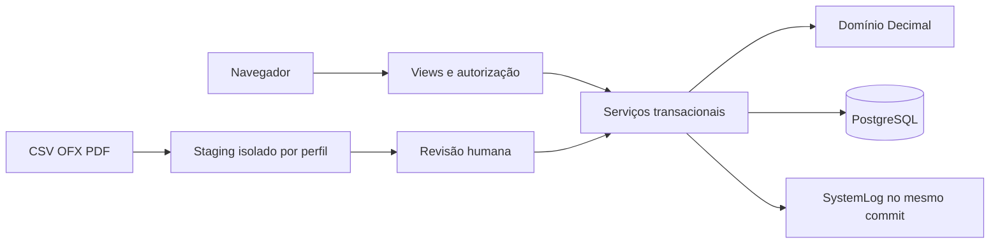

# Revisão de arquitetura — 23/10/2026

## Fronteiras implementadas

O ALECE é um monólito Django 5.2/PostgreSQL. Views verificam autenticação, papel e autorização por workspace, perfil e objeto. Serviços persistem operações em transações; `apps/finance/domain` calcula com `Decimal`. O ledger guarda partidas dobradas, bloqueia alteração direta do histórico postado e usa estorno compensatório. `NULL` em renda/saldo representa ausência de informação, distinta de zero.

## Decisões verificadas

- Primeiro cadastro: advisory lock adquirido dentro de `atomic`, checagem de instalação repetida, criação de Admin/Pessoal/Principal com renda `NULL`; habilitado apenas com `ALECE_BIND_IP` de loopback. O endereço da requisição e `X-Forwarded-For` não habilitam setup.
- Permissões: Admin tem todos os perfis do seu workspace; Comum exige grant vigente por módulo. Edição implica leitura. Revogação vale na requisição seguinte. O perfil e workspace enviados pelo cliente não determinam autorização.
- Perfis: cinco **ativos** no máximo, com bloqueio transacional na criação e reativação; arquivados mantêm histórico.
- Importação: estágio separado do commit; fingerprint por perfil; batch travado e idempotência no commit. CSV/OFX são entrada não confiável; arquivo não confirma movimentação sozinho.
- Logs: `SystemLog` imutável também no PostgreSQL, metadados allowlist e visualização integral por Admin do próprio workspace ou superusuário operacional.

## Dívida e risco residual

O template financeiro principal ainda concentra quatro destinos e deve ser dividido em componentes menores após concluir a fidelidade visual. Os painéis de histórico, metas, importação e ícones já são parciais reutilizáveis. O protótipo permanece congelado em `docs/prototype/`. O código contém partes herdadas e relatórios históricos com premissas superadas; futuras mudanças devem ser sustentadas por teste de regra e revisão do impacto em migrações. A validação em host Windows/Python 3.14 e Docker Linux/Python 3.12 não substitui testes em ZimaOS real nem CI remota.

## Continuação da interface e dos modelos de leitura

O Django renderiza os cinco destinos a partir de dados autorizados. `workspace_page` seleciona perfis por módulo em cada requisição; `services.metrics` calcula a distribuição e as séries em `Decimal`, usando apenas lotes contábeis confirmados. O cadastro de despesa ou posição não é tratado como lançamento bancário. `NULL` de renda/saldo continua distinto de zero no cartão e no anel. Links contextuais buscam formulários do servidor para exibição em `<dialog>`; POST, CSRF, autorização e persistência permanecem nas views e nos serviços.

Listas de importação e relatórios passaram a cruzar os perfis autorizados para todos os módulos necessários e a recusar seleção de perfil fora desse conjunto. O painel de upload usa o perfil autorizado na URL da view; a importação entra em prévia, seguida de conciliação e confirmação explícita. Exportações de investimentos e metas têm CSV próprio e serialização JSON definida. A diferença entre o editor de metas/permissões do protótipo e os fluxos implementados continua registrada na validação visual; não há controles que finjam persistência.
